# Story Assistant

Story Assistant is a web app for writing fiction with AI while keeping the writer in control. Build a story bible and cast, organize chapters, generate prose a paragraph at a time, and approve each draft before it enters the manuscript. You can also import existing writing, edit accepted paragraphs, plan scenes, and request targeted AI rewrites.


## Features

- **Story bible:** define the premise, genre, tone, setting, POV, tense, and writing preferences that guide generation.
- **Reusable characters:** maintain character sheets and relationships, reuse characters across stories, and choose the active chapter cast.
- **Chapter management:** create, rename, reorder, archive, complete, lock, unlock, and reopen chapters.
- **Streamed AI writing:** describe what happens next and watch prose arrive, with a choice of approximate response length.
- **Draft review:** keep, rewrite, manually edit, discard, or restore an alternate draft before accepting prose.
- **Draft recovery:** recover pending work after reload and handle conflicting changes from another tab or session.
- **Accepted prose editing:** refine saved paragraphs, browse immutable revision history, and restore earlier text as a new revision.
- **Manuscript import/export:** preview text or Markdown imports, choose the chapters to append, and export accepted writing.
- **Optional planning:** save chapter objectives and ordered scenes with their goals, cast, and POV.
- **AI planning suggestions:** review and edit suggested plans before explicitly saving them.
- **Targeted AI rewriting:** rewrite one paragraph or selection, compare the result, then apply or cancel it.
- **AI memory and retrieval:** refresh chapter summaries and retrieve relevant accepted passages for later generation.
- **Provider choice:** configure OpenAI or local Ollama for prose, summaries, planning, and rewrites.

### Story bible and reusable characters

Each story has a title, premise, genre, tone, point of view, tense, setting, themes, content boundaries, audience, and writing-style notes. Character sheets hold appearance, voice, personality, motivation, flaws, and backstory. Directional relationships describe how characters relate to one another.

Import characters into a story and choose the active cast for each chapter. The Galley also lets you create and activate a character while writing. A cast change affects later generation; it does not rewrite an existing draft.

### Chapter management

Create and rename chapters, reorder them within a story, set a target word count, and archive chapters while retaining their accepted writing. Complete a chapter after resolving its pending draft. Locking protects the prose; unlocking makes it available for further work.

Story status is managed separately from chapter status. Finishing one chapter does not automatically mark the story complete.

**Story status transitions**

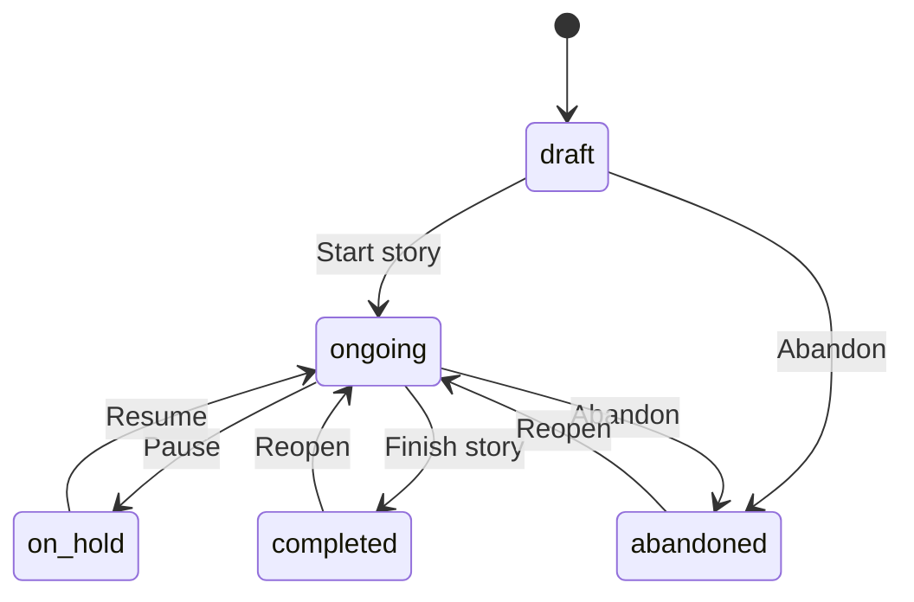

**Chapter status transitions**

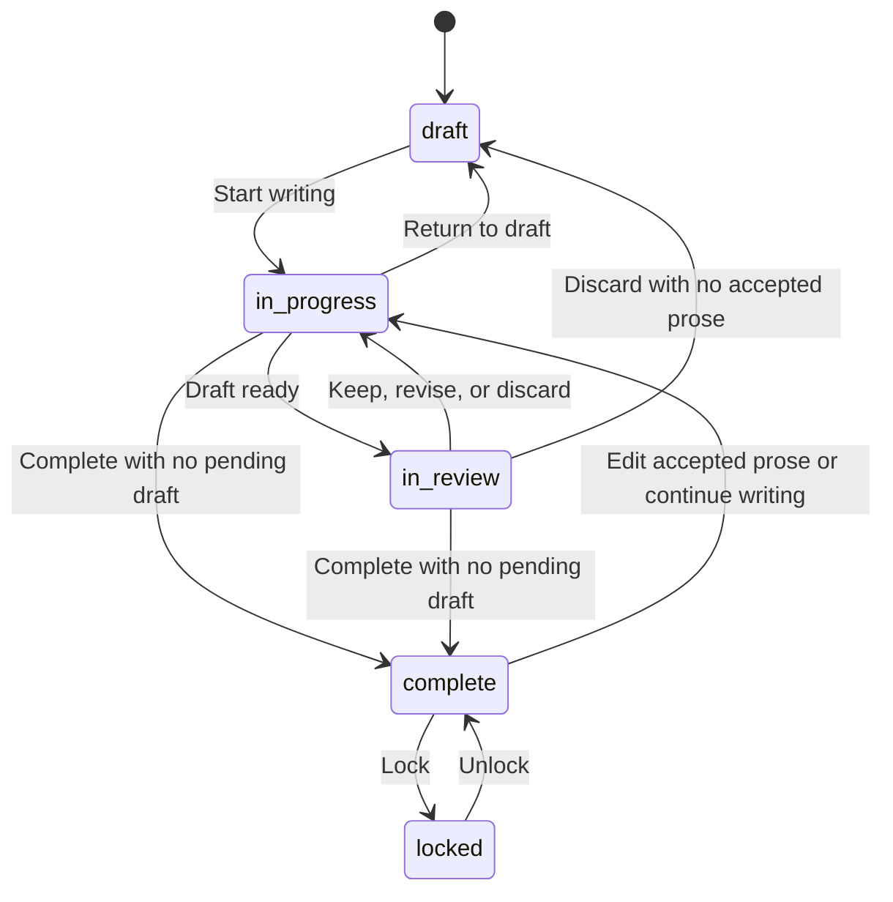

Archiving is separate from these status transitions. It hides a chapter from active lists while keeping its stored text.

### Paragraph-by-paragraph writing

Give the AI an instruction and choose a short, standard, or long response. Prose streams into the Galley as it is generated. Review the draft, then:

- **Keep** it to add it to the accepted manuscript.
- **Rewrite** it with another instruction.
- **Edit** it manually and explicitly save your changes.
- **Discard** it and continue experimenting.

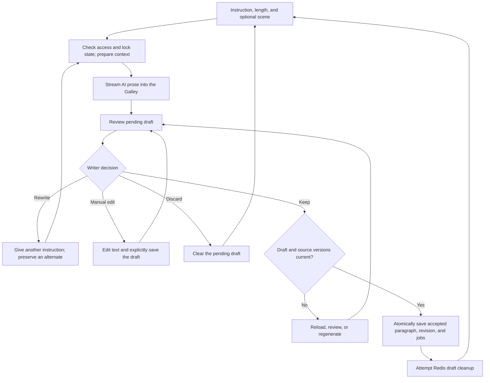

Explicit Keep adds draft text to the manuscript. If Redis cleanup fails after the database commit, the accepted paragraph remains saved and a retry recovers its existing result.

### Draft recovery and session conflicts

Up to three alternate drafts remain available in the chapter session. Reloading can recover the current draft and its alternatives while the Redis session exists. Sessions expire after 48 hours; accepted writing remains in PostgreSQL.

Draft acceptance uses a stable draft ID. Retrying after an interrupted response cannot add the same draft twice. If accepted text or chapter planning changes while a draft is pending, the app requires review before that draft can be accepted.

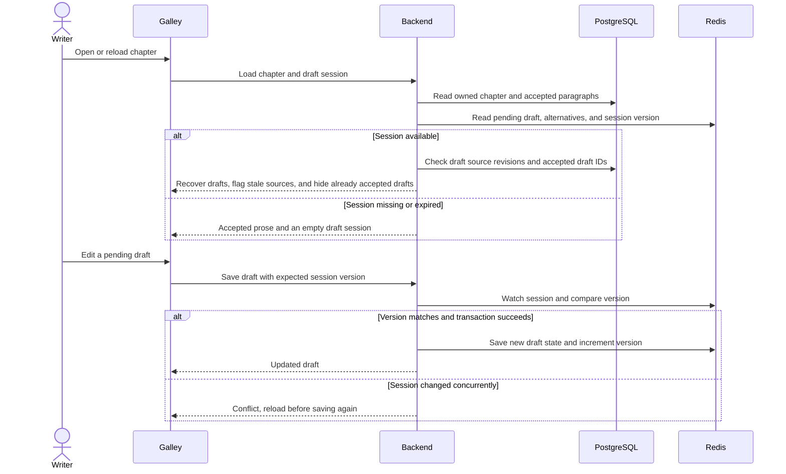

The manuscript and draft session load separately. A lost or expired Redis session does not remove accepted paragraphs or their revision history.

### Accepted prose editing and history

Accepted paragraphs remain editable. **Edit · History** opens the paragraph editor and its immutable revision history. You can save a manual correction or restore an earlier revision; restoring creates a new revision rather than deleting intervening history.

Version checks reject outdated edits from another tab or session. Editing a completed chapter reopens it, invalidates outdated AI memory, and schedules fresh summaries and embeddings. A locked chapter must be unlocked before its prose can change.

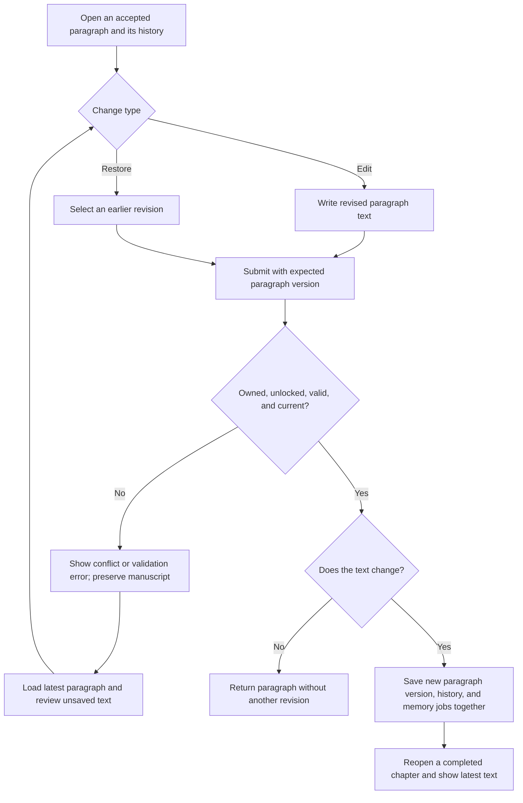

Restoring an earlier version creates a new history entry. Existing revisions remain available.

### Manuscript import and export

Import UTF-8 `.txt` or `.md` files into an existing story. The import preview lets you inspect chapters, rename them, exclude chapters, and choose their order before committing. Imported chapters are appended to the story; its existing prose and bible are preserved.

Parsing rules:

- Blank lines separate paragraphs; line breaks within a paragraph remain.
- Markdown uses `## Chapter title` headings, with an optional initial `# Story title`.
- Plain text uses headings such as `Chapter 1: Arrival`, with an optional initial `Title: Story title`.
- A file without recognized chapter headings becomes one imported chapter.
- Markdown headings inside fenced code blocks are treated as content.

Default bounds are 2,000,000 bytes, 100 chapters, and 2,000 paragraphs per import. An individual paragraph can contain up to 50,000 characters. Previews expire after 30 minutes. Optional AI enrichment can schedule summaries and embeddings after the import commits; enrichment failure does not remove imported writing.

A committed import has a saved receipt. Retrying the same commit recovers its result without creating duplicate chapters. If the response is interrupted, the frontend preserves the commit options for recovery after reload.

Export the accepted manuscript as `.txt` or `.md`, in chapter order. Archived chapters are excluded by default and can be included explicitly. Pending drafts and rewrite suggestions are excluded. These exports contain manuscript text, not the full database or revision history.

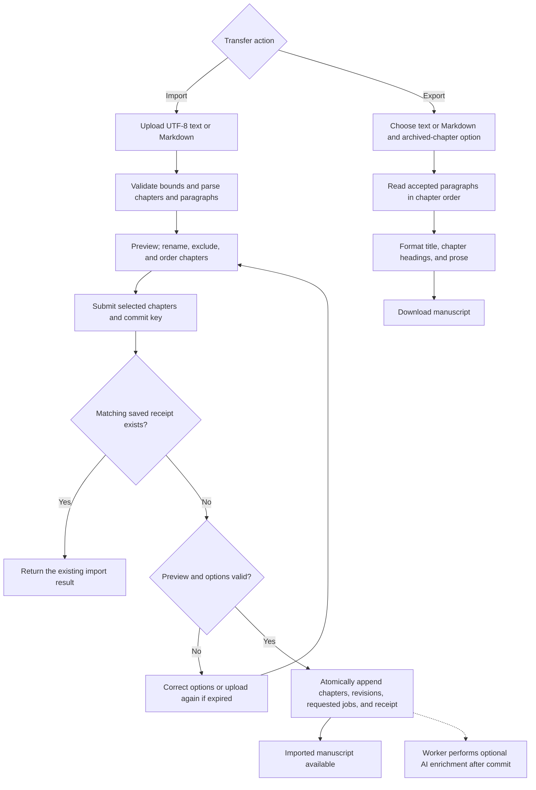

A receipt prevents duplicate chapters when the same import is retried. Export reads accepted prose and leaves drafts and suggestions out of the downloaded manuscript.

### Optional chapter and scene planning

The **Planning** tab supports a chapter objective, conflict, ending beat, and notes. Add ordered scenes with a title, goal, conflict, outcome, setting, notes, cast, and an optional POV character. The POV character must belong to the selected scene cast.

Planning is optional: write with no plan, a chapter plan alone, or detailed scenes. In the Galley, an optional scene selector supplies that scene's context and cast for the next generation. Without a selected scene, generation uses chapter context and its active cast.

AI planning suggestions are editable proposals. They become saved plans only after the writer explicitly approves them. Planning changes do not alter accepted prose or turn intended events into established story facts.

Accepted paragraphs retain their scene association. Removing a scene archives it and preserves existing paragraph links. Planning and scene edits use version checks to prevent overwriting newer changes.

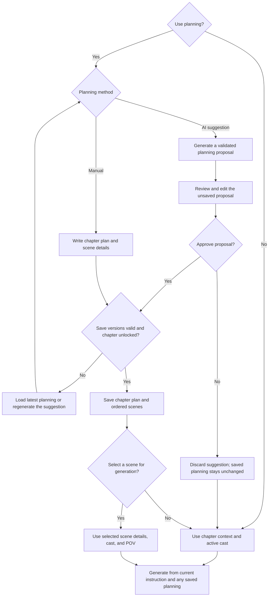

Saved planning describes intended events. Accepted prose establishes what happened in the story. Choosing no scene still allows a saved chapter plan to guide generation.

### Targeted AI rewriting

Choose **AI rewrite** beneath an accepted paragraph. Use the whole paragraph or highlight a smaller range and choose **Use selected text**. Enter an instruction such as “make this more suspenseful while keeping the same events.”

The app displays the original selection beside the AI suggestion. **Apply suggestion** replaces only that selection and records the change in revision history. **Cancel suggestion** leaves the manuscript unchanged. Closing the dialog keeps the saved suggestion available for later review, including after reload.

Rewrite proposals use story context, relevant characters, nearby accepted prose, and optional planning. Applying rechecks the source paragraph, manuscript revision, original selection, and context fingerprint. Changed source material requires regeneration. Repeated application returns the saved receipt without another edit.

Browser selections are converted from UTF-16 offsets to Unicode code-point offsets, so selections after emoji reach the backend correctly. Suggestions expire after 30 minutes. Selections are limited to 12,000 characters, instructions to 2,000, and replacements to 16,000; the resulting paragraph must remain within 50,000 characters.

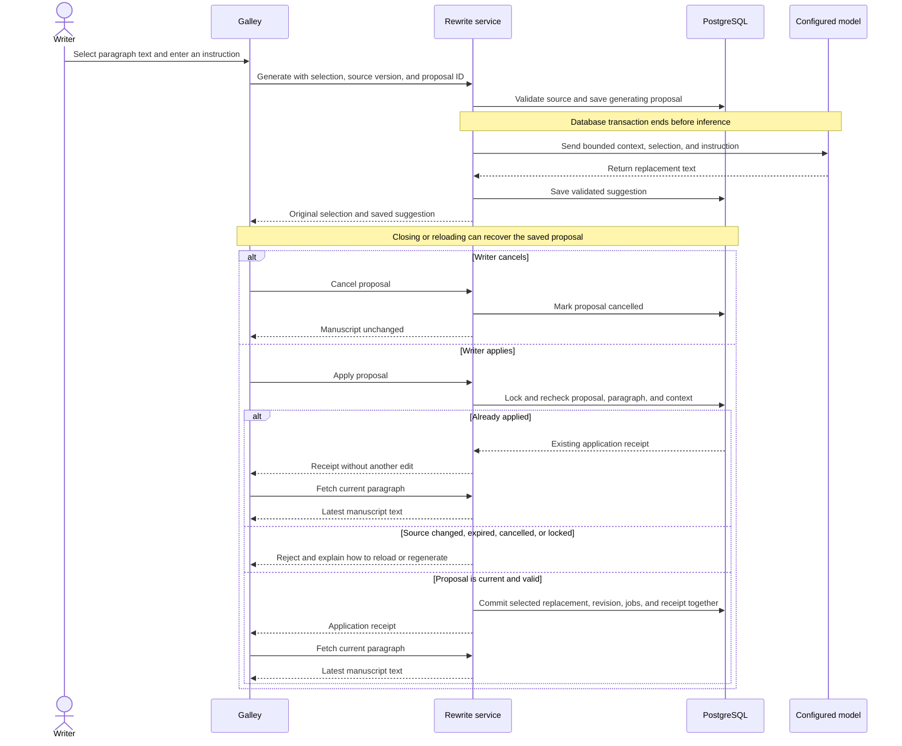

Invalid model output or provider failure marks generation failed and leaves accepted prose unchanged. Applying preserves all text outside the selected range.

### AI memory and retrieval

Accepted prose is the source of truth. Chapter summaries and paragraph embeddings are derived from specific content versions. Outdated summaries and vectors are excluded from generation context, and late AI results cannot overwrite memory for newer prose.

Memory refresh and embedding work use durable PostgreSQL jobs with retries and leases. Interrupted work can be reclaimed, while obsolete jobs are marked accordingly. The Galley shows memory refresh status and offers retry when refresh fails. Character summaries use durable jobs when summary inputs change. Updates invalidate the previous summary; jobs release the database connection during inference and save only if their source fields still match.

Semantic retrieval searches accepted paragraphs in other active chapters of the same story. It uses up to three passages with current embeddings and a cosine-distance relevance threshold. If query embedding fails, generation continues using the other available context.

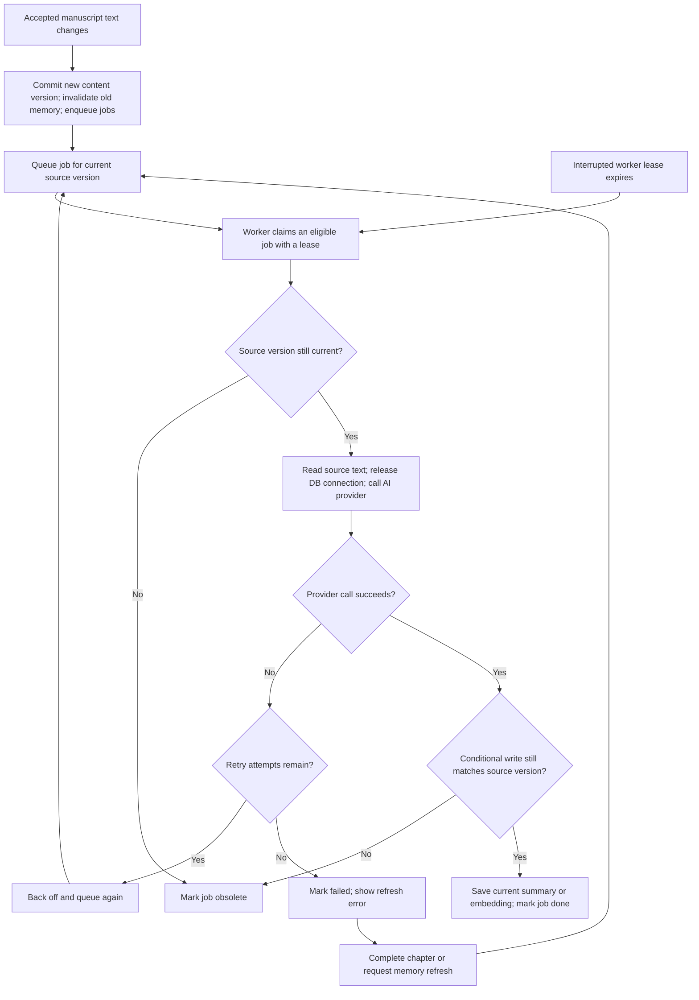

The worker handles chapter memory, paragraph embedding, and character summary jobs. Provider failures leave accepted writing intact. Only results matching the current source version are saved.

### Provider choice

Configure OpenAI or local Ollama for prose generation, summaries, planning suggestions, and targeted rewrites. Manual editing, planning, and manuscript transfer remain usable without AI inference. Semantic embeddings currently use OpenAI even when prose generation uses Ollama; configuration details are listed below.

## Typical workflow

1. Sign up or log in.
2. Create character sheets and a story bible.
3. Import characters into the story, then create chapters or import an existing manuscript.
4. Optionally plan a chapter and its scenes.
5. Open the Galley, choose a scene if useful, and describe what happens next.
6. Review each streamed draft and keep, rewrite, edit, or discard it.
7. Refine accepted prose using manual editing or AI rewrite proposals.
8. Mark the chapter complete and lock it when ready.
9. Export the accepted manuscript when you want a portable text copy.

Stories support draft, ongoing, on-hold, completed, and abandoned states. Chapters support draft, in-progress, in-review, complete, and locked states. Status transitions are checked by the backend; actions such as completion and locking use dedicated endpoints.

## Tech stack

### Frontend

- React and TypeScript for application components and types.
- Vite for local development and production builds.
- React Router for navigation and TanStack Query for server data.
- Tailwind CSS and Radix UI for styling and interface components.
- Motion, Anime.js, and Three.js for transitions and animation.

### Backend and data

- Python and FastAPI for HTTP APIs and streamed responses.
- Pydantic for request, settings, and structured AI-response validation.
- Asynchronous SQLAlchemy and asyncpg for database access; Alembic for migrations.
- PostgreSQL, with pgvector, for durable records and vector search; Neon is supported as a hosted database.
- Redis for temporary writing sessions and rate-limit state.
- PyJWT and bcrypt for bearer tokens and password hashing.
- OpenAI and Ollama as AI provider integrations.

## Architecture

The browser sends authenticated requests to the API. Ownership and validation checks run before domain services act on stories, chapters, drafts, and proposals. Shared manuscript services coordinate accepted-text changes, history, and memory invalidation.

PostgreSQL owns durable records: accepted paragraphs, revisions, story data, planning, import receipts, rewrite proposals, and jobs. Redis owns temporary generation drafts, alternate attempts, session versions, and inference rate-limit state. The worker claims durable jobs and writes AI-derived memory only if the source version still matches.

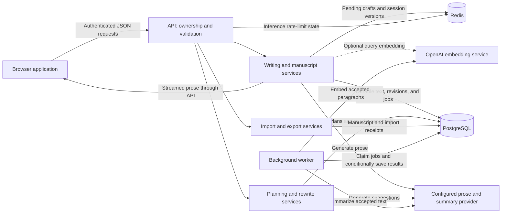

JWT bearer tokens are stored in browser `localStorage` and attached by shared API helpers. Accepted manuscript text is reconstructed from ordered paragraph rows, so there is no separate chapter-body field to keep synchronized. Stories, chapters, characters, and scenes are archived while retaining their durable records.

### Generation and performance

The generation service prepares context before streaming starts. Story, cast, relationships, prior summaries, and chapter context share one short-lived read session. Semantic retrieval runs concurrently and opens its own read session only after its query embedding is available. The request database session closes before prose streaming begins.

The system prompt contains the bible, cast, and relationships. The user prompt contains prior summaries, relevant retrieved prose, current chapter context, optional planning, and the writer's instruction.

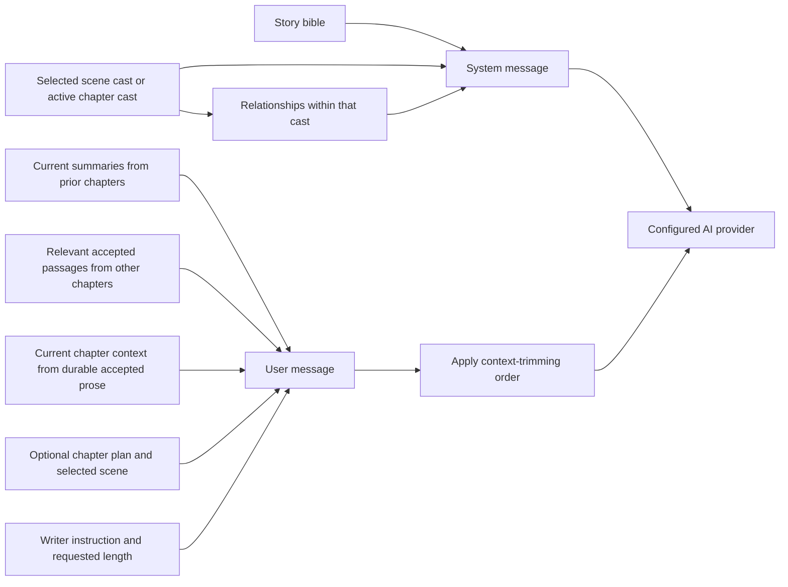

Fresh chapter memory requires only the last two accepted paragraphs. Without a usable current running summary, the fallback reads at most 32 recent paragraphs and supplies at most 24,000 characters of recent prose. Planning is treated as intended events, while accepted prose and current summaries supply established facts.

When the user prompt exceeds its approximate budget, trimming removes older prior summaries first, then retrieved passages, the running summary, and the older raw-tail paragraph. Planning, the current instruction, and the length directive are preserved. Editing a pending draft preserves its text and edit instruction.

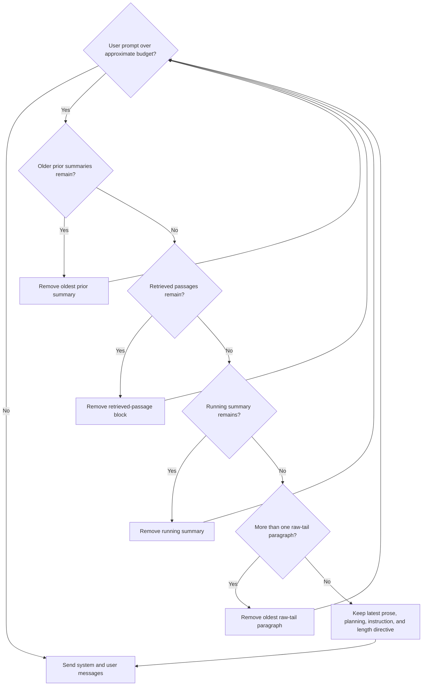

The approximate budget applies to the user message. Protected content can leave it above that target. Pending-draft editing preserves the draft and edit instruction without this trimming ladder.

The provider layer uses OpenAI chat completions or Ollama's native `/api/chat` endpoint. Non-streaming calls have bounded retries; live generation failures are surfaced through the event stream so the writer can decide what to do next. Planning and rewrite responses must pass structured validation before they become usable proposals.

The frontend loads feature pages lazily. The animated landing-page scene has its own Three.js bundle, and the production build checks that it remains isolated from the main application bundle.

### Data integrity

Every child-resource operation checks access through the writer's owned story or chapter. UUIDs identify resources; ownership checks enforce access.

Paragraph and planning edits use expected versions. Redis session writes use optimistic concurrency. Durable acceptance, revision creation, and job scheduling happen together in PostgreSQL; a later Redis failure cannot undo an accepted paragraph. Rewrite application and its receipt also commit in one transaction.

Generation, AI planning, and AI rewriting share a per-user inference rate limiter. Exhausted requests return `429` with `Retry-After`.

## Project structure

```text
app/
  auth/          Signup, login, and current-user endpoints
  users/         User persistence
  characters/    Character sheets, relationships, and summaries
  stories/       Story bible and imported cast
  chapters/      Chapter ordering, status, and active cast
  generation/    Prompt assembly, streaming, drafts, and retrieval
  manuscript/    Accepted prose editing, history, and versioned memory
  planning/      Chapter plans, scenes, and AI planning proposals
  rewriting/     Saved AI rewrite proposals and explicit application
  transfers/     Manuscript parsing, previews, import, and export
  jobs/          Durable memory and embedding jobs
  core/          Authentication, ownership, rate limits, logging, and AI client
  config.py      Environment settings
  database.py    Database engine and session setup
  main.py        Application startup, middleware, and routers

frontend/
  src/features/  Library, characters, chapters, Galley, planning, and transfers
  src/components/ Shared UI components and application shells
  src/hooks/     Streaming, keyboard, and animation hooks
  src/lib/       API helpers, authentication, types, and shared utilities
  src/styles/    Theme, layout, and manuscript styles
  scripts/       Bundle isolation and Unicode selection checks

scripts/         Database migration utilities and embedding backfills
```

Backend domains generally contain their own models, schemas, service, and router. The writing features reuse the manuscript service for accepted-text changes so history and memory invalidation stay consistent.

## Local setup

### Prerequisites

- Python 3.11 or newer.
- Node.js 24 is recommended for the frontend and its TypeScript selection tests.
- PostgreSQL with pgvector support and a database URL.
- Redis for chapter sessions and inference rate limits.
- An OpenAI API key or a running Ollama server with a model available locally.
- The project's Alembic configuration and revision files.

Database migration commands require `alembic.ini` and the `alembic/` revision directory. If either is missing, restore them before applying schema changes. Startup compares the database revision against the application’s required revision in `app/core/schema.py`; it does not load migration scripts or create or change tables automatically.

### Startup and migration checks

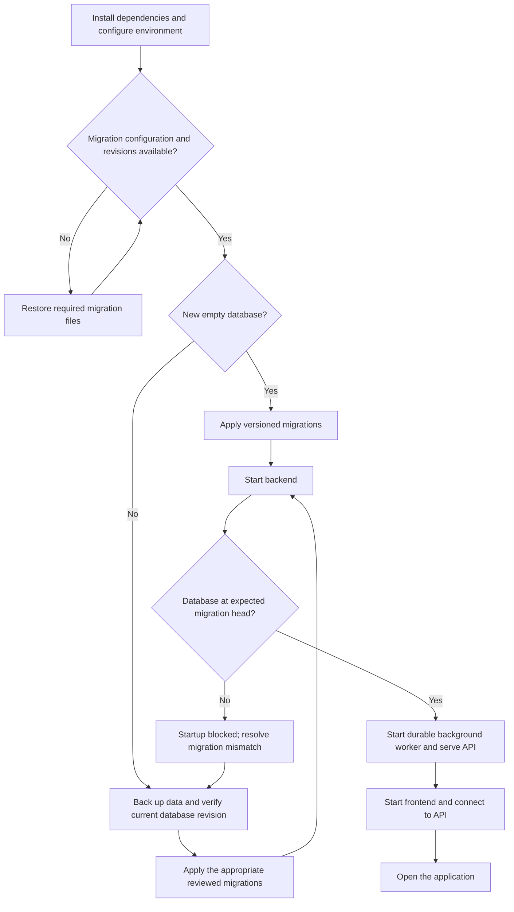

Startup checks the migration version before serving requests. Schema changes happen through explicit migrations, and existing data is preserved during reviewed upgrades.

### Backend

From the repository root:

```bash
python3 -m venv venv
source venv/bin/activate
python -m pip install -r requirements.txt
cp .env.example .env
```

Edit `.env` with your database URL, JWT secret, Redis connection, and provider settings. Keep `.env` private.

For a new empty database, once the migration files are available:

```bash
python -m alembic upgrade head
```

For an existing database, take a recoverable backup and use the migration utility appropriate to its current revision. Existing unversioned schemas require verification before any baseline stamp; do not stamp an unknown schema or reset its data to make startup pass.

Start the API after migrations finish:

```bash
python -m uvicorn app.main:app --reload
```

The API runs at `http://localhost:8000`, with interactive API documentation at `http://localhost:8000/docs`. The backend starts its durable job worker as part of application startup.

### Configuration

Required backend settings:

- `DATABASE_URL` — SQLAlchemy async PostgreSQL URL using the `postgresql+asyncpg://` scheme.
- `JWT_SECRET` — secret used to sign access tokens.

Other settings:

- `DATABASE_SSL_REQUIRE` — defaults to `true`; set to `false` for a local database configured without SSL.
- `DB_POOL_SIZE` and `DB_MAX_OVERFLOW` — both default to `5`.
- `JWT_ALGORITHM` — defaults to `HS256`.
- `ACCESS_TOKEN_EXPIRE_MINUTES` — defaults to `60`.
- `REDIS_URL` — defaults to `redis://localhost:6379/0`.
- `LLM_PROVIDER` — `openai` or `ollama`.
- `OPENAI_API_KEY` and `OPENAI_MODEL` — OpenAI credentials and prose model; the default model is `gpt-4o-mini`.
- `OLLAMA_BASE_URL` — defaults to `http://localhost:11434`, without a `/v1` suffix.
- `OLLAMA_MODEL` — must match an installed model name. The supplied example uses `qwen3.8:27b-mlx`; choose a model available on your machine.
- `IMPORT_MAX_BYTES`, `IMPORT_MAX_CHAPTERS`, `IMPORT_MAX_PARAGRAPHS`, and `IMPORT_PREVIEW_TTL_MINUTES` — import bounds and preview lifetime.
- `ENVIRONMENT` — defaults to `dev`.
- `LOG_LEVEL` — defaults to `INFO`; `DEBUG` includes database query timing.

Settings are loaded from `.env` by `app/config.py`. The settings class defaults to OpenAI, while the supplied environment example selects Ollama.

With Neon, use the pooled endpoint for normal application connections. Use the asyncpg URL scheme and configure SSL through `DATABASE_SSL_REQUIRE` rather than copying driver-specific query parameters from another PostgreSQL client.

Ollama can provide prose, planning, rewrites, and summaries locally. Paragraph embeddings and semantic query embeddings still use OpenAI's `text-embedding-3-small` model. Without an OpenAI key, vector enrichment is unavailable; accepted text remains saved, and generation can continue without retrieved passages.

### Frontend

In a separate terminal:

```bash
cd frontend
npm ci
npm run dev
```

Open `http://localhost:5173`.

The frontend uses `http://localhost:8000` as its default API URL. To change it, set `VITE_API_BASE_URL` in the frontend environment and restart Vite. Production builds need that value at build time.

Development uses port `5173` and fails if it is already occupied. Production preview uses port `4173`. These localhost origins are allowed by the backend; using another origin requires updating its CORS configuration.

## API overview

All manuscript and planning actions are scoped to an owned story and chapter. The API documentation provides request schemas and complete endpoint details.

- `/auth` — signup, login, and current user.
- `/characters` — character sheets, archival, and relationships.
- `/stories` — story bible, archival, and imported cast.
- `/stories/{story_id}/chapters` — chapter creation, ordering, metadata, cast, and lock state.
- Chapter `/generate` and `/generate/edit` — streamed generation and pending-draft revision.
- Chapter `/session`, `/session/select`, `/manual-edit`, `/accept`, and `/discard` — draft recovery and decisions.
- Chapter `/turns` — accepted paragraphs, versioned edits, revision history, and restoration.
- Chapter `/memory-status` and `/memory-refresh` — memory status and refresh requests.
- Chapter `/complete` and `/resummarize` — completion and summary refresh.
- Story `/imports/preview`, `/imports/commit`, and `/export` — manuscript transfer.
- Chapter `/plan`, `/scenes`, and `/plan-proposals/save`, plus story `/plan-suggestions` — optional planning.
- Paragraph `/rewrite-proposals` — generate/list/recover suggestions, with `/{proposal_id}/apply` and `/{proposal_id}/cancel` for explicit decisions.
- `/health` — basic API liveness response.

## Development checks

Backend regression checks (Redis concurrency checks start a disposable local Redis and require `redis-server`):

```bash
venv/bin/python -m unittest discover -s tests -v
```

The backend checks do not reset or write to the application database.

Available frontend checks:

```bash
cd frontend
npm run build
npm run lint
npm run test:rewriting
```

The build performs TypeScript checks and validates bundle isolation. The rewrite tests cover Unicode code-point offsets, emoji surrogate boundaries, combining marks, and invalid selection ranges.

Database-dependent backend tests must run against an explicitly separate disposable database. Use isolated schemas and schema-qualified cleanup; never use the application database for test resets. A full backend regression run requires the repository's test suite and development dependencies to be present.

## Logging and troubleshooting

The backend writes to stdout and `logs/app.log`, rotating at 10 MB with five backups. Request timing, operation timing, database connection diagnostics, and background-job failures help identify problems. Logs and private database snapshots should stay outside version control.

Common issues:

- **Missing migration configuration or migration-version mismatch:** restore the migration files and apply the appropriate migration before starting the API. The application deliberately refuses to start against an unexpected schema.
- **Address already in use:** identify the existing process on the API or frontend port before starting another server.
- **Failed to fetch:** check that the API is running, `VITE_API_BASE_URL` is correct, and the frontend origin is allowed by CORS.
- **Ollama generation failure:** confirm that Ollama is running and that `OLLAMA_MODEL` matches a name returned by `ollama list`.
- **Missing draft after a long break:** Redis sessions expire after 48 hours. Accepted manuscript text and revision history are stored separately in PostgreSQL.
- **Edit or proposal conflict:** load the latest paragraph or plan, review the changes, and regenerate or retry with its current version.
- **AI memory refresh failure:** check provider credentials and connectivity, then request another refresh. Accepted prose remains available while memory is stale.
- **Import rejected:** check UTF-8 encoding, supported extension, file size, chapter/paragraph counts, and long paragraphs.

## Current scope

Imports and exports support plain text and Markdown. AI rewrites operate within one accepted paragraph. Chapter planning is optional. The app supplies continuity context through stored character facts, accepted prose, summaries, and retrieval; it does not currently provide an automated contradiction-review panel or guided story-setup wizard.
