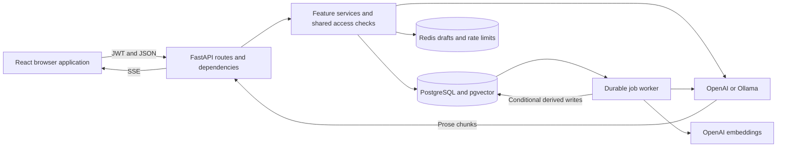
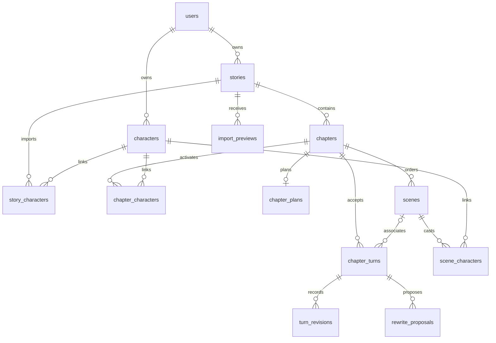

# Story Assistant: Technical Reference

Updated: October 11, 2026. This document describes the current checkout after the backend quality improvements. It covers application source, configuration, development scripts, tests, and frontend assets. It distinguishes implemented behavior from operational recommendations and missing infrastructure.

## Contents

1. [Product and architecture](#product-and-architecture)
2. [Requirements and configuration](#requirements-and-configuration)
3. [Data ownership and invariants](#data-ownership-and-invariants)
4. [Execution workflows](#execution-workflows)
5. [Repository and file reference](#repository-and-file-reference)
6. [Operations, verification, and change impact](#operations-verification-and-change-impact)

The file reference gives each maintained file its functionality, requirements or dependencies, interfaces where applicable, and change impact. Links are relative to the repository so this document remains usable in another checkout. Generated dependencies, private configuration, and runtime artifacts are described as categories rather than documenting third-party installation files individually.

## Product and architecture

Story Assistant is a fiction-writing application. A writer maintains a story bible and reusable characters, organizes chapters, optionally plans scenes, generates prose, and explicitly accepts drafts. Accepted paragraphs can be edited, restored from revision history, imported, exported, or rewritten through separately approved AI proposals.

The backend is a feature-oriented Python monolith. The frontend is a React single-page application. Neither layer is implemented as a collection of separately deployed business microservices.



### Backend boundaries

- **HTTP adapters:** feature `router.py` files validate requests, obtain authenticated identities and owned resources, and invoke use cases. Generation routes additionally frame server-sent events.
- **Request dependencies:** `app/core/deps.py` manages authentication, a function-scoped database session, and rate-limited users. Its database session closes before a streaming response starts transmitting.
- **Ownership and business failures:** `app/core/access.py` contains reusable ownership checks. Services raise `DomainError`; the application translates it into the existing HTTP status and `{"detail": ...}` response contract.
- **Use cases and transactions:** public service operations own their final commit. `stage_turn_edit`, `stage_plan`, and `stage_scene` modify and flush within a caller-owned transaction, allowing a combined rewrite or planning proposal to commit atomically.
- **Durable data:** SQLAlchemy models map users, characters, stories, chapters, paragraph versions, planning, transfer receipts, rewrite proposals, and jobs to PostgreSQL.
- **Temporary drafts:** Redis stores pending prose and alternate attempts. Redis is not the canonical accepted manuscript store.
- **Inference infrastructure:** shared AI and Redis clients centralize connection reuse and shutdown cleanup. Durable jobs release their source-read database sessions before provider inference.

### Frontend boundaries

- `main.tsx` initializes theme, routing, authentication, query caching, and global motion behavior.
- `App.tsx` declares public and protected routes. Most feature pages are lazy-loaded; login and signup remain eagerly imported.
- `lib/apiFetch.ts` owns authenticated JSON, multipart, blob, and streaming requests. Feature API modules specify endpoint paths and request/response contracts.
- `lib/types.ts` represents shared backend data in TypeScript. Planning, transfer, and rewrite modules additionally define their own feature-specific types.
- Feature pages coordinate queries and mutations. Presentational components receive data and callbacks. The Galley uses a dedicated chapter-session hook to coordinate generation and draft review.
- React Query provides server-data caching; it does not replace PostgreSQL or Redis persistence. The stream buffer batches UI updates by animation frame.

## Requirements and configuration

### Runtime prerequisites

- **Python:** Python 3.11 or newer is needed by the code's language/runtime features, including `asyncio.timeout` and `datetime.UTC`. The local environment used during the backend checks is Python 3.14. Third-party package compatibility must also match the selected Python version.
- **Backend packages:** install `requirements.txt`. FastAPI is required at version 0.143.0 or newer in this checkout; the installed version used to verify function-scoped dependencies is 0.143.0.
- **Node.js:** Node 24 is the project's recommended frontend runtime. The locally installed Vite 8.2.1 package declares Node `^20.19.0 || >=22.12.0`; the selection tests also use Node's TypeScript stripping flag. Recheck the installed package metadata when changing the lockfile or Node version.
- **PostgreSQL:** the application needs an existing, compatible schema and an asyncpg-compatible connection URL. It uses PostgreSQL UUIDs, arrays, named enums, JSON, row locks, and pgvector. SQLite is not a supported replacement for the application database.
- **Redis:** needed for draft sessions and AI rate limiting. A Redis server with Lua scripting and WATCH/MULTI/EXEC is required. Installing the Python `redis` package does not start a Redis server.
- **AI provider:** OpenAI credentials or a reachable Ollama server with the configured model are needed for prose, planning, rewriting, and summaries. Embeddings use OpenAI regardless of the prose-provider choice.
- **Browser:** the UI uses localStorage, fetch streaming, AbortController, requestAnimationFrame, browser selections, and several observer APIs. The landing-page WebGL hero has a static fallback.
- **Network fonts:** `frontend/index.html` loads external font stylesheets. CSS font fallbacks remain available when those services cannot be reached.

### Backend dependency responsibilities

- `fastapi`: route registration, dependency injection, validation integration, HTTP responses, and application lifespan.
- `uvicorn[standard]`: ASGI server for running the backend.
- `sqlalchemy[asyncio]>=2.0`: ORM, SQL construction, async sessions, pooling, transaction management, and database events.
- `asyncpg`: asynchronous PostgreSQL driver.
- `pydantic-settings`: environment-backed settings and `.env` loading. Pydantic itself is also used for request and provider-output validation.
- `email-validator`: validation used by Pydantic `EmailStr`.
- `pyjwt`: JWT signing and decoding.
- `bcrypt`: password hashing and checking.
- `anyio`: bounded thread execution for password work; the password limiter allows four concurrent operations per process.
- `redis>=5.0`: asynchronous Redis connection, scripting, and optimistic draft writes.
- `openai`: shared OpenAI client for prose and embedding inference.
- `httpx`: Ollama HTTP client and HTTP-based API contract tests.
- `pgvector`: SQLAlchemy vector type and similarity operators.
- `alembic>=1.13`: explicit schema-migration tooling used by administrative scripts.
- `python-multipart>=0.0.20`: multipart manuscript uploads.

The Python requirements specify some minimum versions but do not fully lock the dependency graph. The frontend lockfile does record a concrete npm dependency resolution.

### Backend environment variables

Settings are defined in `app/config.py`. Environment names correspond to the settings fields; defaults below describe code defaults, which can differ from `.env.example`.

- `DATABASE_URL`: required; use `postgresql+asyncpg://...`. This must point to the intended application database.
- `JWT_SECRET`: required; signs access tokens. `.env.example` contains a placeholder, not a deployment secret.
- `DATABASE_SSL_REQUIRE`: defaults to `true`; controls asyncpg SSL configuration. A local database without SSL needs `false`.
- `DB_POOL_SIZE`: defaults to `5` per application process.
- `DB_MAX_OVERFLOW`: defaults to `5` additional connections per process.
- `JWT_ALGORITHM`: defaults to `HS256`.
- `ACCESS_TOKEN_EXPIRE_MINUTES`: defaults to `60`.
- `REDIS_URL`: defaults to `redis://localhost:6379/0`.
- `LLM_PROVIDER`: `openai` or `ollama`; code default is `openai`, while `.env.example` selects `ollama`.
- `OPENAI_API_KEY`: optional at configuration parsing time; required for successful OpenAI inference and embeddings.
- `OPENAI_MODEL`: defaults to `gpt-4o-mini`.
- `OLLAMA_BASE_URL`: defaults to `http://localhost:11434`. The native `/api/chat` endpoint is appended by the client; do not add an OpenAI `/v1` suffix for this implementation.
- `OLLAMA_MODEL`: defaults to `qwen3.8:27b-mlx`. The configured name must exist on the chosen Ollama server; the repository does not install it.
- `IMPORT_MAX_BYTES`: defaults to `2,000,000`, permitted settings range 1–10,000,000.
- `IMPORT_MAX_CHAPTERS`: defaults to `100`, maximum setting `100`.
- `IMPORT_MAX_PARAGRAPHS`: defaults to `2,000`, maximum setting `2,000`; this is the total across one imported file.
- `IMPORT_PREVIEW_TTL_MINUTES`: defaults to `30`, permitted range 1–1,440.
- `ENVIRONMENT`: defaults to `dev`.
- `LOG_LEVEL`: defaults to `INFO`; `DEBUG` enables SQL query-duration logging.

Do not put private values into this document or committed examples. Settings are cached, so changes require restarting the relevant process. Pool sizes multiply across API processes because each process creates its own engine.

### Frontend configuration

`VITE_API_BASE_URL` defaults in code to `http://localhost:8000`; `frontend/.env.example` shows the same URL. Vite injects it into the built application, so production changes require rebuilding. The development server uses port 5173 with `strictPort: true`. The backend allows `http://localhost:5173` and `http://localhost:4173`; another deployment origin requires a reviewed CORS change.

The browser stores its JWT under `story_assistant_token` and its custom theme under `story_assistant_theme`. These are browser-local values, not shared server sessions.

### Database startup and migration requirements

`app/core/schema.py` requires database revision `0005_phase4`. Startup queries the existing `alembic_version` table and rejects missing, older, newer, empty, or multiple revision rows. It does not create tables, stamp a revision, or run migrations.

The checkout currently lacks **`alembic.ini` and the `alembic/` revision directory**. A compatible existing database can start because runtime validation compares against the required revision directly. Migration and baseline scripts still need the missing Alembic assets restored. A new empty database cannot be initialized solely from the migration files present in this checkout.

Legacy revision identifiers remain unchanged because existing databases depend on them. Feature-based migration filenames do not rename the database's recorded revision IDs.

## Data ownership and invariants

### PostgreSQL records

- `users`: account email, password hash, and timestamps.
- `characters`: reusable character facts, derived condensed summary, owner, and archive state.
- `character_relationships`: directional links between characters and their relationship labels.
- `stories`: owner, title, bible fields, lifecycle status, and archive state.
- `story_characters`: characters explicitly imported into a story.
- `chapters`: story association, title, order, lifecycle status, target words, summaries, manuscript/memory/planning revisions, and archive state.
- `chapter_characters`: active chapter cast. Chapter-level generation checks character ownership and archival; scene cast additionally requires story import membership.
- `chapter_turns`: current accepted paragraphs, sequence, source, instruction, version, accepted draft ID, optional scene association, and derived embedding/version.
- `turn_revisions`: immutable paragraph history, revision number, source, actor, and optional restored-from number.
- `background_jobs`: kind, target ID/revision, status, attempts, next availability, lease, error, and creation timestamp.
- `chapter_plans`: one versioned plan per chapter.
- `scenes`: ordered scene details, optional POV, version, and archive state.
- `scene_characters`: scene cast associations.
- `import_previews`: parsed preview data, expiry, owner/story scope, and committed import receipt fields.
- `rewrite_proposals`: selected source text, source paragraph/manuscript versions, context fingerprint, instruction, proposed replacement, lifecycle status, expiry, and application receipt fields.

### Redis records

- `chapter_session:{chapter_id}`: pending draft, up to three sibling attempts, optimistic session version, and generation source metadata. Sessions expire after 48 hours.
- `rate_limit:generate:{user_id}`: token balance and last-refill time. Buckets allow a burst of 10 and refill one token every six seconds, expiring after one idle hour.

Old Redis accepted-text fields are removed during normalization. Pending drafts, alternatives, and versions are retained. There is no active Redis chapter-body cache in the current code.

### Revision and approval rules

1. Accepted prose is authoritative. Plans describe intended events; AI summaries and vectors are derived memory.
2. A stable draft ID identifies acceptance. Retrying acceptance with that ID returns the existing accepted paragraph rather than appending a duplicate.
3. Accepted-text mutations update paragraph history and chapter revision, invalidate derived memory, and enqueue derived work in the same database transaction.
4. Manual edits and restores require the expected paragraph version. Restoring creates another revision rather than deleting history.
5. Locked chapters block prose/planning mutation. Dedicated lock/unlock endpoints keep status side effects explicit.
6. A rewrite is a proposal until applied. Apply validates source versions, exact selected text, expiry, status, and context fingerprint, then commits the paragraph change and receipt together.
7. Import commits identify their preview and commit key. A matching saved receipt recovers a retry; a changed request cannot reuse the same committed receipt silently.
8. Derived jobs only save results for matching source data. Character jobs use a compact source token for scheduling and compare every summary-input field at the final write.

Archival preserves database records. It should not be confused with physical deletion or comprehensive account erasure.

## Execution workflows

### Startup and shutdown

Importing configuration constructs cached settings and the database engine. Application lifespan verifies schema compatibility, starts the durable worker, then serves requests. Shutdown cancels and joins the worker, closes cached AI and Redis clients, and disposes the database engine. Startup failure also triggers cleanup.

The worker currently runs inside each API process. Its deployment, serial processing loop, chapter-summary recomputation algorithm, and chapter-memory scheduling were intentionally not redesigned in the recent optimization work.

### Authentication

Signup validates email and an 8–72-character password, additionally enforcing bcrypt's 72-byte UTF-8 limit. It releases its initial database read transaction before offloading password hashing to the bounded thread pool. The database email constraint remains the final uniqueness check; a competing signup returns the normal existing-email result.

Login reads the user, detaches the loaded record, releases its read transaction, and performs password verification outside the event loop. It issues a signed token after successful verification. Protected requests decode that token and resolve the user. Transient authentication database failures are retried without replaying endpoint writes.

The frontend's Zod forms currently do not duplicate the backend's byte-length rule. Backend validation remains authoritative, and the UI receives a validation error for an oversized Unicode password.

### Generation and draft acceptance

1. Authenticate and consume one token atomically in Redis.
2. Check story/chapter ownership and chapter lock state.
3. Load the Redis draft and optional scene/planning context.
4. Prepare story, cast, relationships, previous summaries, and accepted chapter context using one source-read session. Semantic retrieval runs concurrently, opening its own database read only after embedding.
5. Use the current running summary plus the last two paragraphs when available. Otherwise, bound fallback context to 32 recent paragraphs and 24,000 characters.
6. Build system and user messages. The approximate 6,000-token budget applies to the continuation user message, not a guaranteed total request-token limit. Protected planning/instruction text and the final remaining paragraph can still exceed that approximation.
7. Close the function-scoped request session before streaming. Emit JSON SSE frames with `delta`, followed by `done`, or an in-band `error` if failure occurs after headers are sent.
8. On successful inference, save a new pending draft and preserve alternatives using Redis optimistic concurrency. Mark the chapter in review using a separate short database session.
9. Keep/accept locks the chapter, checks draft ID and source revisions, appends the paragraph, records history, invalidates memory, and queues derived work atomically.
10. Redis draft cleanup occurs after the durable commit. Failure to clean Redis cannot undo an accepted paragraph; session recovery hides already-accepted drafts.

Length presets target approximately 50, 100, or 150 words, with output token ceilings 120, 220, and 320 respectively. Pending-draft AI editing uses the standard ceiling. A client disconnect closes the provider stream and does not persist the partial output as a successful draft.

### Background work and AI memory

The worker claims one eligible job using `FOR UPDATE SKIP LOCKED`, increments attempts, and gives it a 10-minute lease. A heartbeat extends the lease every 60 seconds. Eligible expired jobs can be reclaimed. Success becomes `done`, a source mismatch becomes `obsolete`, and errors retry up to three attempts with delayed availability; exhausted work becomes `failed`.

- **Chapter memory:** `refresh_memory` summarizes chapter prefixes in 6,000-character chunks, then combines that result with recent prose. It conditionally writes summaries for the current manuscript revision. This existing algorithm remains unchanged.
- **Paragraph embeddings:** inference uses OpenAI `text-embedding-3-small`; the stored vector has 1,536 dimensions. The write compares paragraph version.
- **Character summaries:** edits to prompt-input fields invalidate the previous summary and save a durable job with the character mutation. Inference runs without a source-read connection. A final conditional write compares all input fields and archival state. While a summary is absent, generation uses bounded current character facts.
- **Semantic retrieval:** search is scoped to other active chapters of the same story, considers current embeddings, takes up to three results, and applies cosine-distance threshold 0.35. Query-embedding failure permits generation with other context. The SQL does not restrict retrieval to chapters earlier in order.

AI calls have explicit deadlines. Nonstreaming prose calls retry only transient provider/transport failures, up to three attempts within a 180-second deadline. JSON proposal calls have a 150-second outer deadline; embeddings have 60 seconds; streams have 180 seconds. OpenAI SDK retries are disabled so the application controls that retry layer. Durable jobs add their own job-level retries.

### Manuscript editing, planning, rewriting, and transfer

- **Accepted edit or restore:** lock chapter, verify paragraph version, resolve any historical revision, stage changed prose/history/jobs, then commit. Unchanged text does not add another revision.
- **Planning:** store a chapter plan and optional scenes with expected versions. Scene cast must be imported into the story; POV must belong to that cast. A combined approved proposal stages plan and scenes before one final commit. A chapter supports at most 100 active scenes; an AI plan proposal supports at most eight proposed scenes.
- **Rewrite:** capture bounded context and its fingerprint, persist a generating proposal, release the transaction, infer a replacement, and persist the validated result. Apply rechecks source and context before changing only the selected code-point range. Proposals expire after 30 minutes; selected text is limited to 12,000 characters, instruction to 2,000, replacement to 16,000, and resulting paragraph to 50,000.
- **Import:** bound upload before multipart parsing, parse UTF-8 `.txt` or `.md` deterministically, save a preview, let the writer select/rename/order chapters, then atomically append paragraphs/history and a commit receipt. Optional enrichment is scheduled after durable import data is written.
- **Export:** query a consistent ordered snapshot of accepted writing and format text/Markdown. Pending drafts, rewrite suggestions, and revision history are excluded. Archived chapters are excluded unless explicitly requested.

## Repository and file reference

The sections below enumerate maintained files in this checkout. Source dependency links identify direct imports, not a claim that every import performs I/O. Reverse references describe code-level change impact; runtime contracts can have additional effects on the frontend or database.

### Root files

Project root: backend/frontend manifests, private configuration template, product documentation, and this technical reference. The Python and JavaScript applications run as separate processes.

#### [.env.example](.env.example)

- **Functionality:** Backend configuration template with database, JWT, Redis, provider, logging, and import-limit examples. The selected example prose provider is Ollama.
- **Requirements:** Requires replacement deployment values and a private .env or exported environment. Copying its placeholder credentials unchanged will not produce a working deployment.
- **Impact:** Changes affect setup instructions and new installations; they do not modify an already-running process or its private configuration.

#### [.gitignore](.gitignore)

- **Functionality:** Excludes Python environments/caches, private environment files, local databases, logs, operating-system metadata, and selected generated documents from Git.
- **Requirements:** Consumed by Git rather than application runtime.
- **Impact:** Changing ignore rules affects accidental secret/artifact tracking. Ignoring a path does not remove a previously tracked file.

#### [README.md](README.md)

- **Functionality:** Product overview, supported workflows, architecture sketches, setup commands, operational guidance, and current scope.
- **Requirements:** Readable without running the application; operational commands require the services they describe.
- **Impact:** Affects onboarding and expected product behavior. Keep it aligned with actual code, especially startup and migration constraints.

#### [requirements.txt](requirements.txt)

- **Functionality:** Backend dependency manifest, including the FastAPI minimum used for function-scoped dependencies and direct AnyIO use.
- **Requirements:** Install with Python pip inside the intended environment. Redis/PostgreSQL servers and Ollama models are separate prerequisites.
- **Impact:** Changes affect installation compatibility and runtime behavior across the backend; validate package compatibility and the regression suite.

#### [tech.md](tech.md)

- **Functionality:** This detailed architectural, folder, file, requirements, and impact reference.
- **Requirements:** Maintain alongside implementation changes; generated dependency folders and private values are intentionally outside the per-file inventory.
- **Impact:** Outdated entries can misdirect implementation and operations. Recheck interfaces, contracts, and missing infrastructure after structural changes.

### app/

Backend application package. Feature folders contain transport, contracts, data models, and use cases. main.py composes them; database.py and core supply shared infrastructure.

#### [app/__init__.py](app/__init__.py)

- **Functionality:** Python package marker. Empty markers add no business logic; the rewriting package marker contains only a descriptive docstring.
- **Requirements:** Python package import/discovery; importing feature modules may additionally load their declared dependencies.
- **Impact:** Keep business initialization explicit in main.py/services. Removing markers changes conventional package discovery and tooling behavior.

#### [app/config.py](app/config.py)

- **Functionality:** Cached Pydantic settings loaded from .env and environment variables, including validated import bounds and provider selection.
- **Requirements:** DATABASE_URL and JWT_SECRET are required. Service credentials are read here but successful inference depends on the chosen provider.
- **Interface:** `Settings` fields: `database_url`, `database_ssl_require`, `db_pool_size`, `db_max_overflow`, `jwt_secret`, `jwt_algorithm`, `access_token_expire_minutes`, `environment`, `log_level`, `redis_url`, `llm_provider`, `openai_api_key`, `openai_model`, `ollama_base_url`, `ollama_model`, `import_max_bytes`, `import_max_chapters`, `import_max_paragraphs`, `import_preview_ttl_minutes`.
- **Interface:** `get_settings()`.
- **Imported library/runtime modules:** `functools`, `pydantic`, `pydantic_settings`, `typing`.
- **Impact:** Every database/client factory and operational limit; restart after settings changes.
- **Direct source consumers:** [app/core/llm_client.py](app/core/llm_client.py), [app/core/logging_config.py](app/core/logging_config.py), [app/core/redis_client.py](app/core/redis_client.py), [app/core/security.py](app/core/security.py), [app/database.py](app/database.py), [app/transfers/parsers.py](app/transfers/parsers.py), [app/transfers/router.py](app/transfers/router.py), [app/transfers/service.py](app/transfers/service.py); 2 additional importing files.

#### [app/database.py](app/database.py)

- **Functionality:** Async PostgreSQL engine, measured session subclass, session factory, SQL query timing, declarative model base, UUID primary-key helper, and request session generator.
- **Requirements:** SQLAlchemy, asyncpg, configured database URL/SSL, and suitable connection-pool capacity.
- **Interface:** `MeasuredAsyncSession`.
- **Interface:** `Base`.
- **Interface:** `uuid_pk()`.
- **Interface:** `get_db()`.
- **Direct project dependencies:** [app/config.py](app/config.py).
- **Imported library/runtime modules:** `collections`, `functools`, `logging`, `sqlalchemy`, `time`, `uuid`.
- **Impact:** All ORM access and transaction/resource lifetimes. Checkout instrumentation applies to first session reads; it is not a full distributed tracing system.
- **Direct source consumers:** [app/chapters/models.py](app/chapters/models.py), [app/characters/models.py](app/characters/models.py), [app/characters/summarizer.py](app/characters/summarizer.py), [app/core/deps.py](app/core/deps.py), [app/generation/assembler.py](app/generation/assembler.py), [app/generation/embedder.py](app/generation/embedder.py), [app/generation/models.py](app/generation/models.py), [app/generation/service.py](app/generation/service.py); 20 additional importing files.

#### [app/main.py](app/main.py)

- **Functionality:** FastAPI application composition: schema-checked lifespan, worker lifecycle, shared-resource cleanup, DomainError adapter, CORS, upload middleware, request/origin logging, route mounting, and liveness endpoint.
- **Requirements:** Configuration and installed backend packages; startup additionally needs a reachable compatible PostgreSQL database.
- **Interface:** `lifespan(app)`.
- **Interface:** `domain_error_response(request, error)`.
- **Interface:** `log_disallowed_origins(request, call_next)`.
- **Interface:** `log_request_timing(request, call_next)`.
- **Interface:** `health()`.
- **Direct project dependencies:** [app/auth/router.py](app/auth/router.py), [app/chapters/router.py](app/chapters/router.py), [app/characters/router.py](app/characters/router.py), [app/core/errors.py](app/core/errors.py), [app/core/llm_client.py](app/core/llm_client.py), [app/core/logging_config.py](app/core/logging_config.py), [app/core/redis_client.py](app/core/redis_client.py), [app/core/schema.py](app/core/schema.py), [app/database.py](app/database.py), [app/generation/router.py](app/generation/router.py), [app/jobs/worker.py](app/jobs/worker.py), [app/manuscript/router.py](app/manuscript/router.py), [app/planning/router.py](app/planning/router.py), [app/rewriting/router.py](app/rewriting/router.py), [app/stories/router.py](app/stories/router.py), [app/transfers/router.py](app/transfers/router.py), [app/transfers/upload_limit.py](app/transfers/upload_limit.py).
- **Imported library/runtime modules:** `asyncio`, `contextlib`, `fastapi`, `logging`, `time`.
- **Impact:** Application-wide startup, shutdown, API availability, browser access, and error formatting.
- **Direct source consumers:** [scripts/baseline_existing_database.py](scripts/baseline_existing_database.py), [tests/test_backend_api_contracts.py](tests/test_backend_api_contracts.py).

### app/auth/

Authentication endpoints and account-validation/use-case logic. Requires PostgreSQL and JWT/password infrastructure; protected-resource ownership is handled separately.

#### [app/auth/__init__.py](app/auth/__init__.py)

- **Functionality:** Python package marker. Empty markers add no business logic; the rewriting package marker contains only a descriptive docstring.
- **Requirements:** Python package import/discovery; importing feature modules may additionally load their declared dependencies.
- **Impact:** Keep business initialization explicit in main.py/services. Removing markers changes conventional package discovery and tooling behavior.

#### [app/auth/router.py](app/auth/router.py)

- **Functionality:** Signup, login, and current-user HTTP endpoints. Successful signup/login return access tokens; duplicate email and invalid credentials have distinct statuses.
- **Requirements:** FastAPI request dependencies, validated inputs, feature services, and owned-resource checks. Relevant provider/Redis requirements are determined by the invoked use case.
- **Interface:** `signup(body, db)`.
- **Interface:** `login(body, db)`.
- **Interface:** `me(current_user)`.
- **Interface:** HTTP routes: `POST /auth/signup`; `POST /auth/login`; `GET /auth/me`.
- **Direct project dependencies:** [app/auth/schemas.py](app/auth/schemas.py), [app/auth/service.py](app/auth/service.py), [app/core/deps.py](app/core/deps.py), [app/core/security.py](app/core/security.py), [app/users/models.py](app/users/models.py).
- **Imported library/runtime modules:** `fastapi`.
- **Impact:** Public auth API paths, methods, authorization, status codes, and frontend callers.
- **Direct source consumers:** [app/main.py](app/main.py).

#### [app/auth/schemas.py](app/auth/schemas.py)

- **Functionality:** Email/password validation, the shared UTF-8 byte-length validator, token response, and public user shape. Signup preserves its minimum character length.
- **Requirements:** Pydantic and declared type imports. Callers must supply fields/versions consistent with the backend schema; this file does not perform database queries.
- **Interface:** `PasswordRequest` fields: `password`.
- **Interface:** `SignupRequest` fields: `email`, `password`.
- **Interface:** `LoginRequest` fields: `email`, `password`.
- **Interface:** `Token` fields: `access_token`, `token_type`.
- **Interface:** `UserRead` fields: `id`, `email`, `created_at`.
- **Imported library/runtime modules:** `datetime`, `pydantic`, `uuid`.
- **Impact:** Defines validation and response contracts for auth; coordinate changes with its routers, services, and frontend API/types.
- **Direct source consumers:** [app/auth/router.py](app/auth/router.py), [tests/test_backend_optimizations.py](tests/test_backend_optimizations.py).

#### [app/auth/service.py](app/auth/service.py)

- **Functionality:** Account creation and authentication. Releases read transactions before off-thread bcrypt, handles duplicate signup races, and returns detached loaded user data for login.
- **Requirements:** Declared feature imports and appropriate source data/session; persistence needs PostgreSQL, inference paths need the configured provider, and draft paths need Redis.
- **Interface:** `create_user(db, email, password)`.
- **Interface:** `authenticate_user(db, email, password)`.
- **Direct project dependencies:** [app/core/logging_utils.py](app/core/logging_utils.py), [app/core/security.py](app/core/security.py), [app/users/models.py](app/users/models.py).
- **Imported library/runtime modules:** `sqlalchemy`.
- **Impact:** Coordinates auth feature behavior and its downstream callers; preserve ownership/version/transaction invariants when changing it.
- **Direct source consumers:** [app/auth/router.py](app/auth/router.py), [tests/test_backend_optimizations.py](tests/test_backend_optimizations.py).

### app/chapters/

Chapter metadata, order, lifecycle/locking, and active cast. Chapter detail combines metadata with canonical accepted paragraphs.

#### [app/chapters/__init__.py](app/chapters/__init__.py)

- **Functionality:** Python package marker. Empty markers add no business logic; the rewriting package marker contains only a descriptive docstring.
- **Requirements:** Python package import/discovery; importing feature modules may additionally load their declared dependencies.
- **Impact:** Keep business initialization explicit in main.py/services. Removing markers changes conventional package discovery and tooling behavior.

#### [app/chapters/models.py](app/chapters/models.py)

- **Functionality:** Chapter lifecycle enums/transitions, per-story ordering constraint, summaries, manuscript/memory/planning revisions, lock/archive state, and active-cast associations.
- **Requirements:** SQLAlchemy and PostgreSQL-compatible types; shared database configuration is loaded by the model base. Persisted structural changes require reviewed migrations.
- **Interface:** `ChapterStatus`.
- **Interface:** `Chapter` fields: `id`, `story_id`, `order_index`, `title`, `status`, `summary`, `target_length_words`, `chapter_summary`, `running_summary_cache`, `manuscript_revision`, `memory_revision`, `planning_revision`, `is_archived`, `created_at`, `updated_at`, `story`.
- **Interface:** `ChapterCharacter` fields: `chapter_id`, `character_id`.
- **Direct project dependencies:** [app/database.py](app/database.py).
- **Imported library/runtime modules:** `datetime`, `enum`, `sqlalchemy`, `uuid`.
- **Impact:** Stored chapters data and relationships. Do not treat a Python model edit as an automatic database migration.
- **Direct source consumers:** [app/chapters/router.py](app/chapters/router.py), [app/chapters/schemas.py](app/chapters/schemas.py), [app/chapters/service.py](app/chapters/service.py), [app/characters/queries.py](app/characters/queries.py), [app/core/access.py](app/core/access.py), [app/generation/semantic_search.py](app/generation/semantic_search.py), [app/generation/service.py](app/generation/service.py), [app/manuscript/memory.py](app/manuscript/memory.py); 7 additional importing files.

#### [app/chapters/router.py](app/chapters/router.py)

- **Functionality:** Chapter listing, details assembled from accepted turns, create/update/archive/reorder, active-character links, create-and-activate, and dedicated lock/unlock endpoints.
- **Requirements:** FastAPI request dependencies, validated inputs, feature services, and owned-resource checks. Relevant provider/Redis requirements are determined by the invoked use case.
- **Interface:** `list_chapters(story_id, db, current_user)`.
- **Interface:** `create_chapter(story_id, body, db, current_user)`.
- **Interface:** `reorder_chapters(story_id, body, db, current_user)`.
- **Interface:** `get_chapter(story_id, chapter_id, db, current_user)`.
- **Interface:** `update_chapter(story_id, chapter_id, body, db, current_user)`.
- **Interface:** `archive_chapter(story_id, chapter_id, db, current_user)`.
- **Interface:** `create_and_activate_character(story_id, chapter_id, body, db, current_user)`.
- **Interface:** `add_active_character(story_id, chapter_id, character_id, db, current_user)`.
- **Interface:** `remove_active_character(story_id, chapter_id, character_id, db, current_user)`.
- **Interface:** `lock_chapter(story_id, chapter_id, db, current_user)`.
- **Interface:** `unlock_chapter(story_id, chapter_id, db, current_user)`.
- **Interface:** HTTP routes: `GET /stories/{story_id}/chapters`; `POST /stories/{story_id}/chapters`; `PATCH /stories/{story_id}/chapters/reorder`; `GET /stories/{story_id}/chapters/{chapter_id}`; `PATCH /stories/{story_id}/chapters/{chapter_id}`; `DELETE /stories/{story_id}/chapters/{chapter_id}`; `POST /stories/{story_id}/chapters/{chapter_id}/characters/new`; `POST /stories/{story_id}/chapters/{chapter_id}/characters`; `DELETE /stories/{story_id}/chapters/{chapter_id}/characters/{character_id}`; `POST /stories/{story_id}/chapters/{chapter_id}/lock`; `POST /stories/{story_id}/chapters/{chapter_id}/unlock`.
- **Direct project dependencies:** [app/chapters/models.py](app/chapters/models.py), [app/chapters/schemas.py](app/chapters/schemas.py), [app/chapters/service.py](app/chapters/service.py), [app/characters/models.py](app/characters/models.py), [app/characters/schemas.py](app/characters/schemas.py), [app/core/access.py](app/core/access.py), [app/core/deps.py](app/core/deps.py), [app/manuscript/schemas.py](app/manuscript/schemas.py), [app/manuscript/service.py](app/manuscript/service.py).
- **Imported library/runtime modules:** `fastapi`, `uuid`.
- **Impact:** Public chapters API paths, methods, authorization, status codes, and frontend callers.
- **Direct source consumers:** [app/main.py](app/main.py).

#### [app/chapters/schemas.py](app/chapters/schemas.py)

- **Functionality:** Chapter creation, metadata update, list/detail responses, target length, and reorder request contracts.
- **Requirements:** Pydantic and declared type imports. Callers must supply fields/versions consistent with the backend schema; this file does not perform database queries.
- **Interface:** `ChapterBase` fields: `title`, `target_length_words`.
- **Interface:** `ChapterCreate`.
- **Interface:** `ChapterUpdate` fields: `title`, `status`, `summary`, `target_length_words`.
- **Interface:** `ChapterRead` fields: `id`, `story_id`, `order_index`, `status`, `summary`, `created_at`, `updated_at`.
- **Interface:** `ChapterDetailRead` fields: `body`, `turns`, `manuscript_revision`, `planning_revision`.
- **Interface:** `ChapterReorderItem` fields: `chapter_id`, `order_index`.
- **Interface:** `ChapterReorderRequest` fields: `items`.
- **Direct project dependencies:** [app/chapters/models.py](app/chapters/models.py), [app/manuscript/schemas.py](app/manuscript/schemas.py).
- **Imported library/runtime modules:** `datetime`, `pydantic`, `uuid`.
- **Impact:** Defines validation and response contracts for chapters; coordinate changes with its routers, services, and frontend API/types.
- **Direct source consumers:** [app/chapters/router.py](app/chapters/router.py), [app/chapters/service.py](app/chapters/service.py).

#### [app/chapters/service.py](app/chapters/service.py)

- **Functionality:** Serializes story order allocation, stages swaps through temporary indexes, validates lifecycle changes, manages active cast and new characters, retrieves fresh prior summaries, and commits chapter status changes.
- **Requirements:** Declared feature imports and appropriate source data/session; persistence needs PostgreSQL, inference paths need the configured provider, and draft paths need Redis.
- **Interface:** `list_chapters(db, user, story_id)`.
- **Interface:** `create_chapter(db, user, story_id, body)`.
- **Interface:** `reorder_chapters(db, user, story_id, body)`.
- **Interface:** `update_chapter(db, user, story_id, chapter_id, body)`.
- **Interface:** `archive_chapter(db, user, story_id, chapter_id)`.
- **Interface:** `add_active_character(db, user, story_id, chapter_id, character_id)`.
- **Interface:** `remove_active_character(db, user, story_id, chapter_id, character_id)`.
- **Interface:** `create_and_activate_character(db, user, story_id, chapter_id, body)`.
- **Interface:** `get_prior_chapter_summaries(db, story_id, before_chapter_id)`.
- **Interface:** `set_chapter_status(db, chapter_id, new_status, chapter)`.
- **Interface:** `lock_chapter(db, user, story_id, chapter_id)`.
- **Interface:** `unlock_chapter(db, user, story_id, chapter_id)`.
- **Direct project dependencies:** [app/chapters/models.py](app/chapters/models.py), [app/chapters/schemas.py](app/chapters/schemas.py), [app/characters/models.py](app/characters/models.py), [app/characters/schemas.py](app/characters/schemas.py), [app/characters/summarizer.py](app/characters/summarizer.py), [app/core/access.py](app/core/access.py), [app/core/errors.py](app/core/errors.py), [app/core/logging_utils.py](app/core/logging_utils.py), [app/core/status.py](app/core/status.py), [app/stories/models.py](app/stories/models.py), [app/users/models.py](app/users/models.py).
- **Imported library/runtime modules:** `sqlalchemy`, `uuid`.
- **Impact:** Coordinates chapters feature behavior and its downstream callers; preserve ownership/version/transaction invariants when changing it.
- **Direct source consumers:** [app/chapters/router.py](app/chapters/router.py), [app/generation/assembler.py](app/generation/assembler.py), [app/generation/service.py](app/generation/service.py).

### app/characters/

Character facts, directional relationships, shared cast queries, and durable derived character summaries. Changes propagate into prose and rewrite context.

#### [app/characters/__init__.py](app/characters/__init__.py)

- **Functionality:** Python package marker. Empty markers add no business logic; the rewriting package marker contains only a descriptive docstring.
- **Requirements:** Python package import/discovery; importing feature modules may additionally load their declared dependencies.
- **Impact:** Keep business initialization explicit in main.py/services. Removing markers changes conventional package discovery and tooling behavior.

#### [app/characters/models.py](app/characters/models.py)

- **Functionality:** Reusable owned character sheets, condensed derived summaries, archive state, and directional relationship records.
- **Requirements:** SQLAlchemy and PostgreSQL-compatible types; shared database configuration is loaded by the model base. Persisted structural changes require reviewed migrations.
- **Interface:** `Character` fields: `id`, `user_id`, `name`, `role`, `age`, `pronouns`, `appearance`, `voice_notes`, `personality_traits`, `motivation`, `flaw`, `backstory`, `condensed_summary`, `is_archived`, `created_at`, `updated_at`, `user`.
- **Interface:** `CharacterRelationship` fields: `id`, `character_id`, `related_character_id`, `relationship_label`.
- **Direct project dependencies:** [app/database.py](app/database.py).
- **Imported library/runtime modules:** `datetime`, `sqlalchemy`, `uuid`.
- **Impact:** Stored characters data and relationships. Do not treat a Python model edit as an automatic database migration.
- **Direct source consumers:** [app/chapters/router.py](app/chapters/router.py), [app/chapters/service.py](app/chapters/service.py), [app/characters/queries.py](app/characters/queries.py), [app/characters/router.py](app/characters/router.py), [app/characters/service.py](app/characters/service.py), [app/characters/summarizer.py](app/characters/summarizer.py), [app/core/access.py](app/core/access.py), [app/generation/assembler.py](app/generation/assembler.py); 4 additional importing files.

#### [app/characters/queries.py](app/characters/queries.py)

- **Functionality:** Shared active chapter cast, imported scene cast, and within-cast relationship readers. Filters archived characters and validates matching story ownership; optional chapter-cast limit supports rewrite context bounds.
- **Requirements:** Declared feature imports and appropriate source data/session; persistence needs PostgreSQL, inference paths need the configured provider, and draft paths need Redis.
- **Interface:** `chapter_cast(db, chapter_id, limit)`.
- **Interface:** `scene_cast(db, story_id, scene_id)`.
- **Interface:** `cast_relationships(db, ids)`.
- **Direct project dependencies:** [app/chapters/models.py](app/chapters/models.py), [app/characters/models.py](app/characters/models.py), [app/planning/models.py](app/planning/models.py), [app/stories/models.py](app/stories/models.py).
- **Imported library/runtime modules:** `sqlalchemy`, `uuid`.
- **Impact:** Coordinates characters feature behavior and its downstream callers; preserve ownership/version/transaction invariants when changing it.
- **Direct source consumers:** [app/generation/assembler.py](app/generation/assembler.py), [app/planning/service.py](app/planning/service.py), [app/rewriting/context.py](app/rewriting/context.py), [tests/test_backend_optimizations.py](tests/test_backend_optimizations.py).

#### [app/characters/router.py](app/characters/router.py)

- **Functionality:** Character library, detail, create/update/archive, and relationship endpoints with owned-resource checks.
- **Requirements:** FastAPI request dependencies, validated inputs, feature services, and owned-resource checks. Relevant provider/Redis requirements are determined by the invoked use case.
- **Interface:** `list_characters(db, current_user)`.
- **Interface:** `create_character(body, db, current_user)`.
- **Interface:** `get_character(character_id, db, current_user)`.
- **Interface:** `update_character(character_id, body, db, current_user)`.
- **Interface:** `archive_character(character_id, db, current_user)`.
- **Interface:** `list_relationships(character_id, db, current_user)`.
- **Interface:** `add_relationship(character_id, body, db, current_user)`.
- **Interface:** HTTP routes: `GET /characters`; `POST /characters`; `GET /characters/{character_id}`; `PATCH /characters/{character_id}`; `DELETE /characters/{character_id}`; `GET /characters/{character_id}/relationships`; `POST /characters/{character_id}/relationships`.
- **Direct project dependencies:** [app/characters/models.py](app/characters/models.py), [app/characters/schemas.py](app/characters/schemas.py), [app/characters/service.py](app/characters/service.py), [app/core/access.py](app/core/access.py), [app/core/deps.py](app/core/deps.py).
- **Imported library/runtime modules:** `fastapi`, `uuid`.
- **Impact:** Public characters API paths, methods, authorization, status codes, and frontend callers.
- **Direct source consumers:** [app/main.py](app/main.py).

#### [app/characters/schemas.py](app/characters/schemas.py)

- **Functionality:** Character create/update/read shapes and relationship request/response shapes. Optional update fields use explicit-set semantics; database constraints still govern required stored fields.
- **Requirements:** Pydantic and declared type imports. Callers must supply fields/versions consistent with the backend schema; this file does not perform database queries.
- **Interface:** `CharacterBase` fields: `name`, `role`, `age`, `pronouns`, `appearance`, `voice_notes`, `personality_traits`, `motivation`, `flaw`, `backstory`.
- **Interface:** `CharacterCreate`.
- **Interface:** `CharacterUpdate` fields: `name`, `role`, `age`, `pronouns`, `appearance`, `voice_notes`, `personality_traits`, `motivation`, `flaw`, `backstory`.
- **Interface:** `CharacterRead` fields: `id`, `user_id`, `condensed_summary`, `is_archived`, `created_at`, `updated_at`.
- **Interface:** `CharacterRelationshipCreate` fields: `related_character_id`, `relationship_label`.
- **Interface:** `CharacterRelationshipRead` fields: `id`, `character_id`, `related_character_id`, `relationship_label`.
- **Imported library/runtime modules:** `datetime`, `pydantic`, `uuid`.
- **Impact:** Defines validation and response contracts for characters; coordinate changes with its routers, services, and frontend API/types.
- **Direct source consumers:** [app/chapters/router.py](app/chapters/router.py), [app/chapters/service.py](app/chapters/service.py), [app/characters/router.py](app/characters/router.py), [app/characters/service.py](app/characters/service.py), [app/stories/schemas.py](app/stories/schemas.py), [tests/test_backend_optimizations.py](tests/test_backend_optimizations.py).

#### [app/characters/service.py](app/characters/service.py)

- **Functionality:** Character writes and relationship management. Locks character updates, invalidates changed summary inputs, and saves summary jobs atomically with mutations; unchanged source fields do not schedule another job.
- **Requirements:** Declared feature imports and appropriate source data/session; persistence needs PostgreSQL, inference paths need the configured provider, and draft paths need Redis.
- **Interface:** `list_characters(db, user)`.
- **Interface:** `create_character(db, user, body)`.
- **Interface:** `update_character(db, user, character_id, body)`.
- **Interface:** `archive_character(db, user, character_id)`.
- **Interface:** `list_relationships(db, user, character_id)`.
- **Interface:** `add_relationship(db, user, character_id, body)`.
- **Direct project dependencies:** [app/characters/models.py](app/characters/models.py), [app/characters/schemas.py](app/characters/schemas.py), [app/characters/summarizer.py](app/characters/summarizer.py), [app/core/access.py](app/core/access.py), [app/core/logging_utils.py](app/core/logging_utils.py), [app/users/models.py](app/users/models.py).
- **Imported library/runtime modules:** `sqlalchemy`, `uuid`.
- **Impact:** Coordinates characters feature behavior and its downstream callers; preserve ownership/version/transaction invariants when changing it.
- **Direct source consumers:** [app/characters/router.py](app/characters/router.py), [tests/test_backend_optimizations.py](tests/test_backend_optimizations.py).

#### [app/characters/summarizer.py](app/characters/summarizer.py)

- **Functionality:** Builds compact character prompts, determines invalidating fields, derives a scheduling token, saves durable summary jobs, and conditionally persists inferred summaries only for matching unarchived source fields.
- **Requirements:** Declared feature imports and appropriate source data/session; persistence needs PostgreSQL, inference paths need the configured provider, and draft paths need Redis.
- **Interface:** `summary_source(character)`.
- **Interface:** `source_revision(source)`.
- **Interface:** `schedule_summary(db, character)`.
- **Interface:** `should_resummarize(changed_fields)`.
- **Interface:** `summarize_character(character_id, expected_revision)`.
- **Direct project dependencies:** [app/characters/models.py](app/characters/models.py), [app/core/llm_client.py](app/core/llm_client.py), [app/core/logging_utils.py](app/core/logging_utils.py), [app/database.py](app/database.py), [app/jobs/models.py](app/jobs/models.py).
- **Imported library/runtime modules:** `hashlib`, `json`, `sqlalchemy`, `uuid`.
- **Impact:** Coordinates characters feature behavior and its downstream callers; preserve ownership/version/transaction invariants when changing it.
- **Direct source consumers:** [app/chapters/service.py](app/chapters/service.py), [app/characters/service.py](app/characters/service.py), [app/jobs/worker.py](app/jobs/worker.py), [tests/test_backend_optimizations.py](tests/test_backend_optimizations.py).

### app/core/

Shared infrastructure and request boundaries. Access checks and domain errors are separate from FastAPI dependencies; clients, security, schema validation, status checks, and logging are reusable across features.

#### [app/core/__init__.py](app/core/__init__.py)

- **Functionality:** Python package marker. Empty markers add no business logic; the rewriting package marker contains only a descriptive docstring.
- **Requirements:** Python package import/discovery; importing feature modules may additionally load their declared dependencies.
- **Impact:** Keep business initialization explicit in main.py/services. Removing markers changes conventional package discovery and tooling behavior.

#### [app/core/access.py](app/core/access.py)

- **Functionality:** Reusable ownership checks for stories, characters, and chapters; optional row locking for story and character reads. Archived or non-owned resources return the domain not-found failure.
- **Requirements:** An AsyncSession, identifiers, authenticated user, and registered feature models.
- **Interface:** `get_owned_story(db, story_id, user, for_update)`.
- **Interface:** `get_owned_character(db, character_id, user, for_update)`.
- **Interface:** `get_owned_chapter(db, story_id, chapter_id, user)`.
- **Direct project dependencies:** [app/chapters/models.py](app/chapters/models.py), [app/characters/models.py](app/characters/models.py), [app/core/errors.py](app/core/errors.py), [app/stories/models.py](app/stories/models.py), [app/users/models.py](app/users/models.py).
- **Imported library/runtime modules:** `sqlalchemy`, `uuid`.
- **Impact:** Authorization consistency across all features and serialization of order/character mutations.
- **Direct source consumers:** [app/chapters/router.py](app/chapters/router.py), [app/chapters/service.py](app/chapters/service.py), [app/characters/router.py](app/characters/router.py), [app/characters/service.py](app/characters/service.py), [app/generation/router.py](app/generation/router.py), [app/manuscript/router.py](app/manuscript/router.py), [app/planning/router.py](app/planning/router.py), [app/rewriting/router.py](app/rewriting/router.py); 4 additional importing files.

#### [app/core/deps.py](app/core/deps.py)

- **Functionality:** FastAPI aliases for function-scoped DB sessions, authenticated users, and rate-limited users. Token decoding precedes user lookup; transient authentication reads are retried without replaying writes.
- **Requirements:** Bearer credentials, database session, JWT configuration; rate-limited dependency additionally requires Redis.
- **Interface:** `get_current_user(db, credentials)`.
- **Interface:** `rate_limited_user(current_user)`.
- **Direct project dependencies:** [app/core/rate_limit.py](app/core/rate_limit.py), [app/core/security.py](app/core/security.py), [app/database.py](app/database.py), [app/users/models.py](app/users/models.py).
- **Imported library/runtime modules:** `asyncio`, `fastapi`, `logging`, `sqlalchemy`, `typing`.
- **Impact:** All protected endpoints. Scope changes can retain connections during streaming or close them before required work.
- **Direct source consumers:** [app/auth/router.py](app/auth/router.py), [app/chapters/router.py](app/chapters/router.py), [app/characters/router.py](app/characters/router.py), [app/generation/router.py](app/generation/router.py), [app/manuscript/router.py](app/manuscript/router.py), [app/planning/router.py](app/planning/router.py), [app/rewriting/router.py](app/rewriting/router.py), [app/stories/router.py](app/stories/router.py); 2 additional importing files.

#### [app/core/errors.py](app/core/errors.py)

- **Functionality:** Defines DomainError with a status code and detail independent of FastAPI exception classes.
- **Requirements:** Python only; app.main registers its HTTP translation.
- **Interface:** `DomainError`.
- **Impact:** Keeps service failures reusable while preserving the existing HTTP error contract. Non-HTTP callers must handle this exception directly.
- **Direct source consumers:** [app/chapters/service.py](app/chapters/service.py), [app/core/access.py](app/core/access.py), [app/core/status.py](app/core/status.py), [app/generation/service.py](app/generation/service.py), [app/main.py](app/main.py), [app/manuscript/memory.py](app/manuscript/memory.py), [app/manuscript/service.py](app/manuscript/service.py), [app/planning/service.py](app/planning/service.py); 8 additional importing files.

#### [app/core/llm_client.py](app/core/llm_client.py)

- **Functionality:** Shared OpenAI/Ollama clients, messages, native Ollama chat requests, streams, JSON validation, embedding calls, transient-only retries, deadlines, and client cleanup.
- **Requirements:** Provider configuration, httpx/OpenAI/Pydantic; embeddings always require OpenAI.
- **Interface:** `call_json_model(user, response_model, max_tokens, system)`.
- **Interface:** `close_model_clients()`.
- **Interface:** `is_transient(error)`.
- **Interface:** `embed_text(text)`.
- **Interface:** `call_model(user, max_tokens, system)`.
- **Interface:** `stream_model(user, max_tokens, system)`.
- **Direct project dependencies:** [app/config.py](app/config.py), [app/core/logging_utils.py](app/core/logging_utils.py).
- **Imported library/runtime modules:** `asyncio`, `collections`, `functools`, `httpx`, `json`, `logging`, `openai`, `pydantic`, `typing`.
- **Impact:** All inference behavior, latency, output validation, retry cost, cancellation, and external-resource ownership.
- **Direct source consumers:** [app/characters/summarizer.py](app/characters/summarizer.py), [app/generation/embedder.py](app/generation/embedder.py), [app/generation/semantic_search.py](app/generation/semantic_search.py), [app/generation/service.py](app/generation/service.py), [app/main.py](app/main.py), [app/manuscript/memory.py](app/manuscript/memory.py), [app/planning/suggestions.py](app/planning/suggestions.py), [app/rewriting/suggestions.py](app/rewriting/suggestions.py); 2 additional importing files.

#### [app/core/logging_config.py](app/core/logging_config.py)

- **Functionality:** Sets logging level, console output, and rotating logs/app.log handling.
- **Requirements:** Writable local logs directory and configured log level.
- **Interface:** `setup_logging()`.
- **Direct project dependencies:** [app/config.py](app/config.py).
- **Imported library/runtime modules:** `logging`, `pathlib`.
- **Impact:** Application observability and disk usage; logs must remain private and outside version control.
- **Direct source consumers:** [app/main.py](app/main.py).

#### [app/core/logging_utils.py](app/core/logging_utils.py)

- **Functionality:** Timing decorator for sync, async, and streamed operations; redacts sensitive argument names, logs stream TTFT/total duration, and closes wrapped generators. Also records Redis hit/miss events.
- **Requirements:** Python logging and functions with supported calling/streaming shapes.
- **Interface:** `log_execution(func, label)`.
- **Interface:** `log_cache_event(key, hit, source)`.
- **Imported library/runtime modules:** `asyncio`, `collections`, `functools`, `inspect`, `io`, `logging`, `time`, `uuid`.
- **Impact:** Cross-feature diagnostic consistency and streaming cleanup. Argument redaction is not a general sanitizer for every exception string.
- **Direct source consumers:** [app/auth/service.py](app/auth/service.py), [app/chapters/service.py](app/chapters/service.py), [app/characters/service.py](app/characters/service.py), [app/characters/summarizer.py](app/characters/summarizer.py), [app/core/llm_client.py](app/core/llm_client.py), [app/core/rate_limit.py](app/core/rate_limit.py), [app/core/status.py](app/core/status.py), [app/generation/assembler.py](app/generation/assembler.py); 5 additional importing files.

#### [app/core/rate_limit.py](app/core/rate_limit.py)

- **Functionality:** Atomic Redis Lua token bucket using Redis server time, lazy refill, balance update, and expiry. Converts denial into HTTP 429 with Retry-After.
- **Requirements:** Reachable scripting-enabled Redis; current scope is per-user generate bucket.
- **Interface:** `check_and_consume(user_id, scope)`.
- **Interface:** `enforce_generation_rate_limit(user_id)`.
- **Direct project dependencies:** [app/core/logging_utils.py](app/core/logging_utils.py), [app/core/redis_client.py](app/core/redis_client.py).
- **Imported library/runtime modules:** `asyncio`, `fastapi`, `uuid`.
- **Impact:** AI request bursts and cross-process fairness. It limits requests, not total inference tokens or global provider concurrency.
- **Direct source consumers:** [app/core/deps.py](app/core/deps.py), [tests/test_redis_optimizations.py](tests/test_redis_optimizations.py).

#### [app/core/redis_client.py](app/core/redis_client.py)

- **Functionality:** Creates one cached async Redis client/pool for rate limits and draft sessions, with explicit close and cache reset.
- **Requirements:** REDIS_URL and Python redis package.
- **Interface:** `redis_client()`.
- **Interface:** `close_redis_client()`.
- **Direct project dependencies:** [app/config.py](app/config.py).
- **Imported library/runtime modules:** `functools`, `redis`.
- **Impact:** Redis connection reuse and orderly application shutdown; Redis itself remains an external service.
- **Direct source consumers:** [app/core/rate_limit.py](app/core/rate_limit.py), [app/generation/session_store.py](app/generation/session_store.py), [app/main.py](app/main.py).

#### [app/core/schema.py](app/core/schema.py)

- **Functionality:** Declares required revision 0005_phase4 and verifies all alembic_version rows; reports missing revision table and mismatches explicitly.
- **Requirements:** A SQL-capable connection to the intended schema; no migration scripts are loaded at runtime.
- **Interface:** `check_schema_revision(connection)`.
- **Imported library/runtime modules:** `sqlalchemy`.
- **Impact:** Startup compatibility gate. This checks the recorded revision, not a complete audit of every table/column.
- **Direct source consumers:** [app/main.py](app/main.py), [tests/test_schema_revision.py](tests/test_schema_revision.py).

#### [app/core/security.py](app/core/security.py)

- **Functionality:** bcrypt hash/check helpers, bounded async thread wrappers, JWT creation, and token decoding with UUID subject and expiration.
- **Requirements:** bcrypt, PyJWT, AnyIO, JWT settings; passwords passed through API schemas obey the byte limit.
- **Interface:** `hash_password(password)`.
- **Interface:** `verify_password(password, hashed_password)`.
- **Interface:** `hash_password_async(password)`.
- **Interface:** `verify_password_async(password, hashed_password)`.
- **Interface:** `create_access_token(user_id)`.
- **Interface:** `decode_access_token(token)`.
- **Direct project dependencies:** [app/config.py](app/config.py).
- **Imported library/runtime modules:** `anyio`, `bcrypt`, `datetime`, `jwt`, `uuid`.
- **Impact:** Account authentication, API token compatibility, event-loop responsiveness, and CPU concurrency.
- **Direct source consumers:** [app/auth/router.py](app/auth/router.py), [app/auth/service.py](app/auth/service.py), [app/core/deps.py](app/core/deps.py), [tests/test_backend_optimizations.py](tests/test_backend_optimizations.py).

#### [app/core/status.py](app/core/status.py)

- **Functionality:** Shared Enum transition guard; unchanged status is allowed and invalid transitions raise DomainError.
- **Requirements:** Transition maps declared by feature models and valid enum values.
- **Interface:** `assert_transition(current, new, allowed)`.
- **Direct project dependencies:** [app/core/errors.py](app/core/errors.py), [app/core/logging_utils.py](app/core/logging_utils.py).
- **Imported library/runtime modules:** `enum`.
- **Impact:** Story/chapter lifecycle enforcement. Dedicated endpoint side effects are implemented elsewhere.
- **Direct source consumers:** [app/chapters/service.py](app/chapters/service.py), [app/stories/service.py](app/stories/service.py).

### app/generation/

Pending-draft workflow, prompt assembly, streaming, Redis concurrency, semantic retrieval, and the accepted-paragraph model. Temporary draft storage and durable paragraphs must remain distinct.

#### [app/generation/__init__.py](app/generation/__init__.py)

- **Functionality:** Python package marker. Empty markers add no business logic; the rewriting package marker contains only a descriptive docstring.
- **Requirements:** Python package import/discovery; importing feature modules may additionally load their declared dependencies.
- **Impact:** Keep business initialization explicit in main.py/services. Removing markers changes conventional package discovery and tooling behavior.

#### [app/generation/assembler.py](app/generation/assembler.py)

- **Functionality:** Reads prompt sources with one database session, performs optional semantic retrieval concurrently, formats bible/cast/relationships, and applies continuation user-context trimming. Uses current raw character facts if a summary is unavailable.
- **Requirements:** Declared feature imports and appropriate source data/session; persistence needs PostgreSQL, inference paths need the configured provider, and draft paths need Redis.
- **Interface:** `build_continue_prompt(chapter_id, story_id, session_state, instruction, length_words, planning_context)`.
- **Interface:** `build_edit_prompt(chapter_id, story_id, session_state, instruction, planning_context)`.
- **Direct project dependencies:** [app/chapters/service.py](app/chapters/service.py), [app/characters/models.py](app/characters/models.py), [app/characters/queries.py](app/characters/queries.py), [app/core/logging_utils.py](app/core/logging_utils.py), [app/database.py](app/database.py), [app/generation/semantic_search.py](app/generation/semantic_search.py), [app/manuscript/memory.py](app/manuscript/memory.py), [app/stories/models.py](app/stories/models.py).
- **Imported library/runtime modules:** `asyncio`, `uuid`.
- **Impact:** Coordinates generation feature behavior and its downstream callers; preserve ownership/version/transaction invariants when changing it.
- **Direct source consumers:** [app/generation/service.py](app/generation/service.py), [tests/test_backend_optimizations.py](tests/test_backend_optimizations.py).

#### [app/generation/embedder.py](app/generation/embedder.py)

- **Functionality:** Reads an accepted paragraph snapshot, releases its DB session, computes a shared-client embedding, and conditionally saves it only if paragraph version still matches.
- **Requirements:** Declared feature imports and appropriate source data/session; persistence needs PostgreSQL, inference paths need the configured provider, and draft paths need Redis.
- **Interface:** `embed_turn(turn_id, expected_version)`.
- **Direct project dependencies:** [app/core/llm_client.py](app/core/llm_client.py), [app/core/logging_utils.py](app/core/logging_utils.py), [app/database.py](app/database.py), [app/generation/models.py](app/generation/models.py).
- **Imported library/runtime modules:** `sqlalchemy`, `uuid`.
- **Impact:** Coordinates generation feature behavior and its downstream callers; preserve ownership/version/transaction invariants when changing it.
- **Direct source consumers:** [app/jobs/worker.py](app/jobs/worker.py), [scripts/backfill_embeddings.py](scripts/backfill_embeddings.py).

#### [app/generation/models.py](app/generation/models.py)

- **Functionality:** ChapterTurn is the canonical current accepted paragraph even though its model lives under generation. Stores source/version, unique accepted-draft ID, sequence, optional scene, and versioned pgvector embedding.
- **Requirements:** SQLAlchemy and PostgreSQL-compatible types; shared database configuration is loaded by the model base. Persisted structural changes require reviewed migrations.
- **Interface:** `ChapterTurn` fields: `id`, `chapter_id`, `sequence`, `content`, `instruction`, `scene_id`, `version`, `source`, `accepted_draft_id`, `embedding_version`, `updated_at`, `embedding`, `created_at`.
- **Direct project dependencies:** [app/database.py](app/database.py).
- **Imported library/runtime modules:** `datetime`, `pgvector`, `sqlalchemy`, `uuid`.
- **Impact:** Stored generation data and relationships. Do not treat a Python model edit as an automatic database migration.
- **Direct source consumers:** [app/generation/embedder.py](app/generation/embedder.py), [app/generation/semantic_search.py](app/generation/semantic_search.py), [app/generation/service.py](app/generation/service.py), [app/manuscript/memory.py](app/manuscript/memory.py), [app/manuscript/router.py](app/manuscript/router.py), [app/manuscript/service.py](app/manuscript/service.py), [app/planning/suggestions.py](app/planning/suggestions.py), [app/rewriting/context.py](app/rewriting/context.py); 2 additional importing files.

#### [app/generation/router.py](app/generation/router.py)

- **Functionality:** Chapter generation/edit SSE adapters plus session recovery/selection, manual draft edit, accept, discard, complete, and resummarize HTTP endpoints. Wraps streams for cleanup and surfaces midstream failures in-band.
- **Requirements:** FastAPI request dependencies, validated inputs, feature services, and owned-resource checks. Relevant provider/Redis requirements are determined by the invoked use case.
- **Interface:** `generate(story_id, chapter_id, body, db, current_user)`.
- **Interface:** `generate_edit(story_id, chapter_id, body, db, current_user)`.
- **Interface:** `session(story_id, chapter_id, db, current_user)`.
- **Interface:** `select_attempt(story_id, chapter_id, body, db, current_user)`.
- **Interface:** `manual_edit(story_id, chapter_id, body, db, current_user)`.
- **Interface:** `accept(story_id, chapter_id, db, current_user, body)`.
- **Interface:** `discard(story_id, chapter_id, db, current_user)`.
- **Interface:** `complete(story_id, chapter_id, db, current_user)`.
- **Interface:** `resummarize(story_id, chapter_id, db, current_user)`.
- **Interface:** HTTP routes: `POST /stories/{story_id}/chapters/{chapter_id}/generate`; `POST /stories/{story_id}/chapters/{chapter_id}/generate/edit`; `GET /stories/{story_id}/chapters/{chapter_id}/session`; `POST /stories/{story_id}/chapters/{chapter_id}/session/select`; `POST /stories/{story_id}/chapters/{chapter_id}/manual-edit`; `POST /stories/{story_id}/chapters/{chapter_id}/accept`; `POST /stories/{story_id}/chapters/{chapter_id}/discard`; `POST /stories/{story_id}/chapters/{chapter_id}/complete`; `POST /stories/{story_id}/chapters/{chapter_id}/resummarize`.
- **Direct project dependencies:** [app/core/access.py](app/core/access.py), [app/core/deps.py](app/core/deps.py), [app/generation/schemas.py](app/generation/schemas.py), [app/generation/service.py](app/generation/service.py), [app/generation/session_store.py](app/generation/session_store.py).
- **Imported library/runtime modules:** `collections`, `contextlib`, `fastapi`, `json`, `logging`, `uuid`.
- **Impact:** Public generation API paths, methods, authorization, status codes, and frontend callers.
- **Direct source consumers:** [app/main.py](app/main.py), [tests/test_backend_api_contracts.py](tests/test_backend_api_contracts.py).

#### [app/generation/schemas.py](app/generation/schemas.py)

- **Functionality:** Continuation/edit instructions, length preset, optional scene, manual draft content/version, acceptance ID, and alternate selection contracts. TurnOut remains a declared lightweight draft shape rather than the streaming response body.
- **Requirements:** Pydantic and declared type imports. Callers must supply fields/versions consistent with the backend schema; this file does not perform database queries.
- **Interface:** `GenerateRequest` fields: `instruction`, `length`, `scene_id`.
- **Interface:** `EditRequest` fields: `instruction`.
- **Interface:** `ManualEditRequest` fields: `content`, `expected_version`.
- **Interface:** `AcceptRequest` fields: `draft_id`.
- **Interface:** `SelectAttemptRequest` fields: `draft_id`, `expected_version`.
- **Interface:** `TurnOut` fields: `content`, `instruction`, `source`.
- **Imported library/runtime modules:** `pydantic`, `typing`, `uuid`.
- **Impact:** Defines validation and response contracts for generation; coordinate changes with its routers, services, and frontend API/types.
- **Direct source consumers:** [app/generation/router.py](app/generation/router.py).

#### [app/generation/semantic_search.py](app/generation/semantic_search.py)

- **Functionality:** Embeds the writer instruction using shared OpenAI infrastructure and retrieves up to three current vector passages from other nonarchived chapters of the same story, applying a distance threshold.
- **Requirements:** Declared feature imports and appropriate source data/session; persistence needs PostgreSQL, inference paths need the configured provider, and draft paths need Redis.
- **Interface:** `embed_query(text)`.
- **Interface:** `search_relevant_turns(db, story_id, current_chapter_id, query_vector)`.
- **Direct project dependencies:** [app/chapters/models.py](app/chapters/models.py), [app/core/llm_client.py](app/core/llm_client.py), [app/core/logging_utils.py](app/core/logging_utils.py), [app/generation/models.py](app/generation/models.py).
- **Imported library/runtime modules:** `sqlalchemy`, `uuid`.
- **Impact:** Coordinates generation feature behavior and its downstream callers; preserve ownership/version/transaction invariants when changing it.
- **Direct source consumers:** [app/generation/assembler.py](app/generation/assembler.py).

#### [app/generation/service.py](app/generation/service.py)

- **Functionality:** Generation preparation, inference streaming, pending-draft persistence, alternate retention, review status, explicit acceptance, discard/completion, session recovery, and manual-draft use cases. Acceptance records prose/history/jobs before best-effort Redis cleanup.
- **Requirements:** Declared feature imports and appropriate source data/session; persistence needs PostgreSQL, inference paths need the configured provider, and draft paths need Redis.
- **Interface:** `prepare_continue(db, chapter, story_id, instruction, length, scene_id)`.
- **Interface:** `generate_continue(system, user, state, chapter_id, instruction, length)`.
- **Interface:** `prepare_edit(db, chapter, story_id, instruction)`.
- **Interface:** `edit_pending(system, user, state, chapter_id, instruction)`.
- **Interface:** `apply_manual_edit(chapter_id, new_content, revision, expected_version, planning_revision, detach_scene, state)`.
- **Interface:** `accept_pending(db, chapter, draft_id, actor_id)`.
- **Interface:** `discard_pending(db, chapter)`.
- **Interface:** `complete_chapter(db, chapter)`.
- **Interface:** `request_resummarize(db, chapter)`.
- **Interface:** `read_session(db, chapter)`.
- **Interface:** `select_attempt(db, chapter, body)`.
- **Interface:** `save_manual_draft(db, chapter, body)`.
- **Direct project dependencies:** [app/chapters/models.py](app/chapters/models.py), [app/chapters/service.py](app/chapters/service.py), [app/core/errors.py](app/core/errors.py), [app/core/llm_client.py](app/core/llm_client.py), [app/core/logging_utils.py](app/core/logging_utils.py), [app/database.py](app/database.py), [app/generation/assembler.py](app/generation/assembler.py), [app/generation/models.py](app/generation/models.py), [app/generation/session_store.py](app/generation/session_store.py), [app/jobs/models.py](app/jobs/models.py), [app/manuscript/schemas.py](app/manuscript/schemas.py), [app/manuscript/service.py](app/manuscript/service.py), [app/planning/service.py](app/planning/service.py).
- **Imported library/runtime modules:** `asyncio`, `collections`, `contextlib`, `logging`, `sqlalchemy`, `uuid`.
- **Impact:** Coordinates generation feature behavior and its downstream callers; preserve ownership/version/transaction invariants when changing it.
- **Direct source consumers:** [app/generation/router.py](app/generation/router.py), [tests/test_backend_optimizations.py](tests/test_backend_optimizations.py).

#### [app/generation/session_store.py](app/generation/session_store.py)

- **Functionality:** Redis draft read/normalize/save helpers and SessionConflict. WATCH-based compare-and-save increments version only after a successful write; old accepted-text fields are removed without dropping drafts.
- **Requirements:** Declared feature imports and appropriate source data/session; persistence needs PostgreSQL, inference paths need the configured provider, and draft paths need Redis.
- **Interface:** `SessionConflict`.
- **Interface:** `normalize_session(state)`.
- **Interface:** `get_session(chapter_id)`.
- **Interface:** `save_session(chapter_id, state)`.
- **Direct project dependencies:** [app/core/logging_utils.py](app/core/logging_utils.py), [app/core/redis_client.py](app/core/redis_client.py).
- **Imported library/runtime modules:** `copy`, `json`, `redis`, `uuid`.
- **Impact:** Coordinates generation feature behavior and its downstream callers; preserve ownership/version/transaction invariants when changing it.
- **Direct source consumers:** [app/generation/router.py](app/generation/router.py), [app/generation/service.py](app/generation/service.py), [tests/test_backend_optimizations.py](tests/test_backend_optimizations.py), [tests/test_redis_optimizations.py](tests/test_redis_optimizations.py).

### app/jobs/

PostgreSQL-backed asynchronous work. The API lifespan starts this worker; it currently processes one job at a time per worker loop.

#### [app/jobs/__init__.py](app/jobs/__init__.py)

- **Functionality:** Python package marker. Empty markers add no business logic; the rewriting package marker contains only a descriptive docstring.
- **Requirements:** Python package import/discovery; importing feature modules may additionally load their declared dependencies.
- **Impact:** Keep business initialization explicit in main.py/services. Removing markers changes conventional package discovery and tooling behavior.

#### [app/jobs/models.py](app/jobs/models.py)

- **Functionality:** Durable BackgroundJob queue record with kind, target/revision, attempts, status, next availability, lease, error, and timestamp. The declared model has a status index but no pending-job uniqueness constraint.
- **Requirements:** SQLAlchemy and PostgreSQL-compatible types; shared database configuration is loaded by the model base. Persisted structural changes require reviewed migrations.
- **Interface:** `BackgroundJob` fields: `id`, `kind`, `target_id`, `target_revision`, `status`, `attempts`, `error`, `available_at`, `lease_until`, `created_at`.
- **Direct project dependencies:** [app/database.py](app/database.py).
- **Imported library/runtime modules:** `datetime`, `sqlalchemy`, `uuid`.
- **Impact:** Stored jobs data and relationships. Do not treat a Python model edit as an automatic database migration.
- **Direct source consumers:** [app/characters/summarizer.py](app/characters/summarizer.py), [app/generation/service.py](app/generation/service.py), [app/jobs/service.py](app/jobs/service.py), [app/jobs/worker.py](app/jobs/worker.py), [app/manuscript/router.py](app/manuscript/router.py), [app/manuscript/service.py](app/manuscript/service.py).

#### [app/jobs/service.py](app/jobs/service.py)

- **Functionality:** Looks for an existing queued/running job matching kind, target, and revision before inserting an explicit retry. It does not provide a universal database-enforced deduplication guarantee; several mutation paths insert jobs directly.
- **Requirements:** Declared feature imports and appropriate source data/session; persistence needs PostgreSQL, inference paths need the configured provider, and draft paths need Redis.
- **Interface:** `enqueue(db, kind, target_id, revision)`.
- **Direct project dependencies:** [app/jobs/models.py](app/jobs/models.py).
- **Imported library/runtime modules:** `sqlalchemy`, `uuid`.
- **Impact:** Coordinates jobs feature behavior and its downstream callers; preserve ownership/version/transaction invariants when changing it.
- **Direct source consumers:** [app/manuscript/router.py](app/manuscript/router.py).

#### [app/jobs/worker.py](app/jobs/worker.py)

- **Functionality:** Serial durable job loop, SKIP LOCKED claim, 10-minute leases, 60-second heartbeat, retries, obsolete-result handling, and dispatch for memory, embedding, and character_summary kinds.
- **Requirements:** Declared feature imports and appropriate source data/session; persistence needs PostgreSQL, inference paths need the configured provider, and draft paths need Redis.
- **Interface:** `run_one()`.
- **Interface:** `run_worker()`.
- **Direct project dependencies:** [app/characters/summarizer.py](app/characters/summarizer.py), [app/database.py](app/database.py), [app/generation/embedder.py](app/generation/embedder.py), [app/jobs/models.py](app/jobs/models.py), [app/manuscript/memory.py](app/manuscript/memory.py).
- **Imported library/runtime modules:** `asyncio`, `datetime`, `logging`, `sqlalchemy`.
- **Impact:** Coordinates jobs feature behavior and its downstream callers; preserve ownership/version/transaction invariants when changing it.
- **Direct source consumers:** [app/main.py](app/main.py), [tests/test_backend_optimizations.py](tests/test_backend_optimizations.py).

### app/manuscript/

Accepted-text history/edit/restore services and derived chapter memory. Shared staging ensures prose, history, invalidation, and jobs remain transactional.

#### [app/manuscript/__init__.py](app/manuscript/__init__.py)

- **Functionality:** Python package marker. Empty markers add no business logic; the rewriting package marker contains only a descriptive docstring.
- **Requirements:** Python package import/discovery; importing feature modules may additionally load their declared dependencies.
- **Impact:** Keep business initialization explicit in main.py/services. Removing markers changes conventional package discovery and tooling behavior.

#### [app/manuscript/memory.py](app/manuscript/memory.py)

- **Functionality:** Bounded version-consistent accepted-context reads plus the existing chunked chapter-summary algorithm and revision-checked writes. Reading optimization and memory recomputation are distinct responsibilities in this file.
- **Requirements:** Declared feature imports and appropriate source data/session; persistence needs PostgreSQL, inference paths need the configured provider, and draft paths need Redis.
- **Interface:** `accepted_context(chapter_id, db)`.
- **Interface:** `chunks(paragraphs, max_chars)`.
- **Interface:** `summarize_parts(parts)`.
- **Interface:** `refresh_memory(chapter_id, expected_revision)`.
- **Direct project dependencies:** [app/chapters/models.py](app/chapters/models.py), [app/core/errors.py](app/core/errors.py), [app/core/llm_client.py](app/core/llm_client.py), [app/database.py](app/database.py), [app/generation/models.py](app/generation/models.py).
- **Imported library/runtime modules:** `sqlalchemy`, `uuid`.
- **Impact:** Coordinates manuscript feature behavior and its downstream callers; preserve ownership/version/transaction invariants when changing it.
- **Direct source consumers:** [app/generation/assembler.py](app/generation/assembler.py), [app/jobs/worker.py](app/jobs/worker.py), [tests/test_backend_optimizations.py](tests/test_backend_optimizations.py).

#### [app/manuscript/models.py](app/manuscript/models.py)

- **Functionality:** Immutable TurnRevision history with unique turn/revision number, source, actor, optional restored-from revision, and creation time.
- **Requirements:** SQLAlchemy and PostgreSQL-compatible types; shared database configuration is loaded by the model base. Persisted structural changes require reviewed migrations.
- **Interface:** `TurnRevision` fields: `id`, `turn_id`, `revision_number`, `content`, `source`, `actor_id`, `restored_from`, `created_at`.
- **Direct project dependencies:** [app/database.py](app/database.py).
- **Imported library/runtime modules:** `datetime`, `sqlalchemy`, `uuid`.
- **Impact:** Stored manuscript data and relationships. Do not treat a Python model edit as an automatic database migration.
- **Direct source consumers:** [app/manuscript/service.py](app/manuscript/service.py).

#### [app/manuscript/router.py](app/manuscript/router.py)

- **Functionality:** Accepted turns, edits, revision history, restoration, memory status, and explicit derived-memory refresh endpoints.
- **Requirements:** FastAPI request dependencies, validated inputs, feature services, and owned-resource checks. Relevant provider/Redis requirements are determined by the invoked use case.
- **Interface:** `turns(story_id, chapter_id, db, user)`.
- **Interface:** `edit(story_id, chapter_id, turn_id, body, db, user)`.
- **Interface:** `revisions(story_id, chapter_id, turn_id, db, user)`.
- **Interface:** `restore(story_id, chapter_id, turn_id, body, db, user)`.
- **Interface:** `memory_status(story_id, chapter_id, db, user)`.
- **Interface:** `refresh_memory(story_id, chapter_id, db, user)`.
- **Interface:** HTTP routes: `GET /stories/{story_id}/chapters/{chapter_id}/turns`; `PATCH /stories/{story_id}/chapters/{chapter_id}/turns/{turn_id}`; `GET /stories/{story_id}/chapters/{chapter_id}/turns/{turn_id}/revisions`; `POST /stories/{story_id}/chapters/{chapter_id}/turns/{turn_id}/restore`; `GET /stories/{story_id}/chapters/{chapter_id}/memory-status`; `POST /stories/{story_id}/chapters/{chapter_id}/memory-refresh`.
- **Direct project dependencies:** [app/chapters/models.py](app/chapters/models.py), [app/core/access.py](app/core/access.py), [app/core/deps.py](app/core/deps.py), [app/generation/models.py](app/generation/models.py), [app/jobs/models.py](app/jobs/models.py), [app/jobs/service.py](app/jobs/service.py), [app/manuscript/schemas.py](app/manuscript/schemas.py), [app/manuscript/service.py](app/manuscript/service.py).
- **Imported library/runtime modules:** `fastapi`, `sqlalchemy`, `uuid`.
- **Impact:** Public manuscript API paths, methods, authorization, status codes, and frontend callers.
- **Direct source consumers:** [app/main.py](app/main.py), [tests/test_backend_api_contracts.py](tests/test_backend_api_contracts.py).

#### [app/manuscript/schemas.py](app/manuscript/schemas.py)

- **Functionality:** Accepted paragraph/read-history response shapes, bounded nonblank edit input, and versioned restore requests.
- **Requirements:** Pydantic and declared type imports. Callers must supply fields/versions consistent with the backend schema; this file does not perform database queries.
- **Interface:** `TurnRead` fields: `id`, `sequence`, `content`, `instruction`, `scene_id`, `version`, `source`, `updated_at`.
- **Interface:** `TurnUpdate` fields: `content`, `expected_version`.
- **Interface:** `RestoreRequest` fields: `revision_id`, `expected_version`.
- **Interface:** `RevisionRead` fields: `id`, `revision_number`, `content`, `source`, `restored_from`, `created_at`.
- **Imported library/runtime modules:** `datetime`, `pydantic`, `uuid`.
- **Impact:** Defines validation and response contracts for manuscript; coordinate changes with its routers, services, and frontend API/types.
- **Direct source consumers:** [app/chapters/router.py](app/chapters/router.py), [app/chapters/schemas.py](app/chapters/schemas.py), [app/generation/service.py](app/generation/service.py), [app/manuscript/router.py](app/manuscript/router.py).

#### [app/manuscript/service.py](app/manuscript/service.py)

- **Functionality:** Chapter write lock, scoped paragraph/history access, revision recording, accepted-text invalidation/jobs, imported paragraph staging, and staged/public prose editing. Stage helpers do not commit combined use cases early.
- **Requirements:** Declared feature imports and appropriate source data/session; persistence needs PostgreSQL, inference paths need the configured provider, and draft paths need Redis.
- **Interface:** `lock_chapter(db, chapter)`.
- **Interface:** `get_turn(db, chapter_id, turn_id)`.
- **Interface:** `list_turns(db, chapter_id)`.
- **Interface:** `list_revisions(db, turn)`.
- **Interface:** `record_revision(db, turn, actor_id, restored_from)`.
- **Interface:** `changed(db, chapter, turn)`.
- **Interface:** `append_imported_paragraphs(db, chapter, paragraphs, actor_id, enrich_with_ai)`.
- **Interface:** `stage_turn_edit(db, chapter, turn_id, content, expected_version, actor_id, revision_id, source)`.
- **Interface:** `edit_turn(db, chapter, turn_id, content, expected_version, actor_id, revision_id)`.
- **Direct project dependencies:** [app/chapters/models.py](app/chapters/models.py), [app/core/errors.py](app/core/errors.py), [app/generation/models.py](app/generation/models.py), [app/jobs/models.py](app/jobs/models.py), [app/manuscript/models.py](app/manuscript/models.py).
- **Imported library/runtime modules:** `sqlalchemy`, `uuid`.
- **Impact:** Coordinates manuscript feature behavior and its downstream callers; preserve ownership/version/transaction invariants when changing it.
- **Direct source consumers:** [app/chapters/router.py](app/chapters/router.py), [app/generation/service.py](app/generation/service.py), [app/manuscript/router.py](app/manuscript/router.py), [app/planning/service.py](app/planning/service.py), [app/rewriting/service.py](app/rewriting/service.py), [app/transfers/service.py](app/transfers/service.py), [tests/test_backend_optimizations.py](tests/test_backend_optimizations.py).

### app/planning/

Optional plans/scenes and unsaved AI proposals. Planning versions influence generation and rewrite validity but do not establish accepted story events.

#### [app/planning/__init__.py](app/planning/__init__.py)

- **Functionality:** Python package marker. Empty markers add no business logic; the rewriting package marker contains only a descriptive docstring.
- **Requirements:** Python package import/discovery; importing feature modules may additionally load their declared dependencies.
- **Impact:** Keep business initialization explicit in main.py/services. Removing markers changes conventional package discovery and tooling behavior.

#### [app/planning/models.py](app/planning/models.py)

- **Functionality:** Versioned per-chapter plan, ordered/archivable scenes, optional POV character, and scene-character association tables.
- **Requirements:** SQLAlchemy and PostgreSQL-compatible types; shared database configuration is loaded by the model base. Persisted structural changes require reviewed migrations.
- **Interface:** `ChapterPlan` fields: `chapter_id`, `objective`, `conflict`, `ending_beat`, `notes`, `version`, `updated_at`.
- **Interface:** `Scene` fields: `id`, `chapter_id`, `order_index`, `title`, `goal`, `conflict`, `outcome`, `setting`, `notes`, `pov_character_id`, `version`, `is_archived`, `updated_at`.
- **Interface:** `SceneCharacter` fields: `scene_id`, `character_id`.
- **Direct project dependencies:** [app/database.py](app/database.py).
- **Imported library/runtime modules:** `datetime`, `sqlalchemy`, `uuid`.
- **Impact:** Stored planning data and relationships. Do not treat a Python model edit as an automatic database migration.
- **Direct source consumers:** [app/characters/queries.py](app/characters/queries.py), [app/planning/service.py](app/planning/service.py), [app/rewriting/context.py](app/rewriting/context.py).

#### [app/planning/prompts.py](app/planning/prompts.py)

- **Functionality:** Serializes planning context and writer instruction into system/user messages requiring structured JSON and treating existing prose as story data.
- **Requirements:** Declared Python imports and supplied structured inputs; these helpers themselves do not persist records.
- **Interface:** `suggestion_prompt(context, instruction)`.
- **Direct project dependencies:** [app/planning/schemas.py](app/planning/schemas.py).
- **Imported library/runtime modules:** `json`.
- **Impact:** Output representation/content for planning; changing formatting can affect model adherence, downstream validation, or exported files.
- **Direct source consumers:** [app/planning/suggestions.py](app/planning/suggestions.py).

#### [app/planning/router.py](app/planning/router.py)

- **Functionality:** Read/update chapter plans, scene CRUD/reorder, generate unsaved planning suggestions, and explicitly save approved combined proposals.
- **Requirements:** FastAPI request dependencies, validated inputs, feature services, and owned-resource checks. Relevant provider/Redis requirements are determined by the invoked use case.
- **Interface:** `read_plan(story_id, chapter_id, db, user)`.
- **Interface:** `update_plan(story_id, chapter_id, body, db, user)`.
- **Interface:** `scenes(story_id, chapter_id, db, user)`.
- **Interface:** `create_scene(story_id, chapter_id, body, db, user)`.
- **Interface:** `reorder(story_id, chapter_id, body, db, user)`.
- **Interface:** `update_scene(story_id, chapter_id, scene_id, body, db, user)`.
- **Interface:** `remove_scene(story_id, chapter_id, scene_id, db, user, expected_version)`.
- **Interface:** `suggest(story_id, body, db, user)`.
- **Interface:** `save_proposal(story_id, chapter_id, body, db, user)`.
- **Interface:** HTTP routes: `GET /stories/{story_id}/chapters/{chapter_id}/plan`; `PATCH /stories/{story_id}/chapters/{chapter_id}/plan`; `GET /stories/{story_id}/chapters/{chapter_id}/scenes`; `POST /stories/{story_id}/chapters/{chapter_id}/scenes`; `PATCH /stories/{story_id}/chapters/{chapter_id}/scenes/reorder`; `PATCH /stories/{story_id}/chapters/{chapter_id}/scenes/{scene_id}`; `DELETE /stories/{story_id}/chapters/{chapter_id}/scenes/{scene_id}`; `POST /stories/{story_id}/plan-suggestions`; `POST /stories/{story_id}/chapters/{chapter_id}/plan-proposals/save`.
- **Direct project dependencies:** [app/core/access.py](app/core/access.py), [app/core/deps.py](app/core/deps.py), [app/planning/schemas.py](app/planning/schemas.py), [app/planning/service.py](app/planning/service.py), [app/planning/suggestions.py](app/planning/suggestions.py).
- **Imported library/runtime modules:** `fastapi`, `uuid`.
- **Impact:** Public planning API paths, methods, authorization, status codes, and frontend callers.
- **Direct source consumers:** [app/main.py](app/main.py).

#### [app/planning/schemas.py](app/planning/schemas.py)

- **Functionality:** Bounded plan/scene inputs, cast uniqueness and POV validation, reorder contracts, AI proposal shapes, and expected source versions for approved saves.
- **Requirements:** Pydantic and declared type imports. Callers must supply fields/versions consistent with the backend schema; this file does not perform database queries.
- **Interface:** `PlanFields` fields: `objective`, `conflict`, `ending_beat`, `notes`.
- **Interface:** `PlanUpdate` fields: `expected_version`.
- **Interface:** `PlanRead` fields: `chapter_id`, `version`, `planning_revision`.
- **Interface:** `SceneFields` fields: `title`, `goal`, `conflict`, `outcome`, `setting`, `notes`, `pov_character_id`, `character_ids`.
- **Interface:** `SceneUpdate` fields: `expected_version`, `title`, `goal`, `conflict`, `outcome`, `setting`, `notes`, `pov_character_id`, `character_ids`.
- **Interface:** `SceneRead` fields: `id`, `chapter_id`, `order_index`, `version`, `updated_at`.
- **Interface:** `SceneReorder` fields: `scene_ids`, `expected_planning_revision`.
- **Interface:** `SuggestionRequest` fields: `chapter_id`, `instruction`.
- **Interface:** `PlanProposal` fields: `plan`, `scenes`.
- **Interface:** `ProposalRead` fields: `chapter_id`, `expected_plan_version`, `expected_planning_revision`, `expected_manuscript_revision`.
- **Interface:** `ProposalSave` fields: `expected_plan_version`, `expected_planning_revision`, `expected_manuscript_revision`.
- **Imported library/runtime modules:** `datetime`, `pydantic`, `uuid`.
- **Impact:** Defines validation and response contracts for planning; coordinate changes with its routers, services, and frontend API/types.
- **Direct source consumers:** [app/planning/prompts.py](app/planning/prompts.py), [app/planning/router.py](app/planning/router.py), [app/planning/service.py](app/planning/service.py), [app/planning/suggestions.py](app/planning/suggestions.py).

#### [app/planning/service.py](app/planning/service.py)

- **Functionality:** Versioned plan/scene writes, cast membership validation, archival ordering, proposal atomicity, and prompt-ready planning context. Staging helpers support one final commit in combined proposals.
- **Requirements:** Declared feature imports and appropriate source data/session; persistence needs PostgreSQL, inference paths need the configured provider, and draft paths need Redis.
- **Interface:** `plan_read(db, chapter)`.
- **Interface:** `stage_plan(db, chapter, body)`.
- **Interface:** `get_scene(db, chapter_id, scene_id, allow_archived)`.
- **Interface:** `validate_cast(db, chapter, ids)`.
- **Interface:** `scenes_read(db, chapter)`.
- **Interface:** `stage_scene(db, chapter, body)`.
- **Interface:** `update_scene(db, chapter, scene_id, body)`.
- **Interface:** `archive_scene(db, chapter, scene_id, expected_version)`.
- **Interface:** `reorder_scenes(db, chapter, body)`.
- **Interface:** `save_proposal(db, chapter, body)`.
- **Interface:** `generation_context(db, chapter, scene_id)`.
- **Interface:** `save_plan(db, chapter, body)`.
- **Interface:** `create_scene(db, chapter, body)`.
- **Direct project dependencies:** [app/chapters/models.py](app/chapters/models.py), [app/characters/models.py](app/characters/models.py), [app/characters/queries.py](app/characters/queries.py), [app/core/errors.py](app/core/errors.py), [app/manuscript/service.py](app/manuscript/service.py), [app/planning/models.py](app/planning/models.py), [app/planning/schemas.py](app/planning/schemas.py), [app/stories/models.py](app/stories/models.py).
- **Imported library/runtime modules:** `pydantic`, `sqlalchemy`, `uuid`.
- **Impact:** Coordinates planning feature behavior and its downstream callers; preserve ownership/version/transaction invariants when changing it.
- **Direct source consumers:** [app/generation/service.py](app/generation/service.py), [app/planning/router.py](app/planning/router.py), [app/planning/suggestions.py](app/planning/suggestions.py), [app/rewriting/context.py](app/rewriting/context.py), [tests/test_backend_optimizations.py](tests/test_backend_optimizations.py).

#### [app/planning/suggestions.py](app/planning/suggestions.py)

- **Functionality:** Reads bounded plan/scenes/story cast/recent prose, releases the read transaction, requests a validated plan proposal, verifies referenced character IDs, and returns source versions without saving the proposed plan.
- **Requirements:** Declared feature imports and appropriate source data/session; persistence needs PostgreSQL, inference paths need the configured provider, and draft paths need Redis.
- **Interface:** `suggest(db, chapter, story, instruction)`.
- **Direct project dependencies:** [app/chapters/models.py](app/chapters/models.py), [app/characters/models.py](app/characters/models.py), [app/core/errors.py](app/core/errors.py), [app/core/llm_client.py](app/core/llm_client.py), [app/generation/models.py](app/generation/models.py), [app/planning/prompts.py](app/planning/prompts.py), [app/planning/schemas.py](app/planning/schemas.py), [app/planning/service.py](app/planning/service.py), [app/stories/models.py](app/stories/models.py).
- **Imported library/runtime modules:** `sqlalchemy`.
- **Impact:** Coordinates planning feature behavior and its downstream callers; preserve ownership/version/transaction invariants when changing it.
- **Direct source consumers:** [app/planning/router.py](app/planning/router.py).

### app/rewriting/

Persisted, explicitly approved replacements within one accepted paragraph. Proposal source/context checks protect against stale application.

#### [app/rewriting/__init__.py](app/rewriting/__init__.py)

- **Functionality:** Python package marker. Empty markers add no business logic; the rewriting package marker contains only a descriptive docstring.
- **Requirements:** Python package import/discovery; importing feature modules may additionally load their declared dependencies.
- **Impact:** Keep business initialization explicit in main.py/services. Removing markers changes conventional package discovery and tooling behavior.

#### [app/rewriting/context.py](app/rewriting/context.py)

- **Functionality:** Captures authoritative story/cast/relationship/planning fields, nearby accepted prose, and historical scene context. Hashes full source fields while bounding the provider-facing JSON independently.
- **Requirements:** Declared feature imports and appropriate source data/session; persistence needs PostgreSQL, inference paths need the configured provider, and draft paths need Redis.
- **Interface:** `capture_context(db, chapter, turn, start, end)`.
- **Direct project dependencies:** [app/characters/queries.py](app/characters/queries.py), [app/core/errors.py](app/core/errors.py), [app/generation/models.py](app/generation/models.py), [app/planning/models.py](app/planning/models.py), [app/planning/service.py](app/planning/service.py), [app/stories/models.py](app/stories/models.py).
- **Imported library/runtime modules:** `hashlib`, `json`, `sqlalchemy`.
- **Impact:** Coordinates rewriting feature behavior and its downstream callers; preserve ownership/version/transaction invariants when changing it.
- **Direct source consumers:** [app/rewriting/service.py](app/rewriting/service.py).

#### [app/rewriting/models.py](app/rewriting/models.py)

- **Functionality:** Persisted rewrite proposal with source selection, paragraph/manuscript versions, context fingerprint, constrained status/range, replacement, expiry, and apply receipt fields.
- **Requirements:** SQLAlchemy and PostgreSQL-compatible types; shared database configuration is loaded by the model base. Persisted structural changes require reviewed migrations.
- **Interface:** `RewriteProposal` fields: `id`, `user_id`, `turn_id`, `base_turn_version`, `base_manuscript_revision`, `context_version`, `start`, `end`, `original_text`, `proposed_text`, `instruction`, `status`, `applied_version`, `applied_content`, `created_at`, `expires_at`.
- **Direct project dependencies:** [app/database.py](app/database.py).
- **Imported library/runtime modules:** `datetime`, `sqlalchemy`, `uuid`.
- **Impact:** Stored rewriting data and relationships. Do not treat a Python model edit as an automatic database migration.
- **Direct source consumers:** [app/rewriting/service.py](app/rewriting/service.py).

#### [app/rewriting/prompts.py](app/rewriting/prompts.py)

- **Functionality:** Formats context, selected source text, and rewrite instruction into bounded proposal messages that request replacement JSON.
- **Requirements:** Declared Python imports and supplied structured inputs; these helpers themselves do not persist records.
- **Interface:** `rewrite_prompt(context, original, instruction)`.
- **Imported library/runtime modules:** `json`.
- **Impact:** Output representation/content for rewriting; changing formatting can affect model adherence, downstream validation, or exported files.
- **Direct source consumers:** [app/rewriting/suggestions.py](app/rewriting/suggestions.py).

#### [app/rewriting/router.py](app/rewriting/router.py)

- **Functionality:** Generate/list/get/apply/cancel rewrite proposals scoped to an owned story, chapter, and paragraph.
- **Requirements:** FastAPI request dependencies, validated inputs, feature services, and owned-resource checks. Relevant provider/Redis requirements are determined by the invoked use case.
- **Interface:** `generate(story_id, chapter_id, turn_id, body, db, user)`.
- **Interface:** `proposals(story_id, chapter_id, turn_id, db, user)`.
- **Interface:** `proposal(story_id, chapter_id, turn_id, proposal_id, db, user)`.
- **Interface:** `apply(story_id, chapter_id, turn_id, proposal_id, db, user)`.
- **Interface:** `cancel(story_id, chapter_id, turn_id, proposal_id, db, user)`.
- **Interface:** HTTP routes: `POST /stories/{story_id}/chapters/{chapter_id}/turns/{turn_id}/rewrite-proposals`; `GET /stories/{story_id}/chapters/{chapter_id}/turns/{turn_id}/rewrite-proposals`; `GET /stories/{story_id}/chapters/{chapter_id}/turns/{turn_id}/rewrite-proposals/{proposal_id}`; `POST /stories/{story_id}/chapters/{chapter_id}/turns/{turn_id}/rewrite-proposals/{proposal_id}/apply`; `POST /stories/{story_id}/chapters/{chapter_id}/turns/{turn_id}/rewrite-proposals/{proposal_id}/cancel`.
- **Direct project dependencies:** [app/core/access.py](app/core/access.py), [app/core/deps.py](app/core/deps.py), [app/rewriting/schemas.py](app/rewriting/schemas.py), [app/rewriting/service.py](app/rewriting/service.py).
- **Imported library/runtime modules:** `fastapi`, `uuid`.
- **Impact:** Public rewriting API paths, methods, authorization, status codes, and frontend callers.
- **Direct source consumers:** [app/main.py](app/main.py).

#### [app/rewriting/schemas.py](app/rewriting/schemas.py)

- **Functionality:** Strict rewrite input/output/read/apply contracts, nonblank bounds, code-point range validation, and UTC-normalized response timestamps.
- **Requirements:** Pydantic and declared type imports. Callers must supply fields/versions consistent with the backend schema; this file does not perform database queries.
- **Interface:** `RewriteRequest` fields: `proposal_id`, `expected_version`, `start`, `end`, `original_text`, `instruction`.
- **Interface:** `RewriteOutput` fields: `proposed_text`.
- **Interface:** `ProposalRead` fields: `id`, `turn_id`, `base_turn_version`, `base_manuscript_revision`, `context_version`, `start`, `end`, `original_text`, `proposed_text`, `instruction`, `status`, `applied_version`, `created_at`, `expires_at`.
- **Interface:** `ApplyRead` fields: `proposal_id`, `applied_version`, `applied_content`, `already_applied`.
- **Imported library/runtime modules:** `datetime`, `pydantic`, `uuid`.
- **Impact:** Defines validation and response contracts for rewriting; coordinate changes with its routers, services, and frontend API/types.
- **Direct source consumers:** [app/rewriting/router.py](app/rewriting/router.py), [app/rewriting/service.py](app/rewriting/service.py), [app/rewriting/suggestions.py](app/rewriting/suggestions.py).

#### [app/rewriting/service.py](app/rewriting/service.py)

- **Functionality:** Source locking and proposal lifecycle, idempotent request recovery, per-user active proposal limit, provider-failure states, expiry/source/context checks, staged selected replacement, and atomic application receipt.
- **Requirements:** Declared feature imports and appropriate source data/session; persistence needs PostgreSQL, inference paths need the configured provider, and draft paths need Redis.
- **Interface:** `now()`.
- **Interface:** `expired(proposal)`.
- **Interface:** `lock_source(db, chapter, user_id)`.
- **Interface:** `get_proposal(db, chapter, turn_id, proposal_id, user_id, lock)`.
- **Interface:** `list_proposals(db, chapter, turn_id, user_id)`.
- **Interface:** `generate(db, chapter, turn_id, user_id, body)`.
- **Interface:** `apply(db, chapter, turn_id, proposal_id, user_id)`.
- **Interface:** `cancel(db, chapter, turn_id, proposal_id, user_id)`.
- **Direct project dependencies:** [app/chapters/models.py](app/chapters/models.py), [app/core/errors.py](app/core/errors.py), [app/manuscript/service.py](app/manuscript/service.py), [app/rewriting/context.py](app/rewriting/context.py), [app/rewriting/models.py](app/rewriting/models.py), [app/rewriting/schemas.py](app/rewriting/schemas.py), [app/rewriting/suggestions.py](app/rewriting/suggestions.py), [app/stories/models.py](app/stories/models.py).
- **Imported library/runtime modules:** `datetime`, `sqlalchemy`.
- **Impact:** Coordinates rewriting feature behavior and its downstream callers; preserve ownership/version/transaction invariants when changing it.
- **Direct source consumers:** [app/rewriting/router.py](app/rewriting/router.py).

#### [app/rewriting/suggestions.py](app/rewriting/suggestions.py)

- **Functionality:** Small inference adapter combining rewrite prompt construction with shared JSON-model validation.
- **Requirements:** Declared feature imports and appropriate source data/session; persistence needs PostgreSQL, inference paths need the configured provider, and draft paths need Redis.
- **Interface:** `suggest(context, original, instruction)`.
- **Direct project dependencies:** [app/core/llm_client.py](app/core/llm_client.py), [app/rewriting/prompts.py](app/rewriting/prompts.py), [app/rewriting/schemas.py](app/rewriting/schemas.py).
- **Impact:** Coordinates rewriting feature behavior and its downstream callers; preserve ownership/version/transaction invariants when changing it.
- **Direct source consumers:** [app/rewriting/service.py](app/rewriting/service.py).

### app/stories/

Story bible, lifecycle, ownership, and story-cast imports. Stories are the root ownership boundary for chapters and manuscript operations.

#### [app/stories/__init__.py](app/stories/__init__.py)

- **Functionality:** Python package marker. Empty markers add no business logic; the rewriting package marker contains only a descriptive docstring.
- **Requirements:** Python package import/discovery; importing feature modules may additionally load their declared dependencies.
- **Impact:** Keep business initialization explicit in main.py/services. Removing markers changes conventional package discovery and tooling behavior.

#### [app/stories/models.py](app/stories/models.py)

- **Functionality:** Story bible storage, POV/tense/status enums, allowed status transitions, owner/archive metadata, and story-character imports.
- **Requirements:** SQLAlchemy and PostgreSQL-compatible types; shared database configuration is loaded by the model base. Persisted structural changes require reviewed migrations.
- **Interface:** `POV`.
- **Interface:** `Tense`.
- **Interface:** `StoryStatus`.
- **Interface:** `Story` fields: `id`, `user_id`, `title`, `genre`, `tone`, `pov`, `tense`, `rating`, `premise`, `opening_line`, `setting`, `themes`, `content_boundaries`, `writing_style_notes`, `target_audience`, `status`, `is_archived`, `created_at`, `updated_at`, `user`, `chapters`.
- **Interface:** `StoryCharacter` fields: `story_id`, `character_id`.
- **Direct project dependencies:** [app/database.py](app/database.py).
- **Imported library/runtime modules:** `datetime`, `enum`, `sqlalchemy`, `uuid`.
- **Impact:** Stored stories data and relationships. Do not treat a Python model edit as an automatic database migration.
- **Direct source consumers:** [app/chapters/service.py](app/chapters/service.py), [app/characters/queries.py](app/characters/queries.py), [app/core/access.py](app/core/access.py), [app/generation/assembler.py](app/generation/assembler.py), [app/planning/service.py](app/planning/service.py), [app/planning/suggestions.py](app/planning/suggestions.py), [app/rewriting/context.py](app/rewriting/context.py), [app/rewriting/service.py](app/rewriting/service.py); 4 additional importing files.

#### [app/stories/router.py](app/stories/router.py)

- **Functionality:** Owned story collection/detail, create/update/archive, and character-import/remove endpoints.
- **Requirements:** FastAPI request dependencies, validated inputs, feature services, and owned-resource checks. Relevant provider/Redis requirements are determined by the invoked use case.
- **Interface:** `list_stories(db, current_user)`.
- **Interface:** `create_story(body, db, current_user)`.
- **Interface:** `get_story(story_id, db, current_user)`.
- **Interface:** `update_story(story_id, body, db, current_user)`.
- **Interface:** `archive_story(story_id, db, current_user)`.
- **Interface:** `import_character(story_id, character_id, db, current_user)`.
- **Interface:** `remove_character(story_id, character_id, db, current_user)`.
- **Interface:** HTTP routes: `GET /stories`; `POST /stories`; `GET /stories/{story_id}`; `PATCH /stories/{story_id}`; `DELETE /stories/{story_id}`; `POST /stories/{story_id}/characters`; `DELETE /stories/{story_id}/characters/{character_id}`.
- **Direct project dependencies:** [app/core/access.py](app/core/access.py), [app/core/deps.py](app/core/deps.py), [app/stories/models.py](app/stories/models.py), [app/stories/schemas.py](app/stories/schemas.py), [app/stories/service.py](app/stories/service.py).
- **Imported library/runtime modules:** `fastapi`, `uuid`.
- **Impact:** Public stories API paths, methods, authorization, status codes, and frontend callers.
- **Direct source consumers:** [app/main.py](app/main.py).

#### [app/stories/schemas.py](app/stories/schemas.py)

- **Functionality:** Story bible create/update/read contracts, enums, optional values, and detailed story response with imported cast.
- **Requirements:** Pydantic and declared type imports. Callers must supply fields/versions consistent with the backend schema; this file does not perform database queries.
- **Interface:** `StoryBase` fields: `title`, `genre`, `tone`, `pov`, `tense`, `rating`, `premise`, `opening_line`, `setting`, `themes`, `content_boundaries`, `writing_style_notes`, `target_audience`.
- **Interface:** `StoryCreate`.
- **Interface:** `StoryUpdate` fields: `title`, `genre`, `tone`, `pov`, `tense`, `rating`, `premise`, `opening_line`, `setting`, `themes`, `content_boundaries`, `writing_style_notes`, `target_audience`, `status`.
- **Interface:** `StoryRead` fields: `id`, `user_id`, `status`, `created_at`, `updated_at`.
- **Interface:** `StoryDetailRead` fields: `characters`.
- **Direct project dependencies:** [app/characters/schemas.py](app/characters/schemas.py), [app/stories/models.py](app/stories/models.py).
- **Imported library/runtime modules:** `datetime`, `pydantic`, `uuid`.
- **Impact:** Defines validation and response contracts for stories; coordinate changes with its routers, services, and frontend API/types.
- **Direct source consumers:** [app/stories/router.py](app/stories/router.py), [app/stories/service.py](app/stories/service.py).

#### [app/stories/service.py](app/stories/service.py)

- **Functionality:** Story CRUD, lifecycle validation, and imported-cast association management. imported_characters currently returns association rows without applying the shared generation cast archival filter.
- **Requirements:** Declared feature imports and appropriate source data/session; persistence needs PostgreSQL, inference paths need the configured provider, and draft paths need Redis.
- **Interface:** `list_stories(db, user)`.
- **Interface:** `create_story(db, user, body)`.
- **Interface:** `imported_characters(db, story_id)`.
- **Interface:** `update_story(db, user, story_id, body)`.
- **Interface:** `archive_story(db, user, story_id)`.
- **Interface:** `import_character(db, user, story_id, character_id)`.
- **Interface:** `remove_character(db, user, story_id, character_id)`.
- **Direct project dependencies:** [app/characters/models.py](app/characters/models.py), [app/core/access.py](app/core/access.py), [app/core/errors.py](app/core/errors.py), [app/core/logging_utils.py](app/core/logging_utils.py), [app/core/status.py](app/core/status.py), [app/stories/models.py](app/stories/models.py), [app/stories/schemas.py](app/stories/schemas.py), [app/users/models.py](app/users/models.py).
- **Imported library/runtime modules:** `sqlalchemy`, `uuid`.
- **Impact:** Coordinates stories feature behavior and its downstream callers; preserve ownership/version/transaction invariants when changing it.
- **Direct source consumers:** [app/stories/router.py](app/stories/router.py).

### app/transfers/

UTF-8 text/Markdown import preview/commit and accepted-manuscript export. Parsing/formatting are separate from persistence and upload handling.

#### [app/transfers/__init__.py](app/transfers/__init__.py)

- **Functionality:** Python package marker. Empty markers add no business logic; the rewriting package marker contains only a descriptive docstring.
- **Requirements:** Python package import/discovery; importing feature modules may additionally load their declared dependencies.
- **Impact:** Keep business initialization explicit in main.py/services. Removing markers changes conventional package discovery and tooling behavior.

#### [app/transfers/exporters.py](app/transfers/exporters.py)

- **Functionality:** Pure formatting of ordered accepted chapters into text or Markdown with story/chapter headings.
- **Requirements:** Declared Python imports and supplied structured inputs; these helpers themselves do not persist records.
- **Interface:** `export_manuscript(title, chapters, format)`.
- **Interface:** `download_filename(title, format)`.
- **Imported library/runtime modules:** `re`.
- **Impact:** Output representation/content for transfers; changing formatting can affect model adherence, downstream validation, or exported files.
- **Direct source consumers:** [app/transfers/router.py](app/transfers/router.py).

#### [app/transfers/models.py](app/transfers/models.py)

- **Functionality:** ImportPreview stores parsed chapters before approval and preserves commit key/request hash/result as an import receipt afterward; committed preview text is cleared to avoid retaining a second manuscript copy.
- **Requirements:** SQLAlchemy and PostgreSQL-compatible types; shared database configuration is loaded by the model base. Persisted structural changes require reviewed migrations.
- **Interface:** `ImportPreview` fields: `id`, `user_id`, `story_id`, `chapters`, `expires_at`, `commit_key`, `request_hash`, `result`, `created_at`.
- **Direct project dependencies:** [app/database.py](app/database.py).
- **Imported library/runtime modules:** `datetime`, `sqlalchemy`, `uuid`.
- **Impact:** Stored transfers data and relationships. Do not treat a Python model edit as an automatic database migration.
- **Direct source consumers:** [app/transfers/service.py](app/transfers/service.py).

#### [app/transfers/parsers.py](app/transfers/parsers.py)

- **Functionality:** Pure UTF-8 text/Markdown parser with file/paragraph bounds, optional manuscript-title handling, recognized chapter headings, fenced-code awareness, and blank-line paragraph splitting. No inference or database writes.
- **Requirements:** Declared feature imports and appropriate source data/session; persistence needs PostgreSQL, inference paths need the configured provider, and draft paths need Redis.
- **Interface:** `parse_manuscript(filename, data)`.
- **Direct project dependencies:** [app/config.py](app/config.py), [app/core/errors.py](app/core/errors.py), [app/transfers/schemas.py](app/transfers/schemas.py).
- **Imported library/runtime modules:** `pathlib`, `re`.
- **Impact:** Coordinates transfers feature behavior and its downstream callers; preserve ownership/version/transaction invariants when changing it.
- **Direct source consumers:** [app/transfers/service.py](app/transfers/service.py).

#### [app/transfers/router.py](app/transfers/router.py)

- **Functionality:** Owned manuscript upload preview/commit/cancel and text/Markdown export endpoints, including attachment response handling.
- **Requirements:** FastAPI request dependencies, validated inputs, feature services, and owned-resource checks. Relevant provider/Redis requirements are determined by the invoked use case.
- **Interface:** `preview(story_id, file, db, user)`.
- **Interface:** `commit(story_id, body, db, user)`.
- **Interface:** `cancel(story_id, token, db, user)`.
- **Interface:** `export(story_id, db, user, format, include_archived)`.
- **Interface:** HTTP routes: `POST /stories/{story_id}/imports/preview`; `POST /stories/{story_id}/imports/commit`; `DELETE /stories/{story_id}/imports/preview/{token}`; `GET /stories/{story_id}/export`.
- **Direct project dependencies:** [app/config.py](app/config.py), [app/core/access.py](app/core/access.py), [app/core/deps.py](app/core/deps.py), [app/transfers/exporters.py](app/transfers/exporters.py), [app/transfers/schemas.py](app/transfers/schemas.py), [app/transfers/service.py](app/transfers/service.py).
- **Imported library/runtime modules:** `fastapi`, `typing`, `uuid`.
- **Impact:** Public transfers API paths, methods, authorization, status codes, and frontend callers.
- **Direct source consumers:** [app/main.py](app/main.py).

#### [app/transfers/schemas.py](app/transfers/schemas.py)

- **Functionality:** Parsed preview chapters, preview response, selected/renamed chapter mapping, import commit options, and import receipt contracts.
- **Requirements:** Pydantic and declared type imports. Callers must supply fields/versions consistent with the backend schema; this file does not perform database queries.
- **Interface:** `PreviewChapter` fields: `index`, `title`, `paragraphs`.
- **Interface:** `PreviewRead` fields: `preview_token`, `expires_at`, `chapters`, `paragraph_count`.
- **Interface:** `ChapterMapping` fields: `source_index`, `title`.
- **Interface:** `ImportCommit` fields: `preview_token`, `commit_key`, `chapters`, `enrich_with_ai`.
- **Interface:** `ImportedChapter` fields: `id`, `title`, `paragraph_count`.
- **Interface:** `ImportResult` fields: `chapters`, `paragraph_count`, `ai_enrichment_requested`.
- **Imported library/runtime modules:** `datetime`, `pydantic`, `uuid`.
- **Impact:** Defines validation and response contracts for transfers; coordinate changes with its routers, services, and frontend API/types.
- **Direct source consumers:** [app/transfers/parsers.py](app/transfers/parsers.py), [app/transfers/router.py](app/transfers/router.py), [app/transfers/service.py](app/transfers/service.py).

#### [app/transfers/service.py](app/transfers/service.py)

- **Functionality:** Preview limits/expiry cleanup, story-locked import order and receipt recovery, atomic imported paragraphs/history/enrichment scheduling, preview cancellation, and consistent ordered export snapshots.
- **Requirements:** Declared feature imports and appropriate source data/session; persistence needs PostgreSQL, inference paths need the configured provider, and draft paths need Redis.
- **Interface:** `create_preview(db, story_id, user, filename, data)`.
- **Interface:** `commit_import(db, story_id, user, body)`.
- **Interface:** `cancel_preview(db, story_id, user, token)`.
- **Interface:** `read_export(db, story_id, user, include_archived)`.
- **Direct project dependencies:** [app/chapters/models.py](app/chapters/models.py), [app/config.py](app/config.py), [app/core/access.py](app/core/access.py), [app/core/errors.py](app/core/errors.py), [app/generation/models.py](app/generation/models.py), [app/manuscript/service.py](app/manuscript/service.py), [app/stories/models.py](app/stories/models.py), [app/transfers/models.py](app/transfers/models.py), [app/transfers/parsers.py](app/transfers/parsers.py), [app/transfers/schemas.py](app/transfers/schemas.py), [app/users/models.py](app/users/models.py).
- **Imported library/runtime modules:** `datetime`, `hashlib`, `json`, `sqlalchemy`, `uuid`.
- **Impact:** Coordinates transfers feature behavior and its downstream callers; preserve ownership/version/transaction invariants when changing it.
- **Direct source consumers:** [app/transfers/router.py](app/transfers/router.py).

#### [app/transfers/upload_limit.py](app/transfers/upload_limit.py)

- **Functionality:** ASGI upload-size guard for preview requests, checking declared size and streamed received bytes before normal multipart parsing; allows 65,536 bytes for multipart overhead.
- **Requirements:** Declared feature imports and appropriate source data/session; persistence needs PostgreSQL, inference paths need the configured provider, and draft paths need Redis.
- **Interface:** `ImportUploadLimit`.
- **Direct project dependencies:** [app/config.py](app/config.py).
- **Imported library/runtime modules:** `fastapi`, `starlette`.
- **Impact:** Coordinates transfers feature behavior and its downstream callers; preserve ownership/version/transaction invariants when changing it.
- **Direct source consumers:** [app/main.py](app/main.py).

### app/users/

Account persistence model. There is no users-specific service or router; auth owns the public account flow.

#### [app/users/__init__.py](app/users/__init__.py)

- **Functionality:** Python package marker. Empty markers add no business logic; the rewriting package marker contains only a descriptive docstring.
- **Requirements:** Python package import/discovery; importing feature modules may additionally load their declared dependencies.
- **Impact:** Keep business initialization explicit in main.py/services. Removing markers changes conventional package discovery and tooling behavior.

#### [app/users/models.py](app/users/models.py)

- **Functionality:** User ORM record with unique indexed email, optional password hash, timestamps, and relationships to owned stories and characters. Account HTTP behavior lives in auth, not a separate users router.
- **Requirements:** SQLAlchemy and PostgreSQL-compatible types; shared database configuration is loaded by the model base. Persisted structural changes require reviewed migrations.
- **Interface:** `User` fields: `id`, `email`, `hashed_password`, `created_at`, `updated_at`, `characters`, `stories`.
- **Direct project dependencies:** [app/database.py](app/database.py).
- **Imported library/runtime modules:** `datetime`, `sqlalchemy`, `uuid`.
- **Impact:** Stored users data and relationships. Do not treat a Python model edit as an automatic database migration.
- **Direct source consumers:** [app/auth/router.py](app/auth/router.py), [app/auth/service.py](app/auth/service.py), [app/chapters/service.py](app/chapters/service.py), [app/characters/service.py](app/characters/service.py), [app/core/access.py](app/core/access.py), [app/core/deps.py](app/core/deps.py), [app/stories/service.py](app/stories/service.py), [app/transfers/service.py](app/transfers/service.py); 2 additional importing files.

### frontend/

Vite/TypeScript application root, npm tooling, entry HTML, and asset/configuration files.

#### [frontend/.env.example](frontend/.env.example)

- **Functionality:** Documents VITE_API_BASE_URL for frontend API routing.
- **Requirements:** Vite reads build/development environment values. The default points to localhost:8000.
- **Impact:** A wrong URL breaks JSON, uploads, downloads, authentication, and streams; production changes require rebuilding.

#### [frontend/.gitignore](frontend/.gitignore)

- **Functionality:** Frontend-specific exclusions for node_modules, build output, logs, local overrides, and editor artifacts.
- **Requirements:** Git housekeeping; no browser runtime dependency.
- **Impact:** Controls which frontend-generated artifacts and personal files enter source control.

#### [frontend/.oxlintrc.json](frontend/.oxlintrc.json)

- **Functionality:** Oxlint configuration enabling React, TypeScript, and Oxc checks, with hook rules enforced and component-export checks configured.
- **Requirements:** The installed oxlint package and npm run lint.
- **Impact:** Rule changes alter lint failures and developer feedback, not emitted browser behavior directly.

#### [frontend/README.md](frontend/README.md)

- **Functionality:** The retained React/TypeScript/Vite template readme. It is generic tooling guidance rather than the canonical product architecture.
- **Requirements:** Human-readable; some template references may need verification before adoption.
- **Impact:** Do not assume its proposed lint/compiler options are enabled; inspect actual configuration.

#### [frontend/components.json](frontend/components.json)

- **Functionality:** shadcn-style component-generation configuration: TypeScript, New York styling, Tailwind CSS entry, icons, and path aliases.
- **Requirements:** Used by component tooling; current UI wrappers must still compile with local React/Radix dependencies.
- **Impact:** Affects future generated component structure and import paths. It is not a server-rendered framework configuration.

#### [frontend/index.html](frontend/index.html)

- **Functionality:** Browser HTML entry with the root mounting element, page metadata, SVG favicon, module script, and remote font stylesheets.
- **Requirements:** Vite serves or builds it; remote fonts use Fontshare and Google Fonts with CSS fallbacks.
- **Impact:** Changing the root ID breaks main.tsx mounting. Metadata and font changes affect the entire UI and first paint.

#### [frontend/package-lock.json](frontend/package-lock.json)

- **Functionality:** Records the concrete npm dependency graph, integrity values, and resolved package versions.
- **Requirements:** Use npm ci for reproducible installation; keep consistent with package.json.
- **Impact:** Changes can alter transitive code and bundle size even without modifying feature source.

#### [frontend/package.json](frontend/package.json)

- **Functionality:** Defines frontend runtime/development packages and dev, build, lint, rewrite-test, and preview commands.
- **Requirements:** npm and a compatible Node runtime; the package is private and uses ECMAScript modules.
- **Impact:** Dependency and command changes affect every frontend feature, build output, and bundle verification.

#### [frontend/tsconfig.app.json](frontend/tsconfig.app.json)

- **Functionality:** Browser TypeScript settings: ES2023, DOM libraries, bundler resolution, React JSX, no emit, source alias, and unused-symbol checks.
- **Requirements:** Applies to frontend/src; Vite supplies browser environment typing.
- **Impact:** Controls compile-time browser code compatibility. Vite performs JavaScript emission separately.

#### [frontend/tsconfig.json](frontend/tsconfig.json)

- **Functionality:** Root TypeScript project configuration referencing application and Node-tooling projects and defining the source alias.
- **Requirements:** TypeScript build mode invoked by npm run build.
- **Impact:** Changes affect which projects are checked and how aliases resolve.

#### [frontend/tsconfig.node.json](frontend/tsconfig.node.json)

- **Functionality:** TypeScript settings for vite.config.ts, Node typing, NodeNext resolution, and build metadata placement.
- **Requirements:** Applies to Vite configuration rather than browser feature code.
- **Impact:** Changes can break tooling configuration checks even when application components are otherwise valid.

#### [frontend/vite.config.ts](frontend/vite.config.ts)

- **Functionality:** Configures React and Tailwind Vite plugins, the @ source alias, and strict development port 5173.
- **Requirements:** Node, Vite, plugin packages, and a free configured port.
- **Imported library/runtime modules:** `@tailwindcss/vite`, `@vitejs/plugin-react`, `node:url`, `vite`.
- **Impact:** Affects imports, generated CSS, development routing, and backend CORS compatibility.

### frontend/public/

Static assets copied/served directly by Vite rather than imported through a feature module.

#### [frontend/public/favicon.svg](frontend/public/favicon.svg)

- **Functionality:** Static SVG favicon referenced by the HTML entry.
- **Requirements:** Served from the frontend public directory and available at /favicon.svg.
- **Impact:** Affects browser tab branding; has no manuscript or inference behavior.

### frontend/scripts/

Node build/test checks. The bundle guard reads dist output; the selection suite tests source conversion helpers.

#### [frontend/scripts/check-bundle.mjs](frontend/scripts/check-bundle.mjs)

- **Functionality:** Scans built JavaScript assets for the WebGLRenderer marker and fails if Three.js appears outside a HeroCanvas-prefixed chunk.
- **Requirements:** Run after Vite build; requires dist/assets and Node filesystem APIs.
- **Imported library/runtime modules:** `node:fs`, `node:path`.
- **Impact:** Protects landing-hero bundle isolation. This is a marker-based check, not a complete dependency-graph or performance benchmark.

#### [frontend/scripts/test-rewrite-selection.mjs](frontend/scripts/test-rewrite-selection.mjs)

- **Functionality:** Node regression tests for code-point selection conversion, emoji/surrogate boundaries, combining marks, and invalid ranges.
- **Requirements:** npm run test:rewriting and a Node runtime supporting the configured TypeScript stripping command.
- **Direct project dependencies:** [frontend/src/features/rewriting/selection.ts](frontend/src/features/rewriting/selection.ts).
- **Imported library/runtime modules:** `node:assert/strict`, `node:test`.
- **Impact:** Protects correct backend offsets so AI rewrites affect the intended text; it does not exercise the complete browser dialog or backend persistence.

### frontend/src/

Browser application source. App.tsx declares routes, main.tsx assembles global providers, and feature folders own product workflows.

#### [frontend/src/App.tsx](frontend/src/App.tsx)

- **Functionality:** Declares public landing/login/signup, protected library/cast/story tabs, the Galley route, redirects, page transitions, lazy-page suspense, and global toasts.
- **Requirements:** Vite browser build, React/TypeScript where applicable, declared imports, and props/state expected by the exported component or helper.
- **Direct project dependencies:** [frontend/src/components/PageTransition.tsx](frontend/src/components/PageTransition.tsx), [frontend/src/components/ProtectedRoute.tsx](frontend/src/components/ProtectedRoute.tsx), [frontend/src/components/shells/AppShell.tsx](frontend/src/components/shells/AppShell.tsx), [frontend/src/components/shells/GalleyShell.tsx](frontend/src/components/shells/GalleyShell.tsx), [frontend/src/components/ui/skeleton.tsx](frontend/src/components/ui/skeleton.tsx), [frontend/src/components/ui/sonner.tsx](frontend/src/components/ui/sonner.tsx), [frontend/src/features/auth/LoginPage.tsx](frontend/src/features/auth/LoginPage.tsx), [frontend/src/features/auth/SignupPage.tsx](frontend/src/features/auth/SignupPage.tsx), [frontend/src/features/chapters/ChapterListPage.tsx](frontend/src/features/chapters/ChapterListPage.tsx), [frontend/src/features/characters/CastPage.tsx](frontend/src/features/characters/CastPage.tsx), [frontend/src/features/galley/GalleyPage.tsx](frontend/src/features/galley/GalleyPage.tsx), [frontend/src/features/landing/LandingPage.tsx](frontend/src/features/landing/LandingPage.tsx), [frontend/src/features/planning/PlanningPage.tsx](frontend/src/features/planning/PlanningPage.tsx), [frontend/src/features/stories/BibleTab.tsx](frontend/src/features/stories/BibleTab.tsx), [frontend/src/features/stories/StoryCastTab.tsx](frontend/src/features/stories/StoryCastTab.tsx), [frontend/src/features/stories/StoryLayout.tsx](frontend/src/features/stories/StoryLayout.tsx), [frontend/src/features/stories/StoryLibraryPage.tsx](frontend/src/features/stories/StoryLibraryPage.tsx).
- **Imported library/runtime modules:** `react`, `react-router-dom`.
- **Impact:** Route changes affect navigation, authentication boundaries, and bundle reachability across the whole product.
- **Direct source consumers:** [frontend/src/main.tsx](frontend/src/main.tsx).

#### [frontend/src/main.tsx](frontend/src/main.tsx)

- **Functionality:** Applies saved custom theme, mounts React StrictMode, and wraps the app in reduced-motion configuration, React Query, BrowserRouter, and AuthProvider.
- **Requirements:** Vite browser build, React/TypeScript where applicable, declared imports, and props/state expected by the exported component or helper.
- **Direct project dependencies:** [frontend/src/App.tsx](frontend/src/App.tsx), [frontend/src/lib/auth.tsx](frontend/src/lib/auth.tsx), [frontend/src/lib/queryClient.ts](frontend/src/lib/queryClient.ts), [frontend/src/lib/theme.ts](frontend/src/lib/theme.ts), [frontend/src/styles/global.css](frontend/src/styles/global.css).
- **Imported library/runtime modules:** `@tanstack/react-query`, `motion/react`, `react`, `react-dom/client`, `react-router-dom`.
- **Impact:** Provider order and mounting changes affect every route, query, auth consumer, theme token, and animation.

### frontend/src/components/

Product-wide presentation and navigation helpers. These receive props/callbacks rather than owning backend business rules.

#### [frontend/src/components/AutosizeTextarea.tsx](frontend/src/components/AutosizeTextarea.tsx)

- **Functionality:** Textarea wrapper that adjusts height to its text content while retaining shared styling and textarea props.
- **Requirements:** Vite browser build, React/TypeScript where applicable, declared imports, and props/state expected by the exported component or helper.
- **Interface:** Exports: `AutosizeTextarea`.
- **Direct project dependencies:** [frontend/src/components/ui/textarea.tsx](frontend/src/components/ui/textarea.tsx), [frontend/src/lib/utils.ts](frontend/src/lib/utils.ts).
- **Imported library/runtime modules:** `react`.
- **Impact:** Affects long bible, character, instruction, and editing forms; resizing must preserve keyboard/focus behavior.
- **Direct source consumers:** [frontend/src/features/characters/CharacterSheet.tsx](frontend/src/features/characters/CharacterSheet.tsx), [frontend/src/features/galley/InstructionConsole.tsx](frontend/src/features/galley/InstructionConsole.tsx), [frontend/src/features/stories/BibleTab.tsx](frontend/src/features/stories/BibleTab.tsx).

#### [frontend/src/components/EmptyState.tsx](frontend/src/components/EmptyState.tsx)

- **Functionality:** Reusable empty-list/content presentation with supplied message and optional action content.
- **Requirements:** Vite browser build, React/TypeScript where applicable, declared imports, and props/state expected by the exported component or helper.
- **Interface:** Exports: `EmptyState`.
- **Imported library/runtime modules:** `react`.
- **Impact:** Changes affect onboarding and blank views rather than database state.
- **Direct source consumers:** [frontend/src/features/chapters/ChapterListPage.tsx](frontend/src/features/chapters/ChapterListPage.tsx), [frontend/src/features/characters/CastPage.tsx](frontend/src/features/characters/CastPage.tsx), [frontend/src/features/stories/StoryCastTab.tsx](frontend/src/features/stories/StoryCastTab.tsx), [frontend/src/features/stories/StoryLibraryPage.tsx](frontend/src/features/stories/StoryLibraryPage.tsx).

#### [frontend/src/components/Monogram.tsx](frontend/src/components/Monogram.tsx)

- **Functionality:** Builds a small styled textual identity/avatar from a supplied name.
- **Requirements:** Vite browser build, React/TypeScript where applicable, declared imports, and props/state expected by the exported component or helper.
- **Interface:** Exports: `Monogram`.
- **Direct project dependencies:** [frontend/src/lib/utils.ts](frontend/src/lib/utils.ts).
- **Impact:** Shared visual identity for cast/account/story surfaces; names remain display data.
- **Direct source consumers:** [frontend/src/components/shells/AppShell.tsx](frontend/src/components/shells/AppShell.tsx), [frontend/src/features/chapters/ChapterListPage.tsx](frontend/src/features/chapters/ChapterListPage.tsx), [frontend/src/features/characters/CharacterCard.tsx](frontend/src/features/characters/CharacterCard.tsx).

#### [frontend/src/components/PageTransition.tsx](frontend/src/components/PageTransition.tsx)

- **Functionality:** Route-aware Motion wrapper animating page changes using shared easing.
- **Requirements:** Vite browser build, React/TypeScript where applicable, declared imports, and props/state expected by the exported component or helper.
- **Interface:** Exports: `PageTransition`.
- **Direct project dependencies:** [frontend/src/lib/motion.ts](frontend/src/lib/motion.ts).
- **Imported library/runtime modules:** `motion/react`, `react`, `react-router-dom`.
- **Impact:** Affects navigation responsiveness and reduced-motion handling; it does not persist page state.
- **Direct source consumers:** [frontend/src/App.tsx](frontend/src/App.tsx).

#### [frontend/src/components/ProtectedRoute.tsx](frontend/src/components/ProtectedRoute.tsx)

- **Functionality:** Uses auth loading/sign-in state to show a loading skeleton, render protected children, or redirect to login.
- **Requirements:** Vite browser build, React/TypeScript where applicable, declared imports, and props/state expected by the exported component or helper.
- **Interface:** Exports: `ProtectedRoute`.
- **Direct project dependencies:** [frontend/src/components/ui/skeleton.tsx](frontend/src/components/ui/skeleton.tsx), [frontend/src/lib/auth.tsx](frontend/src/lib/auth.tsx).
- **Imported library/runtime modules:** `react`, `react-router-dom`.
- **Impact:** Controls browser access affordances; backend ownership checks remain mandatory regardless of this guard.
- **Direct source consumers:** [frontend/src/App.tsx](frontend/src/App.tsx).

#### [frontend/src/components/StatusPill.tsx](frontend/src/components/StatusPill.tsx)

- **Functionality:** Maps story/chapter lifecycle values into compact styled labels/icons.
- **Requirements:** Vite browser build, React/TypeScript where applicable, declared imports, and props/state expected by the exported component or helper.
- **Interface:** Exports: `StatusPill`.
- **Direct project dependencies:** [frontend/src/lib/types.ts](frontend/src/lib/types.ts), [frontend/src/lib/utils.ts](frontend/src/lib/utils.ts).
- **Imported library/runtime modules:** `lucide-react`.
- **Impact:** Must track backend statuses; incorrect labels can misrepresent lock/completion state.
- **Direct source consumers:** [frontend/src/features/chapters/ChapterRow.tsx](frontend/src/features/chapters/ChapterRow.tsx), [frontend/src/features/galley/GalleyPage.tsx](frontend/src/features/galley/GalleyPage.tsx), [frontend/src/features/stories/StoryCard.tsx](frontend/src/features/stories/StoryCard.tsx), [frontend/src/features/stories/StoryLayout.tsx](frontend/src/features/stories/StoryLayout.tsx).

#### [frontend/src/components/TickRule.tsx](frontend/src/components/TickRule.tsx)

- **Functionality:** Small visual rule/tick decoration shared by the product layout.
- **Requirements:** Vite browser build, React/TypeScript where applicable, declared imports, and props/state expected by the exported component or helper.
- **Interface:** Exports: `TickRule`.
- **Direct project dependencies:** [frontend/src/lib/utils.ts](frontend/src/lib/utils.ts).
- **Impact:** Affects visual hierarchy and styling only.

#### [frontend/src/components/TokenInput.tsx](frontend/src/components/TokenInput.tsx)

- **Functionality:** Interactive input for adding/removing a list of text tokens.
- **Requirements:** Vite browser build, React/TypeScript where applicable, declared imports, and props/state expected by the exported component or helper.
- **Interface:** Exports: `TokenInput`.
- **Direct project dependencies:** [frontend/src/lib/utils.ts](frontend/src/lib/utils.ts).
- **Imported library/runtime modules:** `lucide-react`, `react`.
- **Impact:** Used for list-valued story/character fields; parsing and removal behavior affect submitted arrays.
- **Direct source consumers:** [frontend/src/features/characters/CharacterSheet.tsx](frontend/src/features/characters/CharacterSheet.tsx), [frontend/src/features/stories/BibleTab.tsx](frontend/src/features/stories/BibleTab.tsx).

### frontend/src/components/shells/

Layouts for signed-in navigation, authentication pages, and the focused Galley writing surface.

#### [frontend/src/components/shells/AppShell.tsx](frontend/src/components/shells/AppShell.tsx)

- **Functionality:** Signed-in navigation frame, account controls, theme toggle, and route links.
- **Requirements:** Vite browser build, React/TypeScript where applicable, declared imports, and props/state expected by the exported component or helper.
- **Interface:** Exports: `AppShell`.
- **Direct project dependencies:** [frontend/src/components/Monogram.tsx](frontend/src/components/Monogram.tsx), [frontend/src/components/ui/dropdown-menu.tsx](frontend/src/components/ui/dropdown-menu.tsx), [frontend/src/lib/auth.tsx](frontend/src/lib/auth.tsx), [frontend/src/lib/theme.ts](frontend/src/lib/theme.ts), [frontend/src/lib/utils.ts](frontend/src/lib/utils.ts).
- **Imported library/runtime modules:** `lucide-react`, `react`, `react-router-dom`.
- **Impact:** Affects all library/cast/story screens and logout/theme behavior.
- **Direct source consumers:** [frontend/src/App.tsx](frontend/src/App.tsx).

#### [frontend/src/components/shells/AuthLayout.tsx](frontend/src/components/shells/AuthLayout.tsx)

- **Functionality:** Shared authentication layout combining form content with the visual light-table panel.
- **Requirements:** Vite browser build, React/TypeScript where applicable, declared imports, and props/state expected by the exported component or helper.
- **Interface:** Exports: `AuthLayout`.
- **Direct project dependencies:** [frontend/src/features/auth/LightTablePanel.tsx](frontend/src/features/auth/LightTablePanel.tsx).
- **Imported library/runtime modules:** `react`, `react-router-dom`.
- **Impact:** Keeps login/signup presentation consistent; does not own credential submission.
- **Direct source consumers:** [frontend/src/features/auth/LoginPage.tsx](frontend/src/features/auth/LoginPage.tsx), [frontend/src/features/auth/SignupPage.tsx](frontend/src/features/auth/SignupPage.tsx).

#### [frontend/src/components/shells/GalleyShell.tsx](frontend/src/components/shells/GalleyShell.tsx)

- **Functionality:** Minimal full-height writing surface around the chapter Galley without top-level application navigation.
- **Requirements:** Vite browser build, React/TypeScript where applicable, declared imports, and props/state expected by the exported component or helper.
- **Interface:** Exports: `GalleyShell`.
- **Imported library/runtime modules:** `react`.
- **Impact:** Affects focused writing layout; chapter controls are rendered by GalleyPage.
- **Direct source consumers:** [frontend/src/App.tsx](frontend/src/App.tsx).

### frontend/src/components/ui/

Shared styled UI primitives built with React, Radix, and related packages. Availability in this directory does not mean every primitive is currently used by a feature.

#### [frontend/src/components/ui/accordion.tsx](frontend/src/components/ui/accordion.tsx)

- **Functionality:** Expandable grouped content built on Radix Accordion.
- **Requirements:** React/TypeScript, declared primitive packages, shared cn styling where imported, and the global theme tokens. Consumers must compose required primitive parts accessibly.
- **Interface:** Exports: `Accordion`, `AccordionItem`, `AccordionTrigger`, `AccordionContent`.
- **Direct project dependencies:** [frontend/src/lib/utils.ts](frontend/src/lib/utils.ts).
- **Imported library/runtime modules:** `lucide-react`, `radix-ui`, `react`.
- **Impact:** Shared appearance, focus/keyboard behavior, and all importing forms/dialogs/menus. This is presentation infrastructure, not a database write boundary.

#### [frontend/src/components/ui/alert-dialog.tsx](frontend/src/components/ui/alert-dialog.tsx)

- **Functionality:** Confirmation dialog primitive for deliberate/destructive actions; provides explicit action/cancel parts.
- **Requirements:** React/TypeScript, declared primitive packages, shared cn styling where imported, and the global theme tokens. Consumers must compose required primitive parts accessibly.
- **Interface:** Exports: `AlertDialog`, `AlertDialogAction`, `AlertDialogCancel`, `AlertDialogContent`, `AlertDialogDescription`, `AlertDialogFooter`, `AlertDialogHeader`, `AlertDialogMedia`, `AlertDialogOverlay`, `AlertDialogPortal`, `AlertDialogTitle`, `AlertDialogTrigger`.
- **Direct project dependencies:** [frontend/src/components/ui/button.tsx](frontend/src/components/ui/button.tsx), [frontend/src/lib/utils.ts](frontend/src/lib/utils.ts).
- **Imported library/runtime modules:** `radix-ui`, `react`.
- **Impact:** Shared appearance, focus/keyboard behavior, and all importing forms/dialogs/menus. This is presentation infrastructure, not a database write boundary.
- **Direct source consumers:** [frontend/src/features/chapters/ChapterRow.tsx](frontend/src/features/chapters/ChapterRow.tsx).

#### [frontend/src/components/ui/avatar.tsx](frontend/src/components/ui/avatar.tsx)

- **Functionality:** Avatar root/image/fallback presentation using Radix.
- **Requirements:** React/TypeScript, declared primitive packages, shared cn styling where imported, and the global theme tokens. Consumers must compose required primitive parts accessibly.
- **Interface:** Exports: `Avatar`, `AvatarImage`, `AvatarFallback`, `AvatarBadge`, `AvatarGroup`, `AvatarGroupCount`.
- **Direct project dependencies:** [frontend/src/lib/utils.ts](frontend/src/lib/utils.ts).
- **Imported library/runtime modules:** `radix-ui`, `react`.
- **Impact:** Shared appearance, focus/keyboard behavior, and all importing forms/dialogs/menus. This is presentation infrastructure, not a database write boundary.

#### [frontend/src/components/ui/badge.tsx](frontend/src/components/ui/badge.tsx)

- **Functionality:** Small variant-based labels using class-variance-authority.
- **Requirements:** React/TypeScript, declared primitive packages, shared cn styling where imported, and the global theme tokens. Consumers must compose required primitive parts accessibly.
- **Interface:** Exports: `Badge`, `badgeVariants`.
- **Direct project dependencies:** [frontend/src/lib/utils.ts](frontend/src/lib/utils.ts).
- **Imported library/runtime modules:** `class-variance-authority`, `radix-ui`, `react`.
- **Impact:** Shared appearance, focus/keyboard behavior, and all importing forms/dialogs/menus. This is presentation infrastructure, not a database write boundary.

#### [frontend/src/components/ui/button.tsx](frontend/src/components/ui/button.tsx)

- **Functionality:** Variant/size-based button styling with optional Radix Slot composition.
- **Requirements:** React/TypeScript, declared primitive packages, shared cn styling where imported, and the global theme tokens. Consumers must compose required primitive parts accessibly.
- **Interface:** Exports: `Button`, `buttonVariants`.
- **Direct project dependencies:** [frontend/src/lib/utils.ts](frontend/src/lib/utils.ts).
- **Imported library/runtime modules:** `class-variance-authority`, `radix-ui`, `react`.
- **Impact:** Shared appearance, focus/keyboard behavior, and all importing forms/dialogs/menus. This is presentation infrastructure, not a database write boundary.
- **Direct source consumers:** [frontend/src/components/ui/alert-dialog.tsx](frontend/src/components/ui/alert-dialog.tsx), [frontend/src/components/ui/dialog.tsx](frontend/src/components/ui/dialog.tsx), [frontend/src/features/auth/LoginPage.tsx](frontend/src/features/auth/LoginPage.tsx), [frontend/src/features/auth/SignupPage.tsx](frontend/src/features/auth/SignupPage.tsx), [frontend/src/features/chapters/ChapterRow.tsx](frontend/src/features/chapters/ChapterRow.tsx), [frontend/src/features/characters/CharacterSheet.tsx](frontend/src/features/characters/CharacterSheet.tsx), [frontend/src/features/characters/NewCharacterDialog.tsx](frontend/src/features/characters/NewCharacterDialog.tsx), [frontend/src/features/galley/AcceptedParagraphEditor.tsx](frontend/src/features/galley/AcceptedParagraphEditor.tsx); 13 additional importing files.

#### [frontend/src/components/ui/card.tsx](frontend/src/components/ui/card.tsx)

- **Functionality:** Card surface and header/title/description/content/footer layout parts.
- **Requirements:** React/TypeScript, declared primitive packages, shared cn styling where imported, and the global theme tokens. Consumers must compose required primitive parts accessibly.
- **Interface:** Exports: `Card`, `CardHeader`, `CardFooter`, `CardTitle`, `CardAction`, `CardDescription`, `CardContent`.
- **Direct project dependencies:** [frontend/src/lib/utils.ts](frontend/src/lib/utils.ts).
- **Imported library/runtime modules:** `react`.
- **Impact:** Shared appearance, focus/keyboard behavior, and all importing forms/dialogs/menus. This is presentation infrastructure, not a database write boundary.

#### [frontend/src/components/ui/collapsible.tsx](frontend/src/components/ui/collapsible.tsx)

- **Functionality:** Single collapsible content/trigger/root wrappers.
- **Requirements:** React/TypeScript, declared primitive packages, shared cn styling where imported, and the global theme tokens. Consumers must compose required primitive parts accessibly.
- **Interface:** Exports: `Collapsible`, `CollapsibleTrigger`, `CollapsibleContent`.
- **Imported library/runtime modules:** `radix-ui`.
- **Impact:** Shared appearance, focus/keyboard behavior, and all importing forms/dialogs/menus. This is presentation infrastructure, not a database write boundary.

#### [frontend/src/components/ui/command.tsx](frontend/src/components/ui/command.tsx)

- **Functionality:** Command palette/list/search wrappers around cmdk, including dialog composition.
- **Requirements:** React/TypeScript, declared primitive packages, shared cn styling where imported, and the global theme tokens. Consumers must compose required primitive parts accessibly.
- **Interface:** Exports: `Command`, `CommandDialog`, `CommandInput`, `CommandList`, `CommandEmpty`, `CommandGroup`, `CommandItem`, `CommandShortcut`, `CommandSeparator`.
- **Direct project dependencies:** [frontend/src/components/ui/dialog.tsx](frontend/src/components/ui/dialog.tsx), [frontend/src/lib/utils.ts](frontend/src/lib/utils.ts).
- **Imported library/runtime modules:** `cmdk`, `lucide-react`, `react`.
- **Impact:** Shared appearance, focus/keyboard behavior, and all importing forms/dialogs/menus. This is presentation infrastructure, not a database write boundary.

#### [frontend/src/components/ui/dialog.tsx](frontend/src/components/ui/dialog.tsx)

- **Functionality:** Modal dialog root/trigger/portal/overlay/content/title/description/close wrappers.
- **Requirements:** React/TypeScript, declared primitive packages, shared cn styling where imported, and the global theme tokens. Consumers must compose required primitive parts accessibly.
- **Interface:** Exports: `Dialog`, `DialogClose`, `DialogContent`, `DialogDescription`, `DialogFooter`, `DialogHeader`, `DialogOverlay`, `DialogPortal`, `DialogTitle`, `DialogTrigger`.
- **Direct project dependencies:** [frontend/src/components/ui/button.tsx](frontend/src/components/ui/button.tsx), [frontend/src/lib/utils.ts](frontend/src/lib/utils.ts).
- **Imported library/runtime modules:** `lucide-react`, `radix-ui`, `react`.
- **Impact:** Shared appearance, focus/keyboard behavior, and all importing forms/dialogs/menus. This is presentation infrastructure, not a database write boundary.
- **Direct source consumers:** [frontend/src/components/ui/command.tsx](frontend/src/components/ui/command.tsx), [frontend/src/features/characters/NewCharacterDialog.tsx](frontend/src/features/characters/NewCharacterDialog.tsx), [frontend/src/features/galley/AcceptedParagraphEditor.tsx](frontend/src/features/galley/AcceptedParagraphEditor.tsx), [frontend/src/features/rewriting/RewriteDialog.tsx](frontend/src/features/rewriting/RewriteDialog.tsx), [frontend/src/features/stories/NewStoryDialog.tsx](frontend/src/features/stories/NewStoryDialog.tsx), [frontend/src/features/transfers/ExportManuscriptDialog.tsx](frontend/src/features/transfers/ExportManuscriptDialog.tsx), [frontend/src/features/transfers/ImportManuscriptDialog.tsx](frontend/src/features/transfers/ImportManuscriptDialog.tsx).

#### [frontend/src/components/ui/drawer.tsx](frontend/src/components/ui/drawer.tsx)

- **Functionality:** Drawer presentation and controls using Vaul.
- **Requirements:** React/TypeScript, declared primitive packages, shared cn styling where imported, and the global theme tokens. Consumers must compose required primitive parts accessibly.
- **Interface:** Exports: `Drawer`, `DrawerPortal`, `DrawerOverlay`, `DrawerTrigger`, `DrawerClose`, `DrawerContent`, `DrawerHeader`, `DrawerFooter`, `DrawerTitle`, `DrawerDescription`.
- **Direct project dependencies:** [frontend/src/lib/utils.ts](frontend/src/lib/utils.ts).
- **Imported library/runtime modules:** `react`, `vaul`.
- **Impact:** Shared appearance, focus/keyboard behavior, and all importing forms/dialogs/menus. This is presentation infrastructure, not a database write boundary.

#### [frontend/src/components/ui/dropdown-menu.tsx](frontend/src/components/ui/dropdown-menu.tsx)

- **Functionality:** Radix menu content, triggers, item variants, grouping, separators, and nested-menu parts.
- **Requirements:** React/TypeScript, declared primitive packages, shared cn styling where imported, and the global theme tokens. Consumers must compose required primitive parts accessibly.
- **Interface:** Exports: `DropdownMenu`, `DropdownMenuPortal`, `DropdownMenuTrigger`, `DropdownMenuContent`, `DropdownMenuGroup`, `DropdownMenuLabel`, `DropdownMenuItem`, `DropdownMenuCheckboxItem`, `DropdownMenuRadioGroup`, `DropdownMenuRadioItem`, `DropdownMenuSeparator`, `DropdownMenuShortcut`, `DropdownMenuSub`, `DropdownMenuSubTrigger`, `DropdownMenuSubContent`.
- **Direct project dependencies:** [frontend/src/lib/utils.ts](frontend/src/lib/utils.ts).
- **Imported library/runtime modules:** `lucide-react`, `radix-ui`, `react`.
- **Impact:** Shared appearance, focus/keyboard behavior, and all importing forms/dialogs/menus. This is presentation infrastructure, not a database write boundary.
- **Direct source consumers:** [frontend/src/components/shells/AppShell.tsx](frontend/src/components/shells/AppShell.tsx), [frontend/src/features/chapters/ChapterRow.tsx](frontend/src/features/chapters/ChapterRow.tsx), [frontend/src/features/galley/GalleyPage.tsx](frontend/src/features/galley/GalleyPage.tsx).

#### [frontend/src/components/ui/form.tsx](frontend/src/components/ui/form.tsx)

- **Functionality:** React Hook Form field context, labels, controls, descriptions, and validation messages.
- **Requirements:** React/TypeScript, declared primitive packages, shared cn styling where imported, and the global theme tokens. Consumers must compose required primitive parts accessibly.
- **Interface:** Exports: `useFormField`, `Form`, `FormItem`, `FormLabel`, `FormControl`, `FormDescription`, `FormMessage`, `FormField`.
- **Direct project dependencies:** [frontend/src/components/ui/label.tsx](frontend/src/components/ui/label.tsx), [frontend/src/lib/utils.ts](frontend/src/lib/utils.ts).
- **Imported library/runtime modules:** `radix-ui`, `react`, `react-hook-form`.
- **Impact:** Shared appearance, focus/keyboard behavior, and all importing forms/dialogs/menus. This is presentation infrastructure, not a database write boundary.
- **Direct source consumers:** [frontend/src/features/auth/LoginPage.tsx](frontend/src/features/auth/LoginPage.tsx), [frontend/src/features/auth/SignupPage.tsx](frontend/src/features/auth/SignupPage.tsx).

#### [frontend/src/components/ui/input.tsx](frontend/src/components/ui/input.tsx)

- **Functionality:** Styled native input retaining standard input props.
- **Requirements:** React/TypeScript, declared primitive packages, shared cn styling where imported, and the global theme tokens. Consumers must compose required primitive parts accessibly.
- **Interface:** Exports: `Input`.
- **Direct project dependencies:** [frontend/src/lib/utils.ts](frontend/src/lib/utils.ts).
- **Imported library/runtime modules:** `react`.
- **Impact:** Shared appearance, focus/keyboard behavior, and all importing forms/dialogs/menus. This is presentation infrastructure, not a database write boundary.
- **Direct source consumers:** [frontend/src/features/auth/LoginPage.tsx](frontend/src/features/auth/LoginPage.tsx), [frontend/src/features/auth/SignupPage.tsx](frontend/src/features/auth/SignupPage.tsx), [frontend/src/features/chapters/AddChapterRow.tsx](frontend/src/features/chapters/AddChapterRow.tsx), [frontend/src/features/chapters/ChapterRow.tsx](frontend/src/features/chapters/ChapterRow.tsx), [frontend/src/features/characters/CharacterSheet.tsx](frontend/src/features/characters/CharacterSheet.tsx), [frontend/src/features/characters/NewCharacterDialog.tsx](frontend/src/features/characters/NewCharacterDialog.tsx), [frontend/src/features/galley/DraftActions.tsx](frontend/src/features/galley/DraftActions.tsx), [frontend/src/features/galley/GalleyPage.tsx](frontend/src/features/galley/GalleyPage.tsx); 6 additional importing files.

#### [frontend/src/components/ui/label.tsx](frontend/src/components/ui/label.tsx)

- **Functionality:** Shared field label wrapper using Radix Label.
- **Requirements:** React/TypeScript, declared primitive packages, shared cn styling where imported, and the global theme tokens. Consumers must compose required primitive parts accessibly.
- **Interface:** Exports: `Label`.
- **Direct project dependencies:** [frontend/src/lib/utils.ts](frontend/src/lib/utils.ts).
- **Imported library/runtime modules:** `radix-ui`, `react`.
- **Impact:** Shared appearance, focus/keyboard behavior, and all importing forms/dialogs/menus. This is presentation infrastructure, not a database write boundary.
- **Direct source consumers:** [frontend/src/components/ui/form.tsx](frontend/src/components/ui/form.tsx), [frontend/src/features/characters/CharacterSheet.tsx](frontend/src/features/characters/CharacterSheet.tsx), [frontend/src/features/characters/NewCharacterDialog.tsx](frontend/src/features/characters/NewCharacterDialog.tsx), [frontend/src/features/stories/BibleTab.tsx](frontend/src/features/stories/BibleTab.tsx), [frontend/src/features/stories/NewStoryDialog.tsx](frontend/src/features/stories/NewStoryDialog.tsx), [frontend/src/features/transfers/ImportManuscriptDialog.tsx](frontend/src/features/transfers/ImportManuscriptDialog.tsx).

#### [frontend/src/components/ui/popover.tsx](frontend/src/components/ui/popover.tsx)

- **Functionality:** Radix anchored popover content, trigger, and positioning helpers.
- **Requirements:** React/TypeScript, declared primitive packages, shared cn styling where imported, and the global theme tokens. Consumers must compose required primitive parts accessibly.
- **Interface:** Exports: `Popover`, `PopoverTrigger`, `PopoverContent`, `PopoverAnchor`, `PopoverHeader`, `PopoverTitle`, `PopoverDescription`.
- **Direct project dependencies:** [frontend/src/lib/utils.ts](frontend/src/lib/utils.ts).
- **Imported library/runtime modules:** `radix-ui`, `react`.
- **Impact:** Shared appearance, focus/keyboard behavior, and all importing forms/dialogs/menus. This is presentation infrastructure, not a database write boundary.
- **Direct source consumers:** [frontend/src/features/chapters/ChapterRow.tsx](frontend/src/features/chapters/ChapterRow.tsx), [frontend/src/features/galley/DraftActions.tsx](frontend/src/features/galley/DraftActions.tsx), [frontend/src/features/galley/InSceneRail.tsx](frontend/src/features/galley/InSceneRail.tsx).

#### [frontend/src/components/ui/progress.tsx](frontend/src/components/ui/progress.tsx)

- **Functionality:** Radix progress presentation with value-driven indicator.
- **Requirements:** React/TypeScript, declared primitive packages, shared cn styling where imported, and the global theme tokens. Consumers must compose required primitive parts accessibly.
- **Interface:** Exports: `Progress`.
- **Direct project dependencies:** [frontend/src/lib/utils.ts](frontend/src/lib/utils.ts).
- **Imported library/runtime modules:** `radix-ui`, `react`.
- **Impact:** Shared appearance, focus/keyboard behavior, and all importing forms/dialogs/menus. This is presentation infrastructure, not a database write boundary.

#### [frontend/src/components/ui/scroll-area.tsx](frontend/src/components/ui/scroll-area.tsx)

- **Functionality:** Radix scrollable viewport and scrollbar components.
- **Requirements:** React/TypeScript, declared primitive packages, shared cn styling where imported, and the global theme tokens. Consumers must compose required primitive parts accessibly.
- **Interface:** Exports: `ScrollArea`, `ScrollBar`.
- **Direct project dependencies:** [frontend/src/lib/utils.ts](frontend/src/lib/utils.ts).
- **Imported library/runtime modules:** `radix-ui`, `react`.
- **Impact:** Shared appearance, focus/keyboard behavior, and all importing forms/dialogs/menus. This is presentation infrastructure, not a database write boundary.

#### [frontend/src/components/ui/select.tsx](frontend/src/components/ui/select.tsx)

- **Functionality:** Radix selection root/trigger/content/items and scrolling helpers.
- **Requirements:** React/TypeScript, declared primitive packages, shared cn styling where imported, and the global theme tokens. Consumers must compose required primitive parts accessibly.
- **Interface:** Exports: `Select`, `SelectContent`, `SelectGroup`, `SelectItem`, `SelectLabel`, `SelectScrollDownButton`, `SelectScrollUpButton`, `SelectSeparator`, `SelectTrigger`, `SelectValue`.
- **Direct project dependencies:** [frontend/src/lib/utils.ts](frontend/src/lib/utils.ts).
- **Imported library/runtime modules:** `lucide-react`, `radix-ui`, `react`.
- **Impact:** Shared appearance, focus/keyboard behavior, and all importing forms/dialogs/menus. This is presentation infrastructure, not a database write boundary.
- **Direct source consumers:** [frontend/src/features/characters/CharacterSheet.tsx](frontend/src/features/characters/CharacterSheet.tsx), [frontend/src/features/stories/BibleTab.tsx](frontend/src/features/stories/BibleTab.tsx), [frontend/src/features/stories/StoryCastTab.tsx](frontend/src/features/stories/StoryCastTab.tsx), [frontend/src/features/stories/StoryLayout.tsx](frontend/src/features/stories/StoryLayout.tsx).

#### [frontend/src/components/ui/separator.tsx](frontend/src/components/ui/separator.tsx)

- **Functionality:** Horizontal/vertical Radix structural divider.
- **Requirements:** React/TypeScript, declared primitive packages, shared cn styling where imported, and the global theme tokens. Consumers must compose required primitive parts accessibly.
- **Interface:** Exports: `Separator`.
- **Direct project dependencies:** [frontend/src/lib/utils.ts](frontend/src/lib/utils.ts).
- **Imported library/runtime modules:** `radix-ui`, `react`.
- **Impact:** Shared appearance, focus/keyboard behavior, and all importing forms/dialogs/menus. This is presentation infrastructure, not a database write boundary.

#### [frontend/src/components/ui/sheet.tsx](frontend/src/components/ui/sheet.tsx)

- **Functionality:** Dialog-derived side panel with direction-specific placement and shared title/description parts.
- **Requirements:** React/TypeScript, declared primitive packages, shared cn styling where imported, and the global theme tokens. Consumers must compose required primitive parts accessibly.
- **Interface:** Exports: `Sheet`, `SheetTrigger`, `SheetClose`, `SheetContent`, `SheetHeader`, `SheetFooter`, `SheetTitle`, `SheetDescription`.
- **Direct project dependencies:** [frontend/src/lib/utils.ts](frontend/src/lib/utils.ts).
- **Imported library/runtime modules:** `lucide-react`, `radix-ui`, `react`.
- **Impact:** Shared appearance, focus/keyboard behavior, and all importing forms/dialogs/menus. This is presentation infrastructure, not a database write boundary.
- **Direct source consumers:** [frontend/src/features/characters/CharacterSheet.tsx](frontend/src/features/characters/CharacterSheet.tsx).

#### [frontend/src/components/ui/skeleton.tsx](frontend/src/components/ui/skeleton.tsx)

- **Functionality:** Styled loading placeholder block.
- **Requirements:** React/TypeScript, declared primitive packages, shared cn styling where imported, and the global theme tokens. Consumers must compose required primitive parts accessibly.
- **Interface:** Exports: `Skeleton`.
- **Direct project dependencies:** [frontend/src/lib/utils.ts](frontend/src/lib/utils.ts).
- **Impact:** Shared appearance, focus/keyboard behavior, and all importing forms/dialogs/menus. This is presentation infrastructure, not a database write boundary.
- **Direct source consumers:** [frontend/src/App.tsx](frontend/src/App.tsx), [frontend/src/components/ProtectedRoute.tsx](frontend/src/components/ProtectedRoute.tsx), [frontend/src/features/chapters/ChapterListPage.tsx](frontend/src/features/chapters/ChapterListPage.tsx), [frontend/src/features/characters/CastPage.tsx](frontend/src/features/characters/CastPage.tsx), [frontend/src/features/galley/GalleyPage.tsx](frontend/src/features/galley/GalleyPage.tsx), [frontend/src/features/planning/PlanningPage.tsx](frontend/src/features/planning/PlanningPage.tsx), [frontend/src/features/stories/StoryLayout.tsx](frontend/src/features/stories/StoryLayout.tsx), [frontend/src/features/stories/StoryLibraryPage.tsx](frontend/src/features/stories/StoryLibraryPage.tsx).

#### [frontend/src/components/ui/sonner.tsx](frontend/src/components/ui/sonner.tsx)

- **Functionality:** Toast renderer with Lucide status icons, Sonner props, CSS variable styling, and next-themes hook. Theme comes from next-themes here; the app otherwise uses lib/theme.ts without a ThemeProvider.
- **Requirements:** React/TypeScript, declared primitive packages, shared cn styling where imported, and the global theme tokens. Consumers must compose required primitive parts accessibly.
- **Interface:** Exports: `Toaster`.
- **Imported library/runtime modules:** `lucide-react`, `next-themes`, `sonner`.
- **Impact:** Shared appearance, focus/keyboard behavior, and all importing forms/dialogs/menus. This is presentation infrastructure, not a database write boundary.
- **Direct source consumers:** [frontend/src/App.tsx](frontend/src/App.tsx).

#### [frontend/src/components/ui/tabs.tsx](frontend/src/components/ui/tabs.tsx)

- **Functionality:** Radix tab list/triggers/content wrappers.
- **Requirements:** React/TypeScript, declared primitive packages, shared cn styling where imported, and the global theme tokens. Consumers must compose required primitive parts accessibly.
- **Interface:** Exports: `Tabs`, `TabsList`, `TabsTrigger`, `TabsContent`, `tabsListVariants`.
- **Direct project dependencies:** [frontend/src/lib/utils.ts](frontend/src/lib/utils.ts).
- **Imported library/runtime modules:** `class-variance-authority`, `radix-ui`, `react`.
- **Impact:** Shared appearance, focus/keyboard behavior, and all importing forms/dialogs/menus. This is presentation infrastructure, not a database write boundary.
- **Direct source consumers:** [frontend/src/features/characters/CharacterSheet.tsx](frontend/src/features/characters/CharacterSheet.tsx).

#### [frontend/src/components/ui/textarea.tsx](frontend/src/components/ui/textarea.tsx)

- **Functionality:** Styled native multiline textarea with standard props.
- **Requirements:** React/TypeScript, declared primitive packages, shared cn styling where imported, and the global theme tokens. Consumers must compose required primitive parts accessibly.
- **Interface:** Exports: `Textarea`.
- **Direct project dependencies:** [frontend/src/lib/utils.ts](frontend/src/lib/utils.ts).
- **Imported library/runtime modules:** `react`.
- **Impact:** Shared appearance, focus/keyboard behavior, and all importing forms/dialogs/menus. This is presentation infrastructure, not a database write boundary.
- **Direct source consumers:** [frontend/src/components/AutosizeTextarea.tsx](frontend/src/components/AutosizeTextarea.tsx), [frontend/src/features/galley/AcceptedParagraphEditor.tsx](frontend/src/features/galley/AcceptedParagraphEditor.tsx), [frontend/src/features/rewriting/RewriteDialog.tsx](frontend/src/features/rewriting/RewriteDialog.tsx).

#### [frontend/src/components/ui/toggle-group.tsx](frontend/src/components/ui/toggle-group.tsx)

- **Functionality:** Context-shared styling for Radix toggle groups and items.
- **Requirements:** React/TypeScript, declared primitive packages, shared cn styling where imported, and the global theme tokens. Consumers must compose required primitive parts accessibly.
- **Interface:** Exports: `ToggleGroup`, `ToggleGroupItem`.
- **Direct project dependencies:** [frontend/src/components/ui/toggle.tsx](frontend/src/components/ui/toggle.tsx), [frontend/src/lib/utils.ts](frontend/src/lib/utils.ts).
- **Imported library/runtime modules:** `class-variance-authority`, `radix-ui`, `react`.
- **Impact:** Shared appearance, focus/keyboard behavior, and all importing forms/dialogs/menus. This is presentation infrastructure, not a database write boundary.
- **Direct source consumers:** [frontend/src/features/galley/InstructionConsole.tsx](frontend/src/features/galley/InstructionConsole.tsx), [frontend/src/features/stories/StoryLibraryPage.tsx](frontend/src/features/stories/StoryLibraryPage.tsx).

#### [frontend/src/components/ui/toggle.tsx](frontend/src/components/ui/toggle.tsx)

- **Functionality:** Variant-based Radix binary toggle.
- **Requirements:** React/TypeScript, declared primitive packages, shared cn styling where imported, and the global theme tokens. Consumers must compose required primitive parts accessibly.
- **Interface:** Exports: `Toggle`, `toggleVariants`.
- **Direct project dependencies:** [frontend/src/lib/utils.ts](frontend/src/lib/utils.ts).
- **Imported library/runtime modules:** `class-variance-authority`, `radix-ui`, `react`.
- **Impact:** Shared appearance, focus/keyboard behavior, and all importing forms/dialogs/menus. This is presentation infrastructure, not a database write boundary.
- **Direct source consumers:** [frontend/src/components/ui/toggle-group.tsx](frontend/src/components/ui/toggle-group.tsx).

#### [frontend/src/components/ui/tooltip.tsx](frontend/src/components/ui/tooltip.tsx)

- **Functionality:** Radix tooltip provider/root/trigger/content wrappers.
- **Requirements:** React/TypeScript, declared primitive packages, shared cn styling where imported, and the global theme tokens. Consumers must compose required primitive parts accessibly.
- **Interface:** Exports: `Tooltip`, `TooltipTrigger`, `TooltipContent`, `TooltipProvider`.
- **Direct project dependencies:** [frontend/src/lib/utils.ts](frontend/src/lib/utils.ts).
- **Imported library/runtime modules:** `radix-ui`, `react`.
- **Impact:** Shared appearance, focus/keyboard behavior, and all importing forms/dialogs/menus. This is presentation infrastructure, not a database write boundary.

### frontend/src/features/auth/

Login/signup forms and visual authentication panel. Browser validation assists the user; backend validation remains authoritative.

#### [frontend/src/features/auth/LightTablePanel.module.css](frontend/src/features/auth/LightTablePanel.module.css)

- **Functionality:** Scoped appearance/animation for the authentication visual panel.
- **Requirements:** Vite CSS processing and the shared theme/token layer; selectors and CSS variables must match their consuming components.
- **Impact:** Affects the login/signup illustration without changing account logic.
- **Direct source consumers:** [frontend/src/features/auth/LightTablePanel.tsx](frontend/src/features/auth/LightTablePanel.tsx).

#### [frontend/src/features/auth/LightTablePanel.tsx](frontend/src/features/auth/LightTablePanel.tsx)

- **Functionality:** Illustrative authentication-side display using local content and scoped styles.
- **Requirements:** Vite browser build, React/TypeScript where applicable, declared imports, and props/state expected by the exported component or helper.
- **Interface:** Exports: `LightTablePanel`.
- **Direct project dependencies:** [frontend/src/features/auth/LightTablePanel.module.css](frontend/src/features/auth/LightTablePanel.module.css).
- **Impact:** Visual presentation only; example writing is not an authenticated manuscript API response.
- **Direct source consumers:** [frontend/src/components/shells/AuthLayout.tsx](frontend/src/components/shells/AuthLayout.tsx).

#### [frontend/src/features/auth/LoginPage.tsx](frontend/src/features/auth/LoginPage.tsx)

- **Functionality:** Controlled login form using React Hook Form/Zod, auth submission, loading/errors, and signed-in redirect.
- **Requirements:** Vite browser build, React/TypeScript where applicable, declared imports, and props/state expected by the exported component or helper.
- **Interface:** Exports: `LoginPage`.
- **Direct project dependencies:** [frontend/src/components/shells/AuthLayout.tsx](frontend/src/components/shells/AuthLayout.tsx), [frontend/src/components/ui/button.tsx](frontend/src/components/ui/button.tsx), [frontend/src/components/ui/form.tsx](frontend/src/components/ui/form.tsx), [frontend/src/components/ui/input.tsx](frontend/src/components/ui/input.tsx), [frontend/src/features/auth/schemas.ts](frontend/src/features/auth/schemas.ts), [frontend/src/lib/auth.tsx](frontend/src/lib/auth.tsx).
- **Imported library/runtime modules:** `@hookform/resolvers/zod`, `react`, `react-hook-form`, `react-router-dom`.
- **Impact:** Impacts account access; field validation and error mapping must remain compatible with backend responses.
- **Direct source consumers:** [frontend/src/App.tsx](frontend/src/App.tsx).

#### [frontend/src/features/auth/SignupPage.tsx](frontend/src/features/auth/SignupPage.tsx)

- **Functionality:** Signup form with password validation feedback, auth submission, and navigation after account creation.
- **Requirements:** Vite browser build, React/TypeScript where applicable, declared imports, and props/state expected by the exported component or helper.
- **Interface:** Exports: `SignupPage`.
- **Direct project dependencies:** [frontend/src/components/shells/AuthLayout.tsx](frontend/src/components/shells/AuthLayout.tsx), [frontend/src/components/ui/button.tsx](frontend/src/components/ui/button.tsx), [frontend/src/components/ui/form.tsx](frontend/src/components/ui/form.tsx), [frontend/src/components/ui/input.tsx](frontend/src/components/ui/input.tsx), [frontend/src/features/auth/schemas.ts](frontend/src/features/auth/schemas.ts), [frontend/src/lib/auth.tsx](frontend/src/lib/auth.tsx), [frontend/src/lib/utils.ts](frontend/src/lib/utils.ts).
- **Imported library/runtime modules:** `@hookform/resolvers/zod`, `react`, `react-hook-form`, `react-router-dom`.
- **Impact:** Impacts onboarding. Backend UTF-8 byte validation is more specific than the current frontend minimum-length schema.
- **Direct source consumers:** [frontend/src/App.tsx](frontend/src/App.tsx).

#### [frontend/src/features/auth/schemas.ts](frontend/src/features/auth/schemas.ts)

- **Functionality:** Zod login/signup schemas, inferred form value types, and API-error message mapping.
- **Requirements:** Vite browser build, React/TypeScript where applicable, declared imports, and props/state expected by the exported component or helper.
- **Interface:** Exports: `loginSchema`, `LoginValues`, `signupSchema`, `SignupValues`, `authErrorMessage`.
- **Direct project dependencies:** [frontend/src/lib/apiFetch.ts](frontend/src/lib/apiFetch.ts).
- **Imported library/runtime modules:** `zod`.
- **Impact:** Defines browser-side validation and conflict/credential messaging; it does not replace backend constraints.
- **Direct source consumers:** [frontend/src/features/auth/LoginPage.tsx](frontend/src/features/auth/LoginPage.tsx), [frontend/src/features/auth/SignupPage.tsx](frontend/src/features/auth/SignupPage.tsx).

### frontend/src/features/chapters/

Chapter list, reorder/edit/archive/lock controls, creation row, and chapter API adapters.

#### [frontend/src/features/chapters/AddChapterRow.tsx](frontend/src/features/chapters/AddChapterRow.tsx)

- **Functionality:** Inline chapter creation input with submit behavior.
- **Requirements:** Vite browser build, React/TypeScript where applicable, declared imports, and props/state expected by the exported component or helper.
- **Interface:** Exports: `AddChapterRow`.
- **Direct project dependencies:** [frontend/src/components/ui/input.tsx](frontend/src/components/ui/input.tsx).
- **Imported library/runtime modules:** `react`.
- **Impact:** Creates chapter metadata through its parent callback; it does not generate prose.
- **Direct source consumers:** [frontend/src/features/chapters/ChapterListPage.tsx](frontend/src/features/chapters/ChapterListPage.tsx).

#### [frontend/src/features/chapters/ChapterListPage.tsx](frontend/src/features/chapters/ChapterListPage.tsx)

- **Functionality:** Loads chapters in story context; coordinates creation, renaming, target words, archive/lock controls, and optimistic/debounced reordering.
- **Requirements:** Vite browser build, React/TypeScript where applicable, declared imports, and props/state expected by the exported component or helper.
- **Interface:** Exports: `ChapterListPage`.
- **Direct project dependencies:** [frontend/src/components/EmptyState.tsx](frontend/src/components/EmptyState.tsx), [frontend/src/components/Monogram.tsx](frontend/src/components/Monogram.tsx), [frontend/src/components/ui/skeleton.tsx](frontend/src/components/ui/skeleton.tsx), [frontend/src/features/chapters/AddChapterRow.tsx](frontend/src/features/chapters/AddChapterRow.tsx), [frontend/src/features/chapters/ChapterRow.tsx](frontend/src/features/chapters/ChapterRow.tsx), [frontend/src/features/chapters/chaptersApi.ts](frontend/src/features/chapters/chaptersApi.ts), [frontend/src/features/stories/StoryLayout.tsx](frontend/src/features/stories/StoryLayout.tsx), [frontend/src/lib/types.ts](frontend/src/lib/types.ts).
- **Imported library/runtime modules:** `@tanstack/react-query`, `motion/react`, `react`, `react-router-dom`, `sonner`.
- **Impact:** Ordering influences chapter navigation, exports, and prior-summary selection; failed reorder recovery must preserve server order.
- **Direct source consumers:** [frontend/src/App.tsx](frontend/src/App.tsx).

#### [frontend/src/features/chapters/ChapterRow.tsx](frontend/src/features/chapters/ChapterRow.tsx)

- **Functionality:** Interactive reorderable chapter row with navigation, metadata/status, menus, lock/archive actions, and target-length controls.
- **Requirements:** Vite browser build, React/TypeScript where applicable, declared imports, and props/state expected by the exported component or helper.
- **Interface:** Exports: `ChapterRow`.
- **Direct project dependencies:** [frontend/src/components/StatusPill.tsx](frontend/src/components/StatusPill.tsx), [frontend/src/components/ui/alert-dialog.tsx](frontend/src/components/ui/alert-dialog.tsx), [frontend/src/components/ui/button.tsx](frontend/src/components/ui/button.tsx), [frontend/src/components/ui/dropdown-menu.tsx](frontend/src/components/ui/dropdown-menu.tsx), [frontend/src/components/ui/input.tsx](frontend/src/components/ui/input.tsx), [frontend/src/components/ui/popover.tsx](frontend/src/components/ui/popover.tsx), [frontend/src/lib/types.ts](frontend/src/lib/types.ts), [frontend/src/lib/utils.ts](frontend/src/lib/utils.ts).
- **Imported library/runtime modules:** `lucide-react`, `motion/react`, `react`, `react-router-dom`.
- **Impact:** Affects discoverability and editing affordances; callbacks delegate actual persistence.
- **Direct source consumers:** [frontend/src/features/chapters/ChapterListPage.tsx](frontend/src/features/chapters/ChapterListPage.tsx).

#### [frontend/src/features/chapters/chaptersApi.ts](frontend/src/features/chapters/chaptersApi.ts)

- **Functionality:** Typed chapter list/detail/CRUD/reorder/lock transport plus active-character add/remove and create-and-activate.
- **Requirements:** Browser fetch/localStorage APIs, configured API URL, backend request/response compatibility, and a bearer token for protected operations.
- **Interface:** Exports: `ChapterInput`, `ChapterUpdateInput`, `listChapters`, `createChapter`, `getChapter`, `updateChapter`, `archiveChapter`, `reorderChapters`, `lockChapter`, `unlockChapter`, `addActiveCharacter`, `NewCharacterInput`, `createAndActivateCharacter`, `removeActiveCharacter`.
- **Direct project dependencies:** [frontend/src/lib/apiFetch.ts](frontend/src/lib/apiFetch.ts), [frontend/src/lib/types.ts](frontend/src/lib/types.ts).
- **Impact:** Feeds both chapter management and Galley. Detail responses include accepted turns and reconstructed body.
- **Direct source consumers:** [frontend/src/features/chapters/ChapterListPage.tsx](frontend/src/features/chapters/ChapterListPage.tsx), [frontend/src/features/galley/AcceptedParagraphEditor.tsx](frontend/src/features/galley/AcceptedParagraphEditor.tsx), [frontend/src/features/galley/GalleyPage.tsx](frontend/src/features/galley/GalleyPage.tsx), [frontend/src/features/planning/PlanningPage.tsx](frontend/src/features/planning/PlanningPage.tsx), [frontend/src/features/rewriting/RewriteDialog.tsx](frontend/src/features/rewriting/RewriteDialog.tsx).

### frontend/src/features/characters/

Reusable cast library and character/relationship editing panels, backed by character API adapters and React Query.

#### [frontend/src/features/characters/CastPage.tsx](frontend/src/features/characters/CastPage.tsx)

- **Functionality:** Queries the reusable character library and coordinates creation, cards, and editable character sheets.
- **Requirements:** Vite browser build, React/TypeScript where applicable, declared imports, and props/state expected by the exported component or helper.
- **Interface:** Exports: `CastPage`.
- **Direct project dependencies:** [frontend/src/components/EmptyState.tsx](frontend/src/components/EmptyState.tsx), [frontend/src/components/ui/skeleton.tsx](frontend/src/components/ui/skeleton.tsx), [frontend/src/features/characters/CharacterCard.tsx](frontend/src/features/characters/CharacterCard.tsx), [frontend/src/features/characters/CharacterSheet.tsx](frontend/src/features/characters/CharacterSheet.tsx), [frontend/src/features/characters/NewCharacterDialog.tsx](frontend/src/features/characters/NewCharacterDialog.tsx), [frontend/src/features/characters/charactersApi.ts](frontend/src/features/characters/charactersApi.ts).
- **Imported library/runtime modules:** `@tanstack/react-query`, `react`.
- **Impact:** Library mutations require query invalidation so subsequent screens receive current characters.
- **Direct source consumers:** [frontend/src/App.tsx](frontend/src/App.tsx).

#### [frontend/src/features/characters/CharacterCard.tsx](frontend/src/features/characters/CharacterCard.tsx)

- **Functionality:** Compact character identity/summary card receiving a character and interaction props.
- **Requirements:** Vite browser build, React/TypeScript where applicable, declared imports, and props/state expected by the exported component or helper.
- **Interface:** Exports: `CharacterCard`.
- **Direct project dependencies:** [frontend/src/components/Monogram.tsx](frontend/src/components/Monogram.tsx), [frontend/src/lib/types.ts](frontend/src/lib/types.ts).
- **Impact:** Affects cast browsing and selection; editing/persistence belongs to the surrounding feature.
- **Direct source consumers:** [frontend/src/features/characters/CastPage.tsx](frontend/src/features/characters/CastPage.tsx), [frontend/src/features/stories/StoryCastTab.tsx](frontend/src/features/stories/StoryCastTab.tsx).

#### [frontend/src/features/characters/CharacterSheet.tsx](frontend/src/features/characters/CharacterSheet.tsx)

- **Functionality:** Sheet-based character detail editor with field form and directional relationship tab, querying and mutating character APIs.
- **Requirements:** Vite browser build, React/TypeScript where applicable, declared imports, and props/state expected by the exported component or helper.
- **Interface:** Exports: `CharacterSheet`.
- **Direct project dependencies:** [frontend/src/components/AutosizeTextarea.tsx](frontend/src/components/AutosizeTextarea.tsx), [frontend/src/components/TokenInput.tsx](frontend/src/components/TokenInput.tsx), [frontend/src/components/ui/button.tsx](frontend/src/components/ui/button.tsx), [frontend/src/components/ui/input.tsx](frontend/src/components/ui/input.tsx), [frontend/src/components/ui/label.tsx](frontend/src/components/ui/label.tsx), [frontend/src/components/ui/select.tsx](frontend/src/components/ui/select.tsx), [frontend/src/components/ui/sheet.tsx](frontend/src/components/ui/sheet.tsx), [frontend/src/components/ui/tabs.tsx](frontend/src/components/ui/tabs.tsx), [frontend/src/features/characters/charactersApi.ts](frontend/src/features/characters/charactersApi.ts), [frontend/src/lib/types.ts](frontend/src/lib/types.ts), [frontend/src/lib/utils.ts](frontend/src/lib/utils.ts).
- **Imported library/runtime modules:** `@tanstack/react-query`, `react`.
- **Impact:** Saved changes affect later generation summaries/context and relationship display; query refresh keeps dependent panels consistent.
- **Direct source consumers:** [frontend/src/features/characters/CastPage.tsx](frontend/src/features/characters/CastPage.tsx), [frontend/src/features/stories/StoryCastTab.tsx](frontend/src/features/stories/StoryCastTab.tsx).

#### [frontend/src/features/characters/NewCharacterDialog.tsx](frontend/src/features/characters/NewCharacterDialog.tsx)

- **Functionality:** Minimal creation dialog submitting character input and refreshing the library.
- **Requirements:** Vite browser build, React/TypeScript where applicable, declared imports, and props/state expected by the exported component or helper.
- **Interface:** Exports: `NewCharacterDialog`.
- **Direct project dependencies:** [frontend/src/components/ui/button.tsx](frontend/src/components/ui/button.tsx), [frontend/src/components/ui/dialog.tsx](frontend/src/components/ui/dialog.tsx), [frontend/src/components/ui/input.tsx](frontend/src/components/ui/input.tsx), [frontend/src/components/ui/label.tsx](frontend/src/components/ui/label.tsx), [frontend/src/features/characters/charactersApi.ts](frontend/src/features/characters/charactersApi.ts), [frontend/src/lib/types.ts](frontend/src/lib/types.ts).
- **Imported library/runtime modules:** `@tanstack/react-query`, `react`.
- **Impact:** A successful create now also schedules the backend durable summary job, independent of browser dialog lifetime.
- **Direct source consumers:** [frontend/src/features/characters/CastPage.tsx](frontend/src/features/characters/CastPage.tsx).

#### [frontend/src/features/characters/charactersApi.ts](frontend/src/features/characters/charactersApi.ts)

- **Functionality:** Typed character CRUD/archive and directional relationship transport functions.
- **Requirements:** Browser fetch/localStorage APIs, configured API URL, backend request/response compatibility, and a bearer token for protected operations.
- **Interface:** Exports: `CharacterInput`, `listCharacters`, `createCharacter`, `getCharacter`, `updateCharacter`, `archiveCharacter`, `listRelationships`, `addRelationship`.
- **Direct project dependencies:** [frontend/src/lib/apiFetch.ts](frontend/src/lib/apiFetch.ts), [frontend/src/lib/types.ts](frontend/src/lib/types.ts).
- **Impact:** Must preserve character identifiers, update shapes, and endpoint response contracts.
- **Direct source consumers:** [frontend/src/features/characters/CastPage.tsx](frontend/src/features/characters/CastPage.tsx), [frontend/src/features/characters/CharacterSheet.tsx](frontend/src/features/characters/CharacterSheet.tsx), [frontend/src/features/characters/NewCharacterDialog.tsx](frontend/src/features/characters/NewCharacterDialog.tsx), [frontend/src/features/stories/StoryCastTab.tsx](frontend/src/features/stories/StoryCastTab.tsx).

### frontend/src/features/galley/

Focused manuscript editor and AI draft workflow. Coordinates accepted prose, pending draft, alternatives, scenes, memory status, locks, and keyboard actions.

#### [frontend/src/features/galley/AcceptedParagraphEditor.tsx](frontend/src/features/galley/AcceptedParagraphEditor.tsx)

- **Functionality:** Dialog for editing accepted prose, listing immutable revisions, restoring history, and handling stale-version conflicts.
- **Requirements:** Vite browser build, React/TypeScript where applicable, declared imports, and props/state expected by the exported component or helper.
- **Interface:** Exports: `AcceptedParagraphEditor`.
- **Direct project dependencies:** [frontend/src/components/ui/button.tsx](frontend/src/components/ui/button.tsx), [frontend/src/components/ui/dialog.tsx](frontend/src/components/ui/dialog.tsx), [frontend/src/components/ui/textarea.tsx](frontend/src/components/ui/textarea.tsx), [frontend/src/features/chapters/chaptersApi.ts](frontend/src/features/chapters/chaptersApi.ts), [frontend/src/features/galley/generationApi.ts](frontend/src/features/galley/generationApi.ts), [frontend/src/lib/apiFetch.ts](frontend/src/lib/apiFetch.ts), [frontend/src/lib/types.ts](frontend/src/lib/types.ts).
- **Imported library/runtime modules:** `@tanstack/react-query`, `react`.
- **Impact:** Successful saves create new history/version data, reopen completed prose when appropriate, and refresh relevant chapter queries.
- **Direct source consumers:** [frontend/src/features/galley/Sheet.tsx](frontend/src/features/galley/Sheet.tsx).

#### [frontend/src/features/galley/AttemptsRail.tsx](frontend/src/features/galley/AttemptsRail.tsx)

- **Functionality:** Displays recoverable sibling draft attempts and delegates explicit alternate selection.
- **Requirements:** Vite browser build, React/TypeScript where applicable, declared imports, and props/state expected by the exported component or helper.
- **Interface:** Exports: `AttemptsRail`.
- **Direct project dependencies:** [frontend/src/lib/types.ts](frontend/src/lib/types.ts).
- **Impact:** Selection swaps drafts using the backend session-version check rather than silently accepting text.
- **Direct source consumers:** [frontend/src/features/galley/GalleyPage.tsx](frontend/src/features/galley/GalleyPage.tsx).

#### [frontend/src/features/galley/DraftActions.tsx](frontend/src/features/galley/DraftActions.tsx)

- **Functionality:** Keep, rewrite-instruction, manual-edit, and discard controls with disabled/busy handling.
- **Requirements:** Vite browser build, React/TypeScript where applicable, declared imports, and props/state expected by the exported component or helper.
- **Interface:** Exports: `DraftActions`.
- **Direct project dependencies:** [frontend/src/components/ui/button.tsx](frontend/src/components/ui/button.tsx), [frontend/src/components/ui/input.tsx](frontend/src/components/ui/input.tsx), [frontend/src/components/ui/popover.tsx](frontend/src/components/ui/popover.tsx).
- **Imported library/runtime modules:** `react`.
- **Impact:** Writer decisions route through parent callbacks; only successful backend acceptance establishes manuscript prose.
- **Direct source consumers:** [frontend/src/features/galley/Sheet.tsx](frontend/src/features/galley/Sheet.tsx).

#### [frontend/src/features/galley/GalleyPage.tsx](frontend/src/features/galley/GalleyPage.tsx)

- **Functionality:** Coordinates chapter details/session, memory status, scene selection, chapter controls, cast rails, writing sheet, generation instructions, and shortcuts.
- **Requirements:** Vite browser build, React/TypeScript where applicable, declared imports, and props/state expected by the exported component or helper.
- **Interface:** Exports: `GalleyPage`.
- **Direct project dependencies:** [frontend/src/components/StatusPill.tsx](frontend/src/components/StatusPill.tsx), [frontend/src/components/ui/dropdown-menu.tsx](frontend/src/components/ui/dropdown-menu.tsx), [frontend/src/components/ui/input.tsx](frontend/src/components/ui/input.tsx), [frontend/src/components/ui/skeleton.tsx](frontend/src/components/ui/skeleton.tsx), [frontend/src/features/chapters/chaptersApi.ts](frontend/src/features/chapters/chaptersApi.ts), [frontend/src/features/galley/AttemptsRail.tsx](frontend/src/features/galley/AttemptsRail.tsx), [frontend/src/features/galley/InSceneRail.tsx](frontend/src/features/galley/InSceneRail.tsx), [frontend/src/features/galley/InstructionConsole.tsx](frontend/src/features/galley/InstructionConsole.tsx), [frontend/src/features/galley/Sheet.tsx](frontend/src/features/galley/Sheet.tsx), [frontend/src/features/galley/generationApi.ts](frontend/src/features/galley/generationApi.ts), [frontend/src/features/galley/useChapterSession.ts](frontend/src/features/galley/useChapterSession.ts), [frontend/src/features/planning/planningApi.ts](frontend/src/features/planning/planningApi.ts), [frontend/src/hooks/useKeyboardMap.ts](frontend/src/hooks/useKeyboardMap.ts).
- **Imported library/runtime modules:** `@tanstack/react-query`, `lucide-react`, `react`, `react-router-dom`.
- **Impact:** The main writing workflow integration point; busy/locked/ready state determines allowed frontend actions.
- **Direct source consumers:** [frontend/src/App.tsx](frontend/src/App.tsx).

#### [frontend/src/features/galley/InSceneRail.tsx](frontend/src/features/galley/InSceneRail.tsx)

- **Functionality:** Displays active writing cast and inline add-character affordance.
- **Requirements:** Vite browser build, React/TypeScript where applicable, declared imports, and props/state expected by the exported component or helper.
- **Interface:** Exports: `InSceneRail`.
- **Direct project dependencies:** [frontend/src/components/ui/button.tsx](frontend/src/components/ui/button.tsx), [frontend/src/components/ui/input.tsx](frontend/src/components/ui/input.tsx), [frontend/src/components/ui/popover.tsx](frontend/src/components/ui/popover.tsx).
- **Imported library/runtime modules:** `react`.
- **Impact:** Adding a character influences later generation, while an already-pending draft retains its original text.
- **Direct source consumers:** [frontend/src/features/galley/GalleyPage.tsx](frontend/src/features/galley/GalleyPage.tsx).

#### [frontend/src/features/galley/InstructionConsole.tsx](frontend/src/features/galley/InstructionConsole.tsx)

- **Functionality:** Next-action instruction textarea, short/standard/long selector, and generation controls.
- **Requirements:** Vite browser build, React/TypeScript where applicable, declared imports, and props/state expected by the exported component or helper.
- **Interface:** Exports: `InstructionConsole`.
- **Direct project dependencies:** [frontend/src/components/AutosizeTextarea.tsx](frontend/src/components/AutosizeTextarea.tsx), [frontend/src/components/ui/button.tsx](frontend/src/components/ui/button.tsx), [frontend/src/components/ui/toggle-group.tsx](frontend/src/components/ui/toggle-group.tsx).
- **Impact:** Controls model input and output-length preset; requests remain subject to backend limits and locks.
- **Direct source consumers:** [frontend/src/features/galley/GalleyPage.tsx](frontend/src/features/galley/GalleyPage.tsx).

#### [frontend/src/features/galley/Paragraph.tsx](frontend/src/features/galley/Paragraph.tsx)

- **Functionality:** Accepted paragraph rendering with gutter numbering, one-time ink-settle feedback, and mouse/keyboard selection capture from the content span.
- **Requirements:** Vite browser build, React/TypeScript where applicable, declared imports, and props/state expected by the exported component or helper.
- **Interface:** Exports: `Paragraph`.
- **Direct project dependencies:** [frontend/src/features/galley/inkSettle.ts](frontend/src/features/galley/inkSettle.ts), [frontend/src/features/rewriting/rewritingApi.ts](frontend/src/features/rewriting/rewritingApi.ts), [frontend/src/features/rewriting/selection.ts](frontend/src/features/rewriting/selection.ts), [frontend/src/styles/galley.module.css](frontend/src/styles/galley.module.css).
- **Imported library/runtime modules:** `react`.
- **Impact:** Selection capture must exclude gutter decoration and remain compatible with Unicode rewrite offsets.
- **Direct source consumers:** [frontend/src/features/galley/Sheet.tsx](frontend/src/features/galley/Sheet.tsx).

#### [frontend/src/features/galley/PendingDraft.tsx](frontend/src/features/galley/PendingDraft.tsx)

- **Functionality:** Pending/streaming paragraph display and explicit manual edit UI with scoped animation.
- **Requirements:** Vite browser build, React/TypeScript where applicable, declared imports, and props/state expected by the exported component or helper.
- **Interface:** Exports: `PendingDraft`.
- **Direct project dependencies:** [frontend/src/hooks/useAnimeScope.ts](frontend/src/hooks/useAnimeScope.ts), [frontend/src/lib/motion.ts](frontend/src/lib/motion.ts), [frontend/src/styles/galley.module.css](frontend/src/styles/galley.module.css).
- **Imported library/runtime modules:** `animejs`, `react`.
- **Impact:** Must not visually imply acceptance; edit-save and cancel callbacks determine pending-draft persistence.
- **Direct source consumers:** [frontend/src/features/galley/Sheet.tsx](frontend/src/features/galley/Sheet.tsx).

#### [frontend/src/features/galley/Sheet.tsx](frontend/src/features/galley/Sheet.tsx)

- **Functionality:** Composes accepted paragraphs, history editors, rewrite dialogs, linked scene labels, pending draft, and draft decision controls.
- **Requirements:** Vite browser build, React/TypeScript where applicable, declared imports, and props/state expected by the exported component or helper.
- **Interface:** Exports: `Sheet`.
- **Direct project dependencies:** [frontend/src/features/galley/AcceptedParagraphEditor.tsx](frontend/src/features/galley/AcceptedParagraphEditor.tsx), [frontend/src/features/galley/DraftActions.tsx](frontend/src/features/galley/DraftActions.tsx), [frontend/src/features/galley/Paragraph.tsx](frontend/src/features/galley/Paragraph.tsx), [frontend/src/features/galley/PendingDraft.tsx](frontend/src/features/galley/PendingDraft.tsx), [frontend/src/features/rewriting/RewriteDialog.tsx](frontend/src/features/rewriting/RewriteDialog.tsx), [frontend/src/features/rewriting/rewritingApi.ts](frontend/src/features/rewriting/rewritingApi.ts), [frontend/src/lib/types.ts](frontend/src/lib/types.ts), [frontend/src/styles/galley.module.css](frontend/src/styles/galley.module.css).
- **Imported library/runtime modules:** `react`.
- **Impact:** Changes affect how accepted versus pending text is presented; selected text is associated with a specific turn and version.
- **Direct source consumers:** [frontend/src/features/galley/GalleyPage.tsx](frontend/src/features/galley/GalleyPage.tsx).

#### [frontend/src/features/galley/generationApi.ts](frontend/src/features/galley/generationApi.ts)

- **Functionality:** SSE generate/edit adapters and typed draft/session/accept/discard/complete calls; also accepted-text history/edit/restore and memory status/refresh.
- **Requirements:** Browser fetch/localStorage APIs, configured API URL, backend request/response compatibility, and a bearer token for protected operations.
- **Interface:** Exports: `generate`, `generateEdit`, `manualEdit`, `accept`, `getSession`, `selectAttempt`, `editTurn`, `getRevisions`, `restoreRevision`, `MemoryStatus`, `getMemoryStatus`, `refreshMemory`, `discard`, `completeChapter`.
- **Direct project dependencies:** [frontend/src/lib/apiFetch.ts](frontend/src/lib/apiFetch.ts), [frontend/src/lib/types.ts](frontend/src/lib/types.ts).
- **Impact:** Maintains generation and manuscript request contracts including expected versions and stable draft IDs.
- **Direct source consumers:** [frontend/src/features/galley/AcceptedParagraphEditor.tsx](frontend/src/features/galley/AcceptedParagraphEditor.tsx), [frontend/src/features/galley/GalleyPage.tsx](frontend/src/features/galley/GalleyPage.tsx), [frontend/src/features/galley/useChapterSession.ts](frontend/src/features/galley/useChapterSession.ts).

#### [frontend/src/features/galley/inkSettle.ts](frontend/src/features/galley/inkSettle.ts)

- **Functionality:** 620ms acceptance visual timeline draining pending blue into ink and revealing the gutter tick; reduced-motion users receive immediate state change.
- **Requirements:** Vite browser build, React/TypeScript where applicable, declared imports, and props/state expected by the exported component or helper.
- **Interface:** Exports: `inkSettle`.
- **Imported library/runtime modules:** `animejs`.
- **Impact:** Feedback follows a completed acceptance event; the animation does not itself write to the database.
- **Direct source consumers:** [frontend/src/features/galley/Paragraph.tsx](frontend/src/features/galley/Paragraph.tsx).

#### [frontend/src/features/galley/useChapterSession.ts](frontend/src/features/galley/useChapterSession.ts)

- **Functionality:** Stateful draft controller: hydration, stream lifecycle/abort, session recovery, manual save, accept/discard, alternate selection, completion, and accepted-paragraph updates.
- **Requirements:** Vite browser build, React/TypeScript where applicable, declared imports, and props/state expected by the exported component or helper.
- **Interface:** Exports: `useChapterSession`.
- **Direct project dependencies:** [frontend/src/features/galley/generationApi.ts](frontend/src/features/galley/generationApi.ts), [frontend/src/hooks/useStreamBuffer.ts](frontend/src/hooks/useStreamBuffer.ts), [frontend/src/lib/types.ts](frontend/src/lib/types.ts).
- **Imported library/runtime modules:** `react`.
- **Impact:** Preserves recoverable drafts and source/session versions. Acceptance appends returned durable turns without duplicating an existing ID.
- **Direct source consumers:** [frontend/src/features/galley/GalleyPage.tsx](frontend/src/features/galley/GalleyPage.tsx).

### frontend/src/features/landing/

Public marketing/demo experience. Its local example prose is illustrative, and the lazy WebGL hero remains isolated from protected-route bundles.

#### [frontend/src/features/landing/ClosingCTA.tsx](frontend/src/features/landing/ClosingCTA.tsx)

- **Functionality:** Closing product invitation with route links and scoped motion.
- **Requirements:** Vite browser build, React/TypeScript where applicable, declared imports, and props/state expected by the exported component or helper.
- **Interface:** Exports: `ClosingCTA`.
- **Direct project dependencies:** [frontend/src/components/ui/button.tsx](frontend/src/components/ui/button.tsx), [frontend/src/features/landing/landing.module.css](frontend/src/features/landing/landing.module.css), [frontend/src/hooks/useAnimeScope.ts](frontend/src/hooks/useAnimeScope.ts), [frontend/src/lib/motion.ts](frontend/src/lib/motion.ts), [frontend/src/lib/utils.ts](frontend/src/lib/utils.ts).
- **Imported library/runtime modules:** `animejs`, `motion/react`, `react`, `react-router-dom`.
- **Impact:** Conversion/navigation behavior rather than story persistence.
- **Direct source consumers:** [frontend/src/features/landing/LandingPage.tsx](frontend/src/features/landing/LandingPage.tsx).

#### [frontend/src/features/landing/Hero.tsx](frontend/src/features/landing/Hero.tsx)

- **Functionality:** Hero message/CTA, authored intro timeline, scroll cue, and lazy WebGL eligibility decisions based on reduced motion, coarse narrow input, and data-saving preference.
- **Requirements:** Vite browser build, React/TypeScript where applicable, declared imports, and props/state expected by the exported component or helper.
- **Interface:** Exports: `Hero`.
- **Direct project dependencies:** [frontend/src/components/ui/button.tsx](frontend/src/components/ui/button.tsx), [frontend/src/features/landing/HeroCanvas.tsx](frontend/src/features/landing/HeroCanvas.tsx), [frontend/src/features/landing/HeroPoster.tsx](frontend/src/features/landing/HeroPoster.tsx), [frontend/src/hooks/useAnimeScope.ts](frontend/src/hooks/useAnimeScope.ts), [frontend/src/lib/motion.ts](frontend/src/lib/motion.ts).
- **Imported library/runtime modules:** `animejs`, `react`, `react-router-dom`.
- **Impact:** Controls initial experience, accessibility, and whether the heavy HeroCanvas chunk loads.
- **Direct source consumers:** [frontend/src/features/landing/LandingPage.tsx](frontend/src/features/landing/LandingPage.tsx).

#### [frontend/src/features/landing/HeroCanvas.tsx](frontend/src/features/landing/HeroCanvas.tsx)

- **Functionality:** React lifecycle wrapper for the Three.js scene, resize/pointer/visibility/intersection handling, animation-frame loop, error fallback, and resource disposal.
- **Requirements:** Vite browser build, React/TypeScript where applicable, declared imports, and props/state expected by the exported component or helper.
- **Interface:** Exports: `HeroCanvas`.
- **Direct project dependencies:** [frontend/src/features/landing/HeroPoster.tsx](frontend/src/features/landing/HeroPoster.tsx), [frontend/src/features/landing/heroScene.ts](frontend/src/features/landing/heroScene.ts).
- **Imported library/runtime modules:** `react`.
- **Impact:** Must remain lazy and isolated from protected-route bundles. Cleanup avoids retained GPU resources after navigation.
- **Direct source consumers:** [frontend/src/features/landing/Hero.tsx](frontend/src/features/landing/Hero.tsx).

#### [frontend/src/features/landing/HeroPoster.tsx](frontend/src/features/landing/HeroPoster.tsx)

- **Functionality:** Static visual fallback for unsupported/reduced-motion/loading/failing WebGL hero.
- **Requirements:** Vite browser build, React/TypeScript where applicable, declared imports, and props/state expected by the exported component or helper.
- **Interface:** Exports: `HeroPoster`.
- **Impact:** Keeps the landing readable without GPU support or animation.
- **Direct source consumers:** [frontend/src/features/landing/Hero.tsx](frontend/src/features/landing/Hero.tsx), [frontend/src/features/landing/HeroCanvas.tsx](frontend/src/features/landing/HeroCanvas.tsx).

#### [frontend/src/features/landing/LandingFooter.tsx](frontend/src/features/landing/LandingFooter.tsx)

- **Functionality:** Public footer links and presentation.
- **Requirements:** Vite browser build, React/TypeScript where applicable, declared imports, and props/state expected by the exported component or helper.
- **Interface:** Exports: `LandingFooter`.
- **Imported library/runtime modules:** `motion/react`, `react`, `react-router-dom`.
- **Impact:** Affects landing navigation and footer layout.
- **Direct source consumers:** [frontend/src/features/landing/LandingPage.tsx](frontend/src/features/landing/LandingPage.tsx).

#### [frontend/src/features/landing/LandingNav.tsx](frontend/src/features/landing/LandingNav.tsx)

- **Functionality:** Public navigation and account-entry calls to action with motion behavior.
- **Requirements:** Vite browser build, React/TypeScript where applicable, declared imports, and props/state expected by the exported component or helper.
- **Interface:** Exports: `LandingNav`.
- **Direct project dependencies:** [frontend/src/components/ui/button.tsx](frontend/src/components/ui/button.tsx).
- **Imported library/runtime modules:** `motion/react`, `react`, `react-router-dom`.
- **Impact:** Affects landing navigation and access to login/signup.
- **Direct source consumers:** [frontend/src/features/landing/LandingPage.tsx](frontend/src/features/landing/LandingPage.tsx).

#### [frontend/src/features/landing/LandingPage.tsx](frontend/src/features/landing/LandingPage.tsx)

- **Functionality:** Composes public navigation, hero, workflow demo, product pillars, bible demonstration, closing CTA, and footer.
- **Requirements:** Vite browser build, React/TypeScript where applicable, declared imports, and props/state expected by the exported component or helper.
- **Interface:** Exports: `LandingPage`.
- **Direct project dependencies:** [frontend/src/features/landing/ClosingCTA.tsx](frontend/src/features/landing/ClosingCTA.tsx), [frontend/src/features/landing/Hero.tsx](frontend/src/features/landing/Hero.tsx), [frontend/src/features/landing/LandingFooter.tsx](frontend/src/features/landing/LandingFooter.tsx), [frontend/src/features/landing/LandingNav.tsx](frontend/src/features/landing/LandingNav.tsx), [frontend/src/features/landing/Pillars.tsx](frontend/src/features/landing/Pillars.tsx), [frontend/src/features/landing/StoryBibleDemo.tsx](frontend/src/features/landing/StoryBibleDemo.tsx), [frontend/src/features/landing/TheLoop.tsx](frontend/src/features/landing/TheLoop.tsx).
- **Impact:** Public presentation and bundle entry point; it does not create stories or generate example prose.
- **Direct source consumers:** [frontend/src/App.tsx](frontend/src/App.tsx).

#### [frontend/src/features/landing/LoopConnector.tsx](frontend/src/features/landing/LoopConnector.tsx)

- **Functionality:** Animated visual connectors between workflow-demo steps.
- **Requirements:** Vite browser build, React/TypeScript where applicable, declared imports, and props/state expected by the exported component or helper.
- **Interface:** Exports: `LoopConnector`.
- **Direct project dependencies:** [frontend/src/features/landing/landing.module.css](frontend/src/features/landing/landing.module.css).
- **Imported library/runtime modules:** `motion/react`.
- **Impact:** Local illustrative motion and layout; no backend dependencies.
- **Direct source consumers:** [frontend/src/features/landing/TheLoop.tsx](frontend/src/features/landing/TheLoop.tsx).

#### [frontend/src/features/landing/PillarGlyphs.tsx](frontend/src/features/landing/PillarGlyphs.tsx)

- **Functionality:** Scoped SVG glyph animations with reduced-motion handling.
- **Requirements:** Vite browser build, React/TypeScript where applicable, declared imports, and props/state expected by the exported component or helper.
- **Interface:** Exports: `PillarGlyph`.
- **Direct project dependencies:** [frontend/src/hooks/useAnimeScope.ts](frontend/src/hooks/useAnimeScope.ts), [frontend/src/lib/motion.ts](frontend/src/lib/motion.ts).
- **Imported library/runtime modules:** `animejs`.
- **Impact:** Animation resource/lifecycle and accessibility impact on landing sections.
- **Direct source consumers:** [frontend/src/features/landing/Pillars.tsx](frontend/src/features/landing/Pillars.tsx).

#### [frontend/src/features/landing/Pillars.tsx](frontend/src/features/landing/Pillars.tsx)

- **Functionality:** Public product-value sections using local content and animated glyphs.
- **Requirements:** Vite browser build, React/TypeScript where applicable, declared imports, and props/state expected by the exported component or helper.
- **Interface:** Exports: `Pillars`.
- **Direct project dependencies:** [frontend/src/features/landing/PillarGlyphs.tsx](frontend/src/features/landing/PillarGlyphs.tsx), [frontend/src/features/landing/landing.module.css](frontend/src/features/landing/landing.module.css), [frontend/src/lib/utils.ts](frontend/src/lib/utils.ts).
- **Imported library/runtime modules:** `motion/react`, `react`.
- **Impact:** Marketing presentation; claims should remain aligned with supported product behavior.
- **Direct source consumers:** [frontend/src/features/landing/LandingPage.tsx](frontend/src/features/landing/LandingPage.tsx).

#### [frontend/src/features/landing/StoryBibleDemo.tsx](frontend/src/features/landing/StoryBibleDemo.tsx)

- **Functionality:** Local example bible/prose demonstration where scroll progress highlights corresponding fields and phrases.
- **Requirements:** Vite browser build, React/TypeScript where applicable, declared imports, and props/state expected by the exported component or helper.
- **Interface:** Exports: `StoryBibleDemo`.
- **Direct project dependencies:** [frontend/src/features/landing/landing.module.css](frontend/src/features/landing/landing.module.css), [frontend/src/lib/utils.ts](frontend/src/lib/utils.ts).
- **Imported library/runtime modules:** `motion/react`, `react`.
- **Impact:** Illustrative association only; does not call an AI model to verify field influence.
- **Direct source consumers:** [frontend/src/features/landing/LandingPage.tsx](frontend/src/features/landing/LandingPage.tsx).

#### [frontend/src/features/landing/TheLoop.tsx](frontend/src/features/landing/TheLoop.tsx)

- **Functionality:** Local animated demonstration of the instruction, draft, and writer-decision loop.
- **Requirements:** Vite browser build, React/TypeScript where applicable, declared imports, and props/state expected by the exported component or helper.
- **Interface:** Exports: `TheLoop`.
- **Direct project dependencies:** [frontend/src/features/landing/LoopConnector.tsx](frontend/src/features/landing/LoopConnector.tsx), [frontend/src/features/landing/landing.module.css](frontend/src/features/landing/landing.module.css), [frontend/src/lib/utils.ts](frontend/src/lib/utils.ts).
- **Imported library/runtime modules:** `motion/react`, `react`.
- **Impact:** Explains the product but is not a live generation endpoint or persisted draft session.
- **Direct source consumers:** [frontend/src/features/landing/LandingPage.tsx](frontend/src/features/landing/LandingPage.tsx).

#### [frontend/src/features/landing/heroScene.ts](frontend/src/features/landing/heroScene.ts)

- **Functionality:** Three.js paper/prose scene factory with frame, resize, pointer, and dispose controls; runs the illustrative draft-to-ink loop.
- **Requirements:** Vite browser build, React/TypeScript where applicable, declared imports, and props/state expected by the exported component or helper.
- **Interface:** Exports: `createHeroScene`.
- **Imported library/runtime modules:** `three`.
- **Impact:** GPU and texture work affect landing performance only; animation example content is not saved manuscript data.
- **Direct source consumers:** [frontend/src/features/landing/HeroCanvas.tsx](frontend/src/features/landing/HeroCanvas.tsx).

#### [frontend/src/features/landing/landing.module.css](frontend/src/features/landing/landing.module.css)

- **Functionality:** Scoped styles for landing sections, workflow connectors, and demonstration presentation.
- **Requirements:** Vite CSS processing and the shared theme/token layer; selectors and CSS variables must match their consuming components.
- **Impact:** Changing it affects public layout without changing protected application data behavior.
- **Direct source consumers:** [frontend/src/features/landing/ClosingCTA.tsx](frontend/src/features/landing/ClosingCTA.tsx), [frontend/src/features/landing/LoopConnector.tsx](frontend/src/features/landing/LoopConnector.tsx), [frontend/src/features/landing/Pillars.tsx](frontend/src/features/landing/Pillars.tsx), [frontend/src/features/landing/StoryBibleDemo.tsx](frontend/src/features/landing/StoryBibleDemo.tsx), [frontend/src/features/landing/TheLoop.tsx](frontend/src/features/landing/TheLoop.tsx).

### frontend/src/features/planning/

Optional chapter/scene editors, reorder/version conflicts, and explicitly approved AI plan proposals.

#### [frontend/src/features/planning/PlanningFields.tsx](frontend/src/features/planning/PlanningFields.tsx)

- **Functionality:** Reusable plan and scene input groups including text, cast, and POV controls.
- **Requirements:** Vite browser build, React/TypeScript where applicable, declared imports, and props/state expected by the exported component or helper.
- **Interface:** Exports: `PlanInputs`, `SceneInputs`.
- **Direct project dependencies:** [frontend/src/components/ui/input.tsx](frontend/src/components/ui/input.tsx), [frontend/src/features/planning/planningApi.ts](frontend/src/features/planning/planningApi.ts), [frontend/src/lib/types.ts](frontend/src/lib/types.ts).
- **Impact:** Form changes must align with backend field bounds and POV-in-cast validation.
- **Direct source consumers:** [frontend/src/features/planning/PlanningPage.tsx](frontend/src/features/planning/PlanningPage.tsx).

#### [frontend/src/features/planning/PlanningPage.tsx](frontend/src/features/planning/PlanningPage.tsx)

- **Functionality:** Chapter selector and plan/scene editors with version-aware saves, reorder/removal, AI suggestion review, and explicit proposal approval.
- **Requirements:** Vite browser build, React/TypeScript where applicable, declared imports, and props/state expected by the exported component or helper.
- **Interface:** Exports: `PlanningPage`.
- **Direct project dependencies:** [frontend/src/components/ui/button.tsx](frontend/src/components/ui/button.tsx), [frontend/src/components/ui/skeleton.tsx](frontend/src/components/ui/skeleton.tsx), [frontend/src/features/chapters/chaptersApi.ts](frontend/src/features/chapters/chaptersApi.ts), [frontend/src/features/planning/PlanningFields.tsx](frontend/src/features/planning/PlanningFields.tsx), [frontend/src/features/planning/planningApi.ts](frontend/src/features/planning/planningApi.ts), [frontend/src/features/stories/StoryLayout.tsx](frontend/src/features/stories/StoryLayout.tsx), [frontend/src/lib/types.ts](frontend/src/lib/types.ts).
- **Imported library/runtime modules:** `@tanstack/react-query`, `react`, `react-router-dom`, `sonner`.
- **Impact:** Planning changes alter future generation context and proposal validity, not accepted story facts.
- **Direct source consumers:** [frontend/src/App.tsx](frontend/src/App.tsx).

#### [frontend/src/features/planning/planningApi.ts](frontend/src/features/planning/planningApi.ts)

- **Functionality:** Plan/scene types, empty-value helpers, and read/save/create/archive/reorder/suggest/approve adapters.
- **Requirements:** Browser fetch/localStorage APIs, configured API URL, backend request/response compatibility, and a bearer token for protected operations.
- **Interface:** Exports: `PlanFields`, `ChapterPlan`, `SceneFields`, `Scene`, `SceneList`, `PlanProposal`, `getPlan`, `savePlan`, `getScenes`, `createScene`, `saveScene`, `removeScene`, `reorderScenes`, `suggestPlan`, `saveProposal`, `emptyPlan`, `emptyScene`, `sceneFields`.
- **Direct project dependencies:** [frontend/src/lib/apiFetch.ts](frontend/src/lib/apiFetch.ts).
- **Impact:** Owns expected plan/planning/manuscript version payloads; omitting them weakens conflict handling or causes validation failure.
- **Direct source consumers:** [frontend/src/features/galley/GalleyPage.tsx](frontend/src/features/galley/GalleyPage.tsx), [frontend/src/features/planning/PlanningFields.tsx](frontend/src/features/planning/PlanningFields.tsx), [frontend/src/features/planning/PlanningPage.tsx](frontend/src/features/planning/PlanningPage.tsx).

### frontend/src/features/rewriting/

Selection conversion and persisted AI replacement dialog, with explicit apply/cancel and recovery behavior.

#### [frontend/src/features/rewriting/RewriteDialog.tsx](frontend/src/features/rewriting/RewriteDialog.tsx)

- **Functionality:** Whole-paragraph/selected-range rewrite UI with instructions, proposal recovery, original/replacement comparison, explicit apply/cancel, expiry, and conflict recovery.
- **Requirements:** Vite browser build, React/TypeScript where applicable, declared imports, and props/state expected by the exported component or helper.
- **Interface:** Exports: `RewriteDialog`.
- **Direct project dependencies:** [frontend/src/components/ui/button.tsx](frontend/src/components/ui/button.tsx), [frontend/src/components/ui/dialog.tsx](frontend/src/components/ui/dialog.tsx), [frontend/src/components/ui/textarea.tsx](frontend/src/components/ui/textarea.tsx), [frontend/src/features/chapters/chaptersApi.ts](frontend/src/features/chapters/chaptersApi.ts), [frontend/src/features/rewriting/rewritingApi.ts](frontend/src/features/rewriting/rewritingApi.ts), [frontend/src/features/rewriting/selection.ts](frontend/src/features/rewriting/selection.ts), [frontend/src/lib/apiFetch.ts](frontend/src/lib/apiFetch.ts), [frontend/src/lib/types.ts](frontend/src/lib/types.ts).
- **Imported library/runtime modules:** `@tanstack/react-query`, `react`.
- **Impact:** Applying must use the saved proposal and refresh the current manuscript; closing a dialog is not equivalent to cancelling the saved proposal.
- **Direct source consumers:** [frontend/src/features/galley/Sheet.tsx](frontend/src/features/galley/Sheet.tsx).

#### [frontend/src/features/rewriting/rewritingApi.ts](frontend/src/features/rewriting/rewritingApi.ts)

- **Functionality:** Selection/proposal/receipt types and generate/list/get/apply/cancel requests.
- **Requirements:** Browser fetch/localStorage APIs, configured API URL, backend request/response compatibility, and a bearer token for protected operations.
- **Interface:** Exports: `TextSelection`, `RewriteProposal`, `ApplyReceipt`, `generateRewrite`, `listRewrites`, `getRewrite`, `applyRewrite`, `cancelRewrite`.
- **Direct project dependencies:** [frontend/src/lib/apiFetch.ts](frontend/src/lib/apiFetch.ts), [frontend/src/lib/types.ts](frontend/src/lib/types.ts).
- **Impact:** Transfers source versions, stable proposal IDs, and code-point ranges to the backend.
- **Direct source consumers:** [frontend/src/features/galley/Paragraph.tsx](frontend/src/features/galley/Paragraph.tsx), [frontend/src/features/galley/Sheet.tsx](frontend/src/features/galley/Sheet.tsx), [frontend/src/features/rewriting/RewriteDialog.tsx](frontend/src/features/rewriting/RewriteDialog.tsx), [frontend/src/features/rewriting/selection.ts](frontend/src/features/rewriting/selection.ts).

#### [frontend/src/features/rewriting/selection.ts](frontend/src/features/rewriting/selection.ts)

- **Functionality:** Whole-paragraph selection and UTF-16-to-code-point conversion, including DOM selection extraction and invalid surrogate/range rejection.
- **Requirements:** Vite browser build, React/TypeScript where applicable, declared imports, and props/state expected by the exported component or helper.
- **Interface:** Exports: `wholeParagraph`, `fromUtf16`, `paragraphSelection`.
- **Direct project dependencies:** [frontend/src/features/rewriting/rewritingApi.ts](frontend/src/features/rewriting/rewritingApi.ts).
- **Impact:** Critical to replacing the intended text after emoji and other multicode-unit characters.
- **Direct source consumers:** [frontend/scripts/test-rewrite-selection.mjs](frontend/scripts/test-rewrite-selection.mjs), [frontend/src/features/galley/Paragraph.tsx](frontend/src/features/galley/Paragraph.tsx), [frontend/src/features/rewriting/RewriteDialog.tsx](frontend/src/features/rewriting/RewriteDialog.tsx).

### frontend/src/features/stories/

Story library, bible editor, imported cast, and story layout/context shared by chapter/planning tabs.

#### [frontend/src/features/stories/BibleTab.tsx](frontend/src/features/stories/BibleTab.tsx)

- **Functionality:** Form editor for story bible text, enums, and list fields, backed by story update API.
- **Requirements:** Vite browser build, React/TypeScript where applicable, declared imports, and props/state expected by the exported component or helper.
- **Interface:** Exports: `BibleTab`.
- **Direct project dependencies:** [frontend/src/components/AutosizeTextarea.tsx](frontend/src/components/AutosizeTextarea.tsx), [frontend/src/components/TokenInput.tsx](frontend/src/components/TokenInput.tsx), [frontend/src/components/ui/button.tsx](frontend/src/components/ui/button.tsx), [frontend/src/components/ui/input.tsx](frontend/src/components/ui/input.tsx), [frontend/src/components/ui/label.tsx](frontend/src/components/ui/label.tsx), [frontend/src/components/ui/select.tsx](frontend/src/components/ui/select.tsx), [frontend/src/features/stories/StoryLayout.tsx](frontend/src/features/stories/StoryLayout.tsx), [frontend/src/features/stories/storiesApi.ts](frontend/src/features/stories/storiesApi.ts), [frontend/src/lib/types.ts](frontend/src/lib/types.ts).
- **Imported library/runtime modules:** `@tanstack/react-query`, `react`, `react-router-dom`.
- **Impact:** Bible changes guide later inference and can invalidate pending rewrite context; accepted prose is not automatically rewritten.
- **Direct source consumers:** [frontend/src/App.tsx](frontend/src/App.tsx).

#### [frontend/src/features/stories/NewStoryDialog.tsx](frontend/src/features/stories/NewStoryDialog.tsx)

- **Functionality:** Creates a story from dialog fields and navigates into its workspace.
- **Requirements:** Vite browser build, React/TypeScript where applicable, declared imports, and props/state expected by the exported component or helper.
- **Interface:** Exports: `NewStoryDialog`.
- **Direct project dependencies:** [frontend/src/components/ui/button.tsx](frontend/src/components/ui/button.tsx), [frontend/src/components/ui/dialog.tsx](frontend/src/components/ui/dialog.tsx), [frontend/src/components/ui/input.tsx](frontend/src/components/ui/input.tsx), [frontend/src/components/ui/label.tsx](frontend/src/components/ui/label.tsx), [frontend/src/features/stories/storiesApi.ts](frontend/src/features/stories/storiesApi.ts), [frontend/src/lib/types.ts](frontend/src/lib/types.ts).
- **Imported library/runtime modules:** `@tanstack/react-query`, `react`, `react-router-dom`.
- **Impact:** Starts the story lifecycle and bible record; failures must preserve user-entered inputs appropriately.
- **Direct source consumers:** [frontend/src/features/stories/StoryLibraryPage.tsx](frontend/src/features/stories/StoryLibraryPage.tsx).

#### [frontend/src/features/stories/StoryCard.tsx](frontend/src/features/stories/StoryCard.tsx)

- **Functionality:** Story identity/status navigation card with Motion presentation.
- **Requirements:** Vite browser build, React/TypeScript where applicable, declared imports, and props/state expected by the exported component or helper.
- **Interface:** Exports: `StoryCard`.
- **Direct project dependencies:** [frontend/src/components/StatusPill.tsx](frontend/src/components/StatusPill.tsx), [frontend/src/lib/types.ts](frontend/src/lib/types.ts).
- **Imported library/runtime modules:** `motion/react`, `react-router-dom`.
- **Impact:** Changes affect discoverability and links to story pages; no prose persistence is performed here.
- **Direct source consumers:** [frontend/src/features/stories/StoryLibraryPage.tsx](frontend/src/features/stories/StoryLibraryPage.tsx).

#### [frontend/src/features/stories/StoryCastTab.tsx](frontend/src/features/stories/StoryCastTab.tsx)

- **Functionality:** Shows imported story cast and allows importing/removing reusable library characters and opening character sheets.
- **Requirements:** Vite browser build, React/TypeScript where applicable, declared imports, and props/state expected by the exported component or helper.
- **Interface:** Exports: `StoryCastTab`.
- **Direct project dependencies:** [frontend/src/components/EmptyState.tsx](frontend/src/components/EmptyState.tsx), [frontend/src/components/ui/button.tsx](frontend/src/components/ui/button.tsx), [frontend/src/components/ui/select.tsx](frontend/src/components/ui/select.tsx), [frontend/src/features/characters/CharacterCard.tsx](frontend/src/features/characters/CharacterCard.tsx), [frontend/src/features/characters/CharacterSheet.tsx](frontend/src/features/characters/CharacterSheet.tsx), [frontend/src/features/characters/charactersApi.ts](frontend/src/features/characters/charactersApi.ts), [frontend/src/features/stories/StoryLayout.tsx](frontend/src/features/stories/StoryLayout.tsx), [frontend/src/features/stories/storiesApi.ts](frontend/src/features/stories/storiesApi.ts), [frontend/src/lib/types.ts](frontend/src/lib/types.ts).
- **Imported library/runtime modules:** `@tanstack/react-query`, `react`, `react-router-dom`.
- **Impact:** Story membership affects scene-cast eligibility; chapter active-cast membership remains a separate association.
- **Direct source consumers:** [frontend/src/App.tsx](frontend/src/App.tsx).

#### [frontend/src/features/stories/StoryLayout.tsx](frontend/src/features/stories/StoryLayout.tsx)

- **Functionality:** Loads owned story detail, supplies outlet context, renders story tabs/status controls, and hosts import/export actions.
- **Requirements:** Vite browser build, React/TypeScript where applicable, declared imports, and props/state expected by the exported component or helper.
- **Interface:** Exports: `StoryOutletContext`, `StoryLayout`.
- **Direct project dependencies:** [frontend/src/components/StatusPill.tsx](frontend/src/components/StatusPill.tsx), [frontend/src/components/ui/select.tsx](frontend/src/components/ui/select.tsx), [frontend/src/components/ui/skeleton.tsx](frontend/src/components/ui/skeleton.tsx), [frontend/src/features/stories/storiesApi.ts](frontend/src/features/stories/storiesApi.ts), [frontend/src/features/transfers/ExportManuscriptDialog.tsx](frontend/src/features/transfers/ExportManuscriptDialog.tsx), [frontend/src/features/transfers/ImportManuscriptDialog.tsx](frontend/src/features/transfers/ImportManuscriptDialog.tsx), [frontend/src/lib/types.ts](frontend/src/lib/types.ts), [frontend/src/lib/utils.ts](frontend/src/lib/utils.ts).
- **Imported library/runtime modules:** `@tanstack/react-query`, `lucide-react`, `react-router-dom`, `sonner`.
- **Impact:** Central wrapper for bible/cast/chapters/planning; its queries and invalidation influence all nested story views.
- **Direct source consumers:** [frontend/src/App.tsx](frontend/src/App.tsx), [frontend/src/features/chapters/ChapterListPage.tsx](frontend/src/features/chapters/ChapterListPage.tsx), [frontend/src/features/planning/PlanningPage.tsx](frontend/src/features/planning/PlanningPage.tsx), [frontend/src/features/stories/BibleTab.tsx](frontend/src/features/stories/BibleTab.tsx), [frontend/src/features/stories/StoryCastTab.tsx](frontend/src/features/stories/StoryCastTab.tsx).

#### [frontend/src/features/stories/StoryLibraryPage.tsx](frontend/src/features/stories/StoryLibraryPage.tsx)

- **Functionality:** Queries stories and coordinates library filtering/display, story cards, and creation.
- **Requirements:** Vite browser build, React/TypeScript where applicable, declared imports, and props/state expected by the exported component or helper.
- **Interface:** Exports: `StoryLibraryPage`.
- **Direct project dependencies:** [frontend/src/components/EmptyState.tsx](frontend/src/components/EmptyState.tsx), [frontend/src/components/ui/input.tsx](frontend/src/components/ui/input.tsx), [frontend/src/components/ui/skeleton.tsx](frontend/src/components/ui/skeleton.tsx), [frontend/src/components/ui/toggle-group.tsx](frontend/src/components/ui/toggle-group.tsx), [frontend/src/features/stories/NewStoryDialog.tsx](frontend/src/features/stories/NewStoryDialog.tsx), [frontend/src/features/stories/StoryCard.tsx](frontend/src/features/stories/StoryCard.tsx), [frontend/src/features/stories/storiesApi.ts](frontend/src/features/stories/storiesApi.ts), [frontend/src/lib/types.ts](frontend/src/lib/types.ts).
- **Imported library/runtime modules:** `@tanstack/react-query`, `lucide-react`, `react`.
- **Impact:** Controls access to projects and visible status; cached lists must reflect mutations.
- **Direct source consumers:** [frontend/src/App.tsx](frontend/src/App.tsx).

#### [frontend/src/features/stories/storiesApi.ts](frontend/src/features/stories/storiesApi.ts)

- **Functionality:** Typed story create/read/update/archive and story-character association requests.
- **Requirements:** Browser fetch/localStorage APIs, configured API URL, backend request/response compatibility, and a bearer token for protected operations.
- **Interface:** Exports: `StoryInput`, `listStories`, `createStory`, `getStory`, `updateStory`, `archiveStory`, `importCharacterToStory`, `removeCharacterFromStory`.
- **Direct project dependencies:** [frontend/src/lib/apiFetch.ts](frontend/src/lib/apiFetch.ts), [frontend/src/lib/types.ts](frontend/src/lib/types.ts).
- **Impact:** Shared contract between story pages and backend ownership/status validation.
- **Direct source consumers:** [frontend/src/features/stories/BibleTab.tsx](frontend/src/features/stories/BibleTab.tsx), [frontend/src/features/stories/NewStoryDialog.tsx](frontend/src/features/stories/NewStoryDialog.tsx), [frontend/src/features/stories/StoryCastTab.tsx](frontend/src/features/stories/StoryCastTab.tsx), [frontend/src/features/stories/StoryLayout.tsx](frontend/src/features/stories/StoryLayout.tsx), [frontend/src/features/stories/StoryLibraryPage.tsx](frontend/src/features/stories/StoryLibraryPage.tsx).

### frontend/src/features/transfers/

Import preview selection and retry recovery, plus export download dialogs and transfer API contracts.

#### [frontend/src/features/transfers/ExportManuscriptDialog.tsx](frontend/src/features/transfers/ExportManuscriptDialog.tsx)

- **Functionality:** Text/Markdown export choice with optional archived chapters and download action.
- **Requirements:** Vite browser build, React/TypeScript where applicable, declared imports, and props/state expected by the exported component or helper.
- **Interface:** Exports: `ExportManuscriptDialog`.
- **Direct project dependencies:** [frontend/src/components/ui/button.tsx](frontend/src/components/ui/button.tsx), [frontend/src/components/ui/dialog.tsx](frontend/src/components/ui/dialog.tsx), [frontend/src/features/transfers/transfersApi.ts](frontend/src/features/transfers/transfersApi.ts).
- **Imported library/runtime modules:** `react`.
- **Impact:** Downloads accepted manuscript scope only; archive option changes content included in the file.
- **Direct source consumers:** [frontend/src/features/stories/StoryLayout.tsx](frontend/src/features/stories/StoryLayout.tsx).

#### [frontend/src/features/transfers/ImportManuscriptDialog.tsx](frontend/src/features/transfers/ImportManuscriptDialog.tsx)

- **Functionality:** Upload and preview review, chapter exclusion/rename/order, enrichment choice, commit, and sessionStorage recovery of a pending commit request.
- **Requirements:** Vite browser build, React/TypeScript where applicable, declared imports, and props/state expected by the exported component or helper.
- **Interface:** Exports: `ImportManuscriptDialog`.
- **Direct project dependencies:** [frontend/src/components/ui/button.tsx](frontend/src/components/ui/button.tsx), [frontend/src/components/ui/dialog.tsx](frontend/src/components/ui/dialog.tsx), [frontend/src/components/ui/input.tsx](frontend/src/components/ui/input.tsx), [frontend/src/components/ui/label.tsx](frontend/src/components/ui/label.tsx), [frontend/src/features/transfers/transfersApi.ts](frontend/src/features/transfers/transfersApi.ts), [frontend/src/lib/apiFetch.ts](frontend/src/lib/apiFetch.ts).
- **Imported library/runtime modules:** `@tanstack/react-query`, `react`, `sonner`.
- **Impact:** Retry must preserve commit key and options to recover a receipt rather than importing duplicate chapters.
- **Direct source consumers:** [frontend/src/features/stories/StoryLayout.tsx](frontend/src/features/stories/StoryLayout.tsx).

#### [frontend/src/features/transfers/transfersApi.ts](frontend/src/features/transfers/transfersApi.ts)

- **Functionality:** Multipart preview, import commit/cancel contracts, and blob download with sanitized filename and object-URL cleanup.
- **Requirements:** Browser fetch/localStorage APIs, configured API URL, backend request/response compatibility, and a bearer token for protected operations.
- **Interface:** Exports: `PreviewChapter`, `ImportPreview`, `ImportMapping`, `ImportCommit`, `ImportResult`, `previewImport`, `commitImport`, `cancelImport`, `downloadManuscript`.
- **Direct project dependencies:** [frontend/src/lib/apiFetch.ts](frontend/src/lib/apiFetch.ts).
- **Impact:** Upload body encoding and receipt identifiers must match backend; download lifecycle should release temporary object URLs.
- **Direct source consumers:** [frontend/src/features/transfers/ExportManuscriptDialog.tsx](frontend/src/features/transfers/ExportManuscriptDialog.tsx), [frontend/src/features/transfers/ImportManuscriptDialog.tsx](frontend/src/features/transfers/ImportManuscriptDialog.tsx).

### frontend/src/hooks/

Reusable lifecycle hooks for streaming updates, keyboard shortcuts, and scoped animation cleanup.

#### [frontend/src/hooks/useAnimeScope.ts](frontend/src/hooks/useAnimeScope.ts)

- **Functionality:** Creates an anime.js scope rooted in a React ref and reverts that scope during effect cleanup.
- **Requirements:** Vite browser build, React/TypeScript where applicable, declared imports, and props/state expected by the exported component or helper.
- **Interface:** Exports: `useAnimeScope`.
- **Imported library/runtime modules:** `animejs`, `react`.
- **Impact:** Provides animation lifecycle safety, especially under StrictMode and route unmounting.
- **Direct source consumers:** [frontend/src/features/galley/PendingDraft.tsx](frontend/src/features/galley/PendingDraft.tsx), [frontend/src/features/landing/ClosingCTA.tsx](frontend/src/features/landing/ClosingCTA.tsx), [frontend/src/features/landing/Hero.tsx](frontend/src/features/landing/Hero.tsx), [frontend/src/features/landing/PillarGlyphs.tsx](frontend/src/features/landing/PillarGlyphs.tsx).

#### [frontend/src/hooks/useKeyboardMap.ts](frontend/src/hooks/useKeyboardMap.ts)

- **Functionality:** Normalizes command/control/shift combinations and registers/removes declarative keyboard handlers when active.
- **Requirements:** Vite browser build, React/TypeScript where applicable, declared imports, and props/state expected by the exported component or helper.
- **Interface:** Exports: `useKeyboardMap`.
- **Imported library/runtime modules:** `react`.
- **Impact:** Controls writer shortcuts; handlers can prevent browser defaults and must respect busy/editing state.
- **Direct source consumers:** [frontend/src/features/galley/GalleyPage.tsx](frontend/src/features/galley/GalleyPage.tsx).

#### [frontend/src/hooks/useStreamBuffer.ts](frontend/src/hooks/useStreamBuffer.ts)

- **Functionality:** External text store that batches incoming deltas to one React notification per animation frame; append/reset/peek provide streaming control.
- **Requirements:** Vite browser build, React/TypeScript where applicable, declared imports, and props/state expected by the exported component or helper.
- **Interface:** Exports: `useStreamBuffer`.
- **Imported library/runtime modules:** `react`.
- **Impact:** Improves token-stream rendering without losing the final synchronous value; teardown and frame handling affect perceived prose completeness.
- **Direct source consumers:** [frontend/src/features/galley/useChapterSession.ts](frontend/src/features/galley/useChapterSession.ts).

### frontend/src/lib/

Shared browser transport, server data types, authentication context, query client, custom theme, motion constants, and class utilities.

#### [frontend/src/lib/apiFetch.ts](frontend/src/lib/apiFetch.ts)

- **Functionality:** Token storage, ApiError, JSON/multipart/blob requests, 401 redirection, and POST streaming frame parsing with abort signals.
- **Requirements:** Browser fetch/localStorage APIs, configured API URL, backend request/response compatibility, and a bearer token for protected operations.
- **Interface:** Exports: `getToken`, `setToken`, `clearToken`, `ApiError`, `apiFetch`, `apiStream`.
- **Impact:** The central browser/backend compatibility point; changes affect all features, file transfers, and streamed writing.
- **Direct source consumers:** [frontend/src/features/auth/schemas.ts](frontend/src/features/auth/schemas.ts), [frontend/src/features/chapters/chaptersApi.ts](frontend/src/features/chapters/chaptersApi.ts), [frontend/src/features/characters/charactersApi.ts](frontend/src/features/characters/charactersApi.ts), [frontend/src/features/galley/AcceptedParagraphEditor.tsx](frontend/src/features/galley/AcceptedParagraphEditor.tsx), [frontend/src/features/galley/generationApi.ts](frontend/src/features/galley/generationApi.ts), [frontend/src/features/planning/planningApi.ts](frontend/src/features/planning/planningApi.ts), [frontend/src/features/rewriting/RewriteDialog.tsx](frontend/src/features/rewriting/RewriteDialog.tsx), [frontend/src/features/rewriting/rewritingApi.ts](frontend/src/features/rewriting/rewritingApi.ts); 4 additional importing files.

#### [frontend/src/lib/auth.tsx](frontend/src/lib/auth.tsx)

- **Functionality:** AuthProvider/useAuth resolve the current user, log in or sign up, save the token, and clear local auth on logout.
- **Requirements:** Vite browser build, React/TypeScript where applicable, declared imports, and props/state expected by the exported component or helper.
- **Interface:** Exports: `AuthProvider`, `useAuth`.
- **Direct project dependencies:** [frontend/src/lib/apiFetch.ts](frontend/src/lib/apiFetch.ts), [frontend/src/lib/types.ts](frontend/src/lib/types.ts).
- **Imported library/runtime modules:** `react`.
- **Impact:** Controls protected-route state and account navigation; browser token clearing is not a server-side token revocation mechanism.
- **Direct source consumers:** [frontend/src/components/ProtectedRoute.tsx](frontend/src/components/ProtectedRoute.tsx), [frontend/src/components/shells/AppShell.tsx](frontend/src/components/shells/AppShell.tsx), [frontend/src/features/auth/LoginPage.tsx](frontend/src/features/auth/LoginPage.tsx), [frontend/src/features/auth/SignupPage.tsx](frontend/src/features/auth/SignupPage.tsx), [frontend/src/main.tsx](frontend/src/main.tsx).

#### [frontend/src/lib/motion.ts](frontend/src/lib/motion.ts)

- **Functionality:** Browser reduced-motion detector and shared easing curves.
- **Requirements:** Vite browser build, React/TypeScript where applicable, declared imports, and props/state expected by the exported component or helper.
- **Interface:** Exports: `prefersReducedMotion`, `easeOut`, `easeSettle`.
- **Impact:** Affects product animations and accessibility; avoid invoking the window-based detector in a non-browser context.
- **Direct source consumers:** [frontend/src/components/PageTransition.tsx](frontend/src/components/PageTransition.tsx), [frontend/src/features/galley/PendingDraft.tsx](frontend/src/features/galley/PendingDraft.tsx), [frontend/src/features/landing/ClosingCTA.tsx](frontend/src/features/landing/ClosingCTA.tsx), [frontend/src/features/landing/Hero.tsx](frontend/src/features/landing/Hero.tsx), [frontend/src/features/landing/PillarGlyphs.tsx](frontend/src/features/landing/PillarGlyphs.tsx).

#### [frontend/src/lib/queryClient.ts](frontend/src/lib/queryClient.ts)

- **Functionality:** Creates the shared React Query client with one query retry and 30-second default stale time.
- **Requirements:** Vite browser build, React/TypeScript where applicable, declared imports, and props/state expected by the exported component or helper.
- **Interface:** Exports: `queryClient`.
- **Imported library/runtime modules:** `@tanstack/react-query`.
- **Impact:** Changes affect refetch frequency, network traffic, cached freshness, and error recovery across pages.
- **Direct source consumers:** [frontend/src/main.tsx](frontend/src/main.tsx).

#### [frontend/src/lib/theme.ts](frontend/src/lib/theme.ts)

- **Functionality:** Reads/saves the custom dark/light preference and updates document data-theme; dark is the default.
- **Requirements:** Vite browser build, React/TypeScript where applicable, declared imports, and props/state expected by the exported component or helper.
- **Interface:** Exports: `Theme`, `getTheme`, `applyTheme`, `setTheme`.
- **Impact:** Controls CSS token selection. This custom mechanism is separate from the next-themes hook used in the toaster wrapper.
- **Direct source consumers:** [frontend/src/components/shells/AppShell.tsx](frontend/src/components/shells/AppShell.tsx), [frontend/src/main.tsx](frontend/src/main.tsx).

#### [frontend/src/lib/types.ts](frontend/src/lib/types.ts)

- **Functionality:** Shared TypeScript UUID/user/character/story/chapter/accepted-turn/history/draft-session contracts and lifecycle union types.
- **Requirements:** Vite browser build, React/TypeScript where applicable, declared imports, and props/state expected by the exported component or helper.
- **Interface:** Exports: `UUID`, `User`, `Character`, `CharacterRelationship`, `POV`, `Tense`, `StoryStatus`, `ChapterStatus`, `Story`, `StoryDetail`, `Chapter`, `ChapterDetail`, `AcceptedTurn`, `TurnRevision`, `ChapterSession`, `Turn`.
- **Impact:** Must follow backend response shapes and enum values; mismatches can compile locally yet fail when real responses differ.
- **Direct source consumers:** [frontend/src/components/StatusPill.tsx](frontend/src/components/StatusPill.tsx), [frontend/src/features/chapters/ChapterListPage.tsx](frontend/src/features/chapters/ChapterListPage.tsx), [frontend/src/features/chapters/ChapterRow.tsx](frontend/src/features/chapters/ChapterRow.tsx), [frontend/src/features/chapters/chaptersApi.ts](frontend/src/features/chapters/chaptersApi.ts), [frontend/src/features/characters/CharacterCard.tsx](frontend/src/features/characters/CharacterCard.tsx), [frontend/src/features/characters/CharacterSheet.tsx](frontend/src/features/characters/CharacterSheet.tsx), [frontend/src/features/characters/NewCharacterDialog.tsx](frontend/src/features/characters/NewCharacterDialog.tsx), [frontend/src/features/characters/charactersApi.ts](frontend/src/features/characters/charactersApi.ts); 17 additional importing files.

#### [frontend/src/lib/utils.ts](frontend/src/lib/utils.ts)

- **Functionality:** cn combines conditional class names and merges conflicting Tailwind utilities.
- **Requirements:** Vite browser build, React/TypeScript where applicable, declared imports, and props/state expected by the exported component or helper.
- **Interface:** Exports: `cn`.
- **Imported library/runtime modules:** `clsx`, `tailwind-merge`.
- **Impact:** Shared styling behavior for components; utility-order changes can alter broad appearance without backend effects.
- **Direct source consumers:** [frontend/src/components/AutosizeTextarea.tsx](frontend/src/components/AutosizeTextarea.tsx), [frontend/src/components/Monogram.tsx](frontend/src/components/Monogram.tsx), [frontend/src/components/StatusPill.tsx](frontend/src/components/StatusPill.tsx), [frontend/src/components/TickRule.tsx](frontend/src/components/TickRule.tsx), [frontend/src/components/TokenInput.tsx](frontend/src/components/TokenInput.tsx), [frontend/src/components/shells/AppShell.tsx](frontend/src/components/shells/AppShell.tsx), [frontend/src/components/ui/accordion.tsx](frontend/src/components/ui/accordion.tsx), [frontend/src/components/ui/alert-dialog.tsx](frontend/src/components/ui/alert-dialog.tsx); 31 additional importing files.

### frontend/src/styles/

Global reset, Tailwind mappings, semantic theme tokens, and manuscript-surface CSS. Token changes affect many components simultaneously.

#### [frontend/src/styles/galley.module.css](frontend/src/styles/galley.module.css)

- **Functionality:** Scoped paper sheet, paragraph gutter, pending/ink states, and writing-room presentation.
- **Requirements:** Vite CSS processing and the shared theme/token layer; selectors and CSS variables must match their consuming components.
- **Impact:** Works with data-state and animation variables set by Paragraph/PendingDraft/inkSettle; mismatches break visual acceptance feedback.
- **Direct source consumers:** [frontend/src/features/galley/Paragraph.tsx](frontend/src/features/galley/Paragraph.tsx), [frontend/src/features/galley/PendingDraft.tsx](frontend/src/features/galley/PendingDraft.tsx), [frontend/src/features/galley/Sheet.tsx](frontend/src/features/galley/Sheet.tsx).

#### [frontend/src/styles/global.css](frontend/src/styles/global.css)

- **Functionality:** Imports the theme layer, resets box sizing/margins, sets root height/typography basics, and globally reduces animation/transition duration for reduced-motion users.
- **Requirements:** Vite CSS processing and the shared theme/token layer; selectors and CSS variables must match their consuming components.
- **Direct project dependencies:** [frontend/src/styles/theme.css](frontend/src/styles/theme.css).
- **Impact:** Global CSS affects every route; changes can override both shared primitives and feature styles.
- **Direct source consumers:** [frontend/src/main.tsx](frontend/src/main.tsx).

#### [frontend/src/styles/theme.css](frontend/src/styles/theme.css)

- **Functionality:** Imports Tailwind, animation utilities, and tokens; maps semantic RGB variables/fonts/radii into Tailwind theme names and defines base/ink-sweep utilities.
- **Requirements:** Vite CSS processing and the shared theme/token layer; selectors and CSS variables must match their consuming components.
- **Direct project dependencies:** [frontend/src/styles/tokens.css](frontend/src/styles/tokens.css).
- **Imported library/runtime modules:** `tailwindcss`, `tw-animate-css`.
- **Impact:** Connects design tokens with class utilities. Renaming variables breaks many components simultaneously.
- **Direct source consumers:** [frontend/src/styles/global.css](frontend/src/styles/global.css).

#### [frontend/src/styles/tokens.css](frontend/src/styles/tokens.css)

- **Functionality:** Defines raw and semantic palettes, manuscript paper/ink/pending colors, dark/light overrides, durations, easing, radii, and shadows.
- **Requirements:** Vite CSS processing and the shared theme/token layer; selectors and CSS variables must match their consuming components.
- **Impact:** Central design-system source; contrast and manuscript draft/accepted distinction depend on these values.
- **Direct source consumers:** [frontend/src/styles/theme.css](frontend/src/styles/theme.css).

### scripts/

Administrative database and backfill tools, not HTTP endpoints. Some mutate schema/data and produce private snapshots. Inspect current database revision and restore missing migration assets before execution.

#### [scripts/backfill_embeddings.py](scripts/backfill_embeddings.py)

- **Functionality:** Finds paragraphs missing embeddings, processes them sequentially with version-checked inference, prints periodic progress, and closes shared AI clients/engine at exit.
- **Requirements:** Configured application database and an OpenAI key; execution makes provider calls and writes derived vectors. The file still shows a .venv example although this checkout uses venv.
- **Interface:** `backfill()`.
- **Interface:** `main()`.
- **Direct project dependencies:** [app/core/llm_client.py](app/core/llm_client.py), [app/database.py](app/database.py), [app/generation/embedder.py](app/generation/embedder.py), [app/generation/models.py](app/generation/models.py).
- **Imported library/runtime modules:** `asyncio`, `sqlalchemy`.
- **Impact:** Can incur embedding cost and update vectors; accepted prose remains unchanged. The initial query selects NULL embeddings rather than every possible stale-vector condition.

#### [scripts/baseline_existing_database.py](scripts/baseline_existing_database.py)

- **Functionality:** Read-only verification of a pre-manuscript-history schema, checking types, nullability, keys, enums, and duplicate sequences. --stamp additionally records the verified baseline revision.
- **Requirements:** Needs configured PostgreSQL and model registration. Stamping also needs restored Alembic configuration/revisions; stop application writes and verify the intended baseline first.
- **Interface:** `equivalent_type(expected, actual, dialect)`.
- **Interface:** `verify(connection)`.
- **Interface:** `check()`.
- **Direct project dependencies:** [app/database.py](app/database.py), [app/main.py](app/main.py).
- **Imported library/runtime modules:** `alembic`, `argparse`, `asyncio`, `sqlalchemy`.
- **Impact:** Incorrect stamping can misrepresent schema compatibility. The baseline assumptions predate later feature tables and are not a generic verifier for every current database.
- **Direct source consumers:** [scripts/migrate_manuscript_history.py](scripts/migrate_manuscript_history.py).

#### [scripts/migrate_ai_rewrites.py](scripts/migrate_ai_rewrites.py)

- **Functionality:** Upgrades 0004_phase3 to 0005_phase4, snapshots existing tables, verifies unchanged existing rows, and requires the new rewrite table to start empty.
- **Requirements:** Restored Alembic assets, expected source revision, shared snapshot helpers, and no preexisting unexpected rewrite_proposals table.
- **Interface:** `migrate(connection)`.
- **Interface:** `main()`.
- **Direct project dependencies:** [app/database.py](app/database.py), [scripts/migrate_manuscript_imports.py](scripts/migrate_manuscript_imports.py).
- **Imported library/runtime modules:** `alembic`, `asyncio`, `datetime`, `json`, `os`, `pathlib`, `sqlalchemy`.
- **Impact:** Enables persisted rewrite proposals and receipts while preserving existing application rows.

#### [scripts/migrate_manuscript_history.py](scripts/migrate_manuscript_history.py)

- **Functionality:** Upgrades a verified unversioned/baseline database to 0002_phase1, privately snapshots accepted writing/memory, and compares paragraph IDs/content before committing.
- **Requirements:** Restored Alembic assets and a compatible starting revision; invokes baseline verification when unversioned. Later known revisions are treated as already applied.
- **Interface:** `migrate(connection)`.
- **Interface:** `main()`.
- **Direct project dependencies:** [app/database.py](app/database.py), [scripts/baseline_existing_database.py](scripts/baseline_existing_database.py).
- **Imported library/runtime modules:** `alembic`, `asyncio`, `datetime`, `json`, `os`, `pathlib`, `sqlalchemy`.
- **Impact:** Schema/history changes preserve accepted paragraph content; failure rolls back the transaction. Snapshot JSON is data, not a complete database backup.

#### [scripts/migrate_manuscript_imports.py](scripts/migrate_manuscript_imports.py)

- **Functionality:** Provides schema-qualified table snapshot/canonical comparison helpers and upgrades 0002_phase1 to 0003_phase2 with existing-row preservation checks.
- **Requirements:** Restored Alembic assets, expected source revision, no unexpected import_previews table, and writable ignored logs directory.
- **Interface:** `read_tables(connection, names, schema)`.
- **Interface:** `canonical(rows)`.
- **Interface:** `migrate(connection)`.
- **Interface:** `main()`.
- **Direct project dependencies:** [app/database.py](app/database.py).
- **Imported library/runtime modules:** `alembic`, `asyncio`, `datetime`, `json`, `os`, `pathlib`, `sqlalchemy`.
- **Impact:** Adds import storage without modifying existing application rows. Its helpers are imported by later migration scripts.
- **Direct source consumers:** [scripts/migrate_ai_rewrites.py](scripts/migrate_ai_rewrites.py), [scripts/migrate_scene_planning.py](scripts/migrate_scene_planning.py).

#### [scripts/migrate_optimizations.py](scripts/migrate_optimizations.py)

- **Functionality:** Historical AUTOCOMMIT index and enum update utility with IF NOT EXISTS statements. Its docstring still claims there is no Alembic/startup uses create_all; that statement is outdated.
- **Requirements:** PostgreSQL schema privileges and already-existing legacy tables/enums. Inspect current version before using; this is not the modern revision migration chain.
- **Interface:** `migrate()`.
- **Direct project dependencies:** [app/database.py](app/database.py).
- **Imported library/runtime modules:** `asyncio`, `sqlalchemy`.
- **Impact:** Individual statements commit separately and cannot be rolled back as one complete unit. It does not advance the Alembic revision.

#### [scripts/migrate_scene_planning.py](scripts/migrate_scene_planning.py)

- **Functionality:** Upgrades 0003_phase2 to 0004_phase3 with private snapshots and unchanged-row checks that allow only initial planning_revision=0 and scene_id=NULL additions.
- **Requirements:** Restored Alembic assets, expected source revision, shared snapshot helpers, and no unexpected planning tables.
- **Interface:** `migrate(connection)`.
- **Interface:** `main()`.
- **Direct project dependencies:** [app/database.py](app/database.py), [scripts/migrate_manuscript_imports.py](scripts/migrate_manuscript_imports.py).
- **Imported library/runtime modules:** `alembic`, `asyncio`, `datetime`, `json`, `os`, `pathlib`, `sqlalchemy`.
- **Impact:** Enables plans/scenes and accepted paragraph associations while preserving existing prose and row values.

#### [scripts/migrate_semantic_search.py](scripts/migrate_semantic_search.py)

- **Functionality:** Historical AUTOCOMMIT utility creating pgvector if absent, the embedding column, and an IVFFlat cosine index with lists=100.
- **Requirements:** Database privileges for extension/index creation and an existing chapter_turns table. The chosen index settings must suit the actual data volume.
- **Interface:** `migrate()`.
- **Direct project dependencies:** [app/database.py](app/database.py).
- **Imported library/runtime modules:** `asyncio`, `sqlalchemy`.
- **Impact:** Changes schema/indexes without stamping Alembic; standalone success does not establish compatibility with all newer model fields.

#### [scripts/verify_manuscript_recovery.py](scripts/verify_manuscript_recovery.py)

- **Functionality:** Read-only repeatable-read recovery verification, checking historical paragraph IDs/content and current revision history before writing a private data snapshot.
- **Requirements:** The hard-coded historical logs/phase1-before-migration-20261010T125252804004Z.json snapshot must exist. STORY_RECOVERY_DATABASE_URL may choose an intended recovery database; do not assume a generic fresh-run verifier.
- **Interface:** `main()`.
- **Direct project dependencies:** [app/config.py](app/config.py).
- **Imported library/runtime modules:** `asyncio`, `datetime`, `json`, `os`, `pathlib`, `sqlalchemy`.
- **Impact:** Reports preserved manuscript/history and emits local private JSON without database writes. Historical snapshot filenames remain compatibility references.

### tests/

Backend unittest suite: isolated service/SQL-construction checks, in-process API contract checks, schema guards, and real disposable Redis concurrency checks. Provider calls and database writes are mocked rather than performed against the application database.

#### [tests/test_backend_api_contracts.py](tests/test_backend_api_contracts.py)

- **Functionality:** In-process HTTP contract tests for DomainError translation, oversized Unicode password validation, and request-session closure before streaming.
- **Requirements:** httpx ASGITransport, app imports/settings, and dependency/provider overrides. Application lifespan is not used to run real background jobs here.
- **Interface:** `ApiContractTests`.
- **Direct project dependencies:** [app/core/deps.py](app/core/deps.py), [app/core/errors.py](app/core/errors.py), [app/database.py](app/database.py), [app/generation/router.py](app/generation/router.py), [app/main.py](app/main.py), [app/manuscript/router.py](app/manuscript/router.py), [app/users/models.py](app/users/models.py).
- **Imported library/runtime modules:** `httpx`, `unittest`, `uuid`.
- **Impact:** Guards frontend-facing statuses/payloads and streaming connection lifetime.

#### [tests/test_backend_optimizations.py](tests/test_backend_optimizations.py)

- **Functionality:** Tests off-thread and real bcrypt behavior, duplicate signup race handling, character-source conditional writes/jobs, bounded context SQL and fallback, shared cast filtering, session recovery, inference retry/client cleanup, staged prose edits, planning atomicity, and character worker dispatch.
- **Requirements:** Python unittest/mocks, installed backend dependencies, and import-time settings. Database mutation/inference are mocked; bcrypt round-trip is local.
- **Interface:** `character()`.
- **Interface:** `sql(statement)`.
- **Interface:** `PasswordTests`.
- **Interface:** `AuthenticationTests`.
- **Interface:** `CharacterSummaryTests`.
- **Interface:** `ContextTests`.
- **Interface:** `ClientAndMetricsTests`.
- **Interface:** `ManuscriptTransactionTests`.
- **Interface:** `PlanningAndWorkerTests`.
- **Direct project dependencies:** [app/auth/schemas.py](app/auth/schemas.py), [app/auth/service.py](app/auth/service.py), [app/chapters/models.py](app/chapters/models.py), [app/characters/models.py](app/characters/models.py), [app/characters/queries.py](app/characters/queries.py), [app/characters/schemas.py](app/characters/schemas.py), [app/characters/service.py](app/characters/service.py), [app/characters/summarizer.py](app/characters/summarizer.py), [app/core/errors.py](app/core/errors.py), [app/core/llm_client.py](app/core/llm_client.py), [app/core/security.py](app/core/security.py), [app/database.py](app/database.py), [app/generation/assembler.py](app/generation/assembler.py), [app/generation/service.py](app/generation/service.py), [app/generation/session_store.py](app/generation/session_store.py), [app/jobs/worker.py](app/jobs/worker.py), [app/manuscript/memory.py](app/manuscript/memory.py), [app/manuscript/service.py](app/manuscript/service.py), [app/planning/service.py](app/planning/service.py), [app/users/models.py](app/users/models.py).
- **Imported library/runtime modules:** `asyncio`, `contextlib`, `copy`, `httpx`, `pydantic`, `sqlalchemy`, `threading`, `types`, `unittest`, `uuid`.
- **Impact:** Regression coverage for optimized backend boundaries; SQL-construction checks do not replace a disposable PostgreSQL write/concurrency integration suite.

#### [tests/test_redis_optimizations.py](tests/test_redis_optimizations.py)

- **Functionality:** Starts a temporary nonpersistent Redis on a private Unix socket; checks atomic concurrent token consumption/refill, legacy draft normalization, and competing draft writes.
- **Requirements:** redis-server executable, Python Redis clients, Unix sockets, and temporary local filesystem access. Skips when redis-server is absent.
- **Interface:** `RedisConcurrencyTests`.
- **Direct project dependencies:** [app/core/rate_limit.py](app/core/rate_limit.py), [app/generation/session_store.py](app/generation/session_store.py).
- **Imported library/runtime modules:** `asyncio`, `copy`, `json`, `pathlib`, `redis`, `shutil`, `subprocess`, `tempfile`, `time`, `unittest`, `uuid`.
- **Impact:** Exercises actual Lua and WATCH rather than mocking them, without connecting to the configured application Redis.

#### [tests/test_schema_revision.py](tests/test_schema_revision.py)

- **Functionality:** Verifies correct startup revision, missing/old/new/multiple revision rejection, missing-table diagnosis, and preservation of unrelated database errors.
- **Requirements:** Python unittest, SQLAlchemy exception types, and mocked connection responses; no live database required.
- **Interface:** `SchemaRevisionTests`.
- **Direct project dependencies:** [app/core/schema.py](app/core/schema.py).
- **Imported library/runtime modules:** `sqlalchemy`, `unittest`.
- **Impact:** Protects startup schema compatibility and useful failure messages.

## Operations, verification, and change impact

### Parent folders and generated/private paths

`frontend/src/features/` is the parent grouping for the nine browser feature folders documented above. It has no separate feature registry or executable file; `App.tsx` declares route entry points and feature files import one another explicitly.

The following paths are operational artifacts rather than maintained source files:

- **`.env`:** private backend configuration. It is ignored, must supply real service values, and is not reproduced in this document. Its values are read by cached settings; changing it requires restarting.
- **`.git/`:** Git objects, refs, index, and repository configuration. It controls source history, not product runtime. Do not manually rewrite it as an application change.
- **`venv/`:** the local Python environment, installed packages, and interpreter entry points. Recreate it from requirements rather than treating its installed files as application source. Some older script comments mention `.venv/`; that is not the currently visible environment directory.
- **`frontend/node_modules/`:** installed npm packages and generated tooling state, including TypeScript build metadata under `.tmp`. Recreate with `npm ci`; package behavior is governed by the manifest and lockfile.
- **`frontend/dist/`:** Vite-generated production HTML/assets, consumed by the bundle guard and preview server. Rebuild instead of editing output files directly.
- **`logs/`:** runtime application logs and private administrative snapshot JSON. It may be created during startup/imported logging configuration. Some recovery tools depend on an existing historical snapshot, so deleting it can remove a recovery input even though the directory is ignored.
- **`__pycache__/` and `*.pyc`:** generated Python bytecode caches. They do not provide a replacement for source or migrations.
- **`.DS_Store`:** macOS folder metadata; not an application asset.
- **`frontend/*.local`:** ignored local frontend overrides when present. These may affect the developer build but are not shared configuration.

This inventory deliberately excludes individual dependency-package files, Git internals, compiled bundles, private `.env` values, and log/snapshot contents. Their parent responsibilities and requirements are documented here instead.

### Core relationships and constraints

Stored story statuses are `draft`, `ongoing`, `on_hold`, `completed`, and `abandoned`. Stored chapter statuses are `draft`, `in_progress`, `in_review`, `complete`, and `locked`. Story completion and chapter completion are distinct operations. Archival is a separate boolean rather than an additional lifecycle status.

Story transitions allow draft to ongoing/abandoned; ongoing to on_hold/completed/abandoned; on_hold to ongoing/completed/abandoned; and completed/abandoned to ongoing. Chapter transitions allow draft to in_progress; in_progress to in_review/complete/draft; in_review to in_progress/draft; complete to in_progress/locked; and locked to complete. Same-state updates are permitted by the shared guard. Dedicated completion and accepted-edit operations additionally enforce their own pending-draft and write-protection rules.

Background job statuses used by the worker are `queued`, `running`, `done`, `obsolete`, and `failed`. Rewrite proposal statuses are `generating`, `ready`, `failed`, `cancelled`, and `applied`. These represent work/proposal lifecycles and must not be confused with story/chapter statuses.



Important constraints visible in the ORM definitions include:

- Unique user email.
- Unique `(story_id, order_index)` for chapters. Reordering must avoid intermediate collisions, including occupied archived positions.
- Unique `(chapter_id, sequence)` for accepted paragraphs.
- Unique accepted draft ID, preventing repeated acceptance from appending another paragraph.
- Unique `(turn_id, revision_number)` for paragraph history.
- A chapter-plan primary key on `chapter_id`, implementing one current plan per chapter.
- Unique `(chapter_id, order_index)` for scenes. Archived scenes retain separate positions so active reorder can proceed.
- Composite primary keys for story/chapter/scene cast associations.
- Unique `(story_id, commit_key)` for import receipts.
- Rewrite range/status database checks, in addition to request and service validation.

`background_jobs.target_id` is a polymorphic UUID rather than a foreign key to one table. The handler interprets it according to `kind`; a source missing or no longer matching becomes obsolete. Foreign keys preserve referential relationships, while ownership, archival, locked-state, proposal expiry, and expected-version checks are additionally enforced by application code.

### Local installation and execution

Backend environment and dependencies, from the repository root:

```bash
python3 -m venv venv
source venv/bin/activate
python -m pip install -r requirements.txt
cp .env.example .env
```

Edit the private configuration before running the application. PostgreSQL, Redis, and any chosen local model server must be provisioned separately. Do not overwrite an existing private `.env` as part of a routine restart.

For a compatible, already-migrated database:

```bash
venv/bin/python -m uvicorn app.main:app --reload
```

The API defaults to port 8000. `/docs` exposes generated endpoint/request documentation. `/health` reports basic application liveness after startup; it is not a full dependency readiness check for Redis, inference, or every background job.

Frontend, in a second terminal:

```bash
cd frontend
npm ci
npm run dev
```

Open `http://localhost:5173`. The frontend deliberately fails if its configured development port is occupied instead of silently moving to a different origin.

A new database requires restored migration assets and reviewed initialization. Once those assets are restored, the intended migration command is `python -m alembic upgrade head`; this command is not currently executable successfully using only the missing-asset checkout. For an existing unversioned database, do not blindly stamp a revision based on a model import or the existence of some tables.

### Administrative script execution

Root-relative scripts can be invoked with the repository on the Python module path, for example:

```bash
PYTHONPATH=. venv/bin/python scripts/migrate_manuscript_imports.py
```

This is an invocation example, not an instruction to apply that migration to an arbitrary database. The script must match the actual source revision. Migration scripts currently retain these recorded IDs:

- Baseline: `0001_baseline`.
- Manuscript history: `0002_phase1`.
- Manuscript imports: `0003_phase2`.
- Scene planning: `0004_phase3`.
- AI rewrites/current application: `0005_phase4`.

The feature-specific upgrade scripts lock and snapshot data and verify preservation inside their migration transaction. Their JSON snapshots are useful evidence/recovery inputs but do not include a complete schema dump, extension setup, roles, privileges, or a full point-in-time recovery plan.

`migrate_optimizations.py` and `migrate_semantic_search.py` are historical AUTOCOMMIT tools. Their statements commit independently and do not update Alembic revision state. Use them only for an understood legacy schema, not as a substitute for the modern versioned migration chain.

The baseline checker deserves additional review before reuse: it imports the current model registry but excludes only the original manuscript-history additions when deriving expected baseline tables/columns. Later import/planning/rewrite models and fields can therefore make its expectations incompatible with a true historical baseline. Restore and validate revision-specific migration/verification assets before relying on it to stamp an old schema.

The recovery verifier has a fixed historical snapshot input. It is not a generic backup creation tool for a new installation. Its optional recovery database URL does not waive the requirement to use the intended recovery target.

### Verification commands and their scope

Backend regression checks:

```bash
venv/bin/python -m unittest discover -s tests -v
```

At the end of the recent optimization work, 41 checks passed. The suite uses mocked database/inference behavior, local bcrypt, in-process HTTP requests, and a temporary actual Redis server. It does not reset the application PostgreSQL database or spend real provider credits. Redis concurrency tests skip if `redis-server` is unavailable, so a passing run with skipped tests is weaker than the verified all-tests run.

Additional local checks:

```bash
venv/bin/python -m compileall -q app scripts tests
venv/bin/python -m pip check
```

Compilation checks Python syntax, not business correctness or database compatibility. `pip check` validates installed dependency requirements, not service connectivity.

Frontend checks:

```bash
cd frontend
npm run build
npm run lint
npm run test:rewriting
```

- Build runs TypeScript project checks, Vite bundling, and the Three.js isolation guard.
- Lint checks the configured Oxlint rules.
- Rewrite tests check Unicode conversion helpers; they are not a full browser end-to-end suite.

Recent backend verification also exercised the bounded prompt-source query and character source-comparison query against PostgreSQL read-only, and checked application startup with the worker disabled to avoid writes. These were targeted smoke checks rather than load benchmarks or a PostgreSQL mutation/concurrency suite.

### Changing a feature safely

**A request/response change** usually touches the backend schema, router/service behavior, TypeScript shared or feature-local types, and the feature API adapter. Recheck frontend validation and error presentation. For example, rewriting must keep code-point offsets on both sides; browser UTF-16 offsets cannot be sent unchanged.

**A persisted model change** additionally needs a real database migration, data compatibility review, schema-version update, and deployment coordination. Editing `models.py` alone does not alter tables. `EXPECTED_SCHEMA_REVISION` must identify the schema supported by that application release.

**An accepted-prose change** should reuse the manuscript staging/public services. Bypassing them can leave history, manuscript revision, memory freshness, vectors, or background jobs inconsistent. A targeted rewrite must preserve all content outside its selection.

**A character-source change** needs review in the schemas, prompt input list, summary invalidation, full source comparison, and raw-fact fallback. The character scheduling token is deliberately not the sole freshness proof. Changing only a name or role can still require a new summary because both fields feed the prompt.

**A cast-query change** should be considered in normal generation, scene context, rewrite context, and visible library/story cast. Shared readers cover generation/rewriting, but story detail still has its own imported-character reader. Membership and ownership are distinct from archival.

**A planning change** should preserve expected versions and the distinction between intended events and accepted facts. Scene removal archives rather than removing history links. Approved combined proposals should stage all mutations before one final commit.

**A Redis state change** must normalize existing sessions without dropping unsaved drafts. Session version is a compare-and-save guard, not a paragraph or manuscript version. Do not increment it before successful persistence or blindly retry stale draft content.

**An inference change** should preserve bounded calls, transient retry classification, stream cleanup, structured output validation, source checks, and shared-client shutdown. The prose provider and embedding provider currently have different configuration implications.

**A frontend presentation change** may need only a component/style edit, but stateful writing controls additionally require busy/locked/ready/conflict handling. Animation should confirm an accepted action, not initiate persistence or hide a failed save.

### Failure modes and observable impact

- **Missing settings or incorrect connection URL:** settings/client construction or initial database access fails; there is no automatic local database fallback.
- **Wrong database revision:** startup fails before serving the API. The solution is a reviewed migration/restoration, not removing the guard or stamping an unknown schema.
- **Redis unavailable:** draft recovery/persistence and rate-limited actions fail; accepted PostgreSQL prose remains separate. The application does not implement an alternate draft store or an explicit fail-open rate-limit mode.
- **Expired Redis session:** pending drafts/alternatives may be gone after 48 hours; accepted text/history remain in PostgreSQL.
- **Provider failure:** live generation emits an SSE error after headers; proposals fail without changing accepted prose; durable jobs retry and can eventually fail.
- **Stale paragraph/session/plan/proposal:** expected-version/source checks return conflicts, requiring reload/review/regeneration instead of silently overwriting newer work.
- **Model cancellation/disconnect:** streams close and successful-draft persistence is not performed for a partial cancelled response.
- **Outdated memory/vector result:** conditional source checks reject the late result and jobs become obsolete.
- **Import retry after interrupted response:** preserve preview/commit key/options so the saved receipt can be recovered. A new commit identity is not equivalent to retrying the existing import.
- **CORS mismatch:** a browser cannot use a backend URL/origin pairing that the server rejects, even when direct API calls from a terminal work.
- **Bundle leakage:** importing the Three.js scene into a protected feature can fail the build guard and increase initial/protected bundle cost.

The logs provide request duration, timed operations, actual first-read connection acquisition, SQL execution duration at DEBUG, stream TTFT/total duration, and worker failures. Request timing middleware surrounds response creation; its number should not be interpreted as the complete duration of a long streaming response. Stream-specific instrumentation measures that separately.

### Current limitations and deployment impact

- The missing Alembic configuration/revisions remain a reproducibility gap for schema initialization and upgrades.
- The worker still runs inside each API process and processes jobs serially. Starting more API processes creates more workers and more database pools; it does not provide an explicit independently scaled worker deployment.
- Chapter-memory recomputation still summarizes prefixes from scratch. It was intentionally excluded from the optimization request. Prompt reading is bounded, but that does not make summary recomputation incremental.
- Job creation/deduplication is not universal. Some paths use `enqueue`, others append jobs directly; no pending-job uniqueness or completed-job retention policy is declared in the reviewed model/worker.
- There is no full PostgreSQL mutation/concurrency integration suite in this checkout. Source-comparison SQL was checked read-only, while most transaction/race regression tests use mocks.
- There is no automated contradiction-review panel, guided story setup wizard, full account deletion workflow, or production deployment manifest visible in this inventory.
- Manual paragraph editing, planning, and manuscript transfer avoid inference calls, but still need the application/database/authentication layers. Redis-backed draft actions require Redis even when prose is manually edited.
- Imports/exports support `.txt` and `.md`; they are not full backups and do not transfer all character/bible/history/job records.
- Targeted rewrite ranges are confined to one accepted paragraph.
- Browser JWT persistence uses localStorage and custom auth state. Logging out clears the browser token; the backend has no token revocation store in the current code.
- The custom theme implementation and next-themes toaster wrapper are separate mechanisms; the root does not mount a next-themes ThemeProvider.
- Some comments in historical scripts and frontend demos refer to older design documents or behavior. The executable implementation and current configuration take precedence.

Restart the backend after deploying changes to Python modules or cached settings. Rebuild the frontend when changing frontend code or build-time API configuration. Compatible current databases do not need schema mutation for the recent backend-only quality changes; future model changes still require restored, reviewed migrations.
